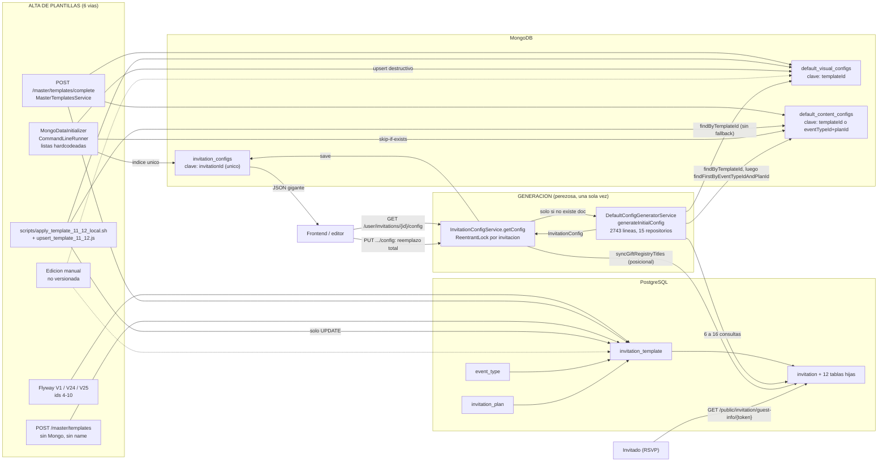
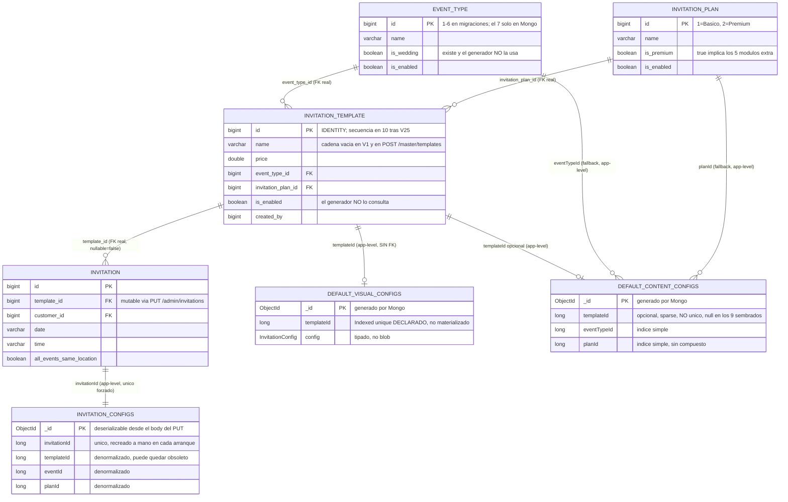
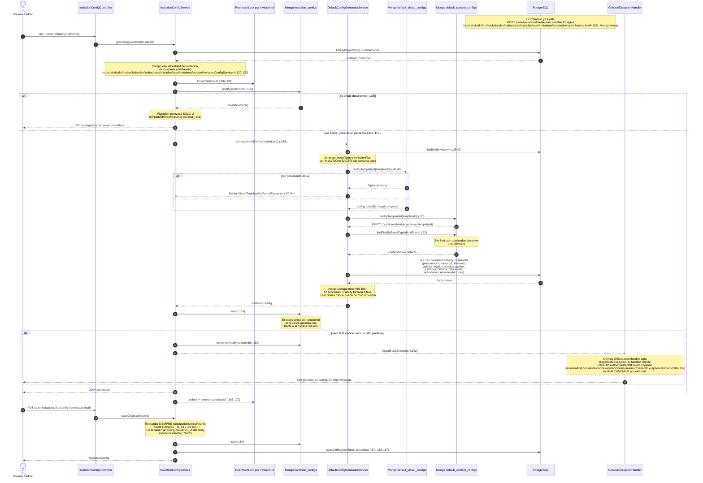
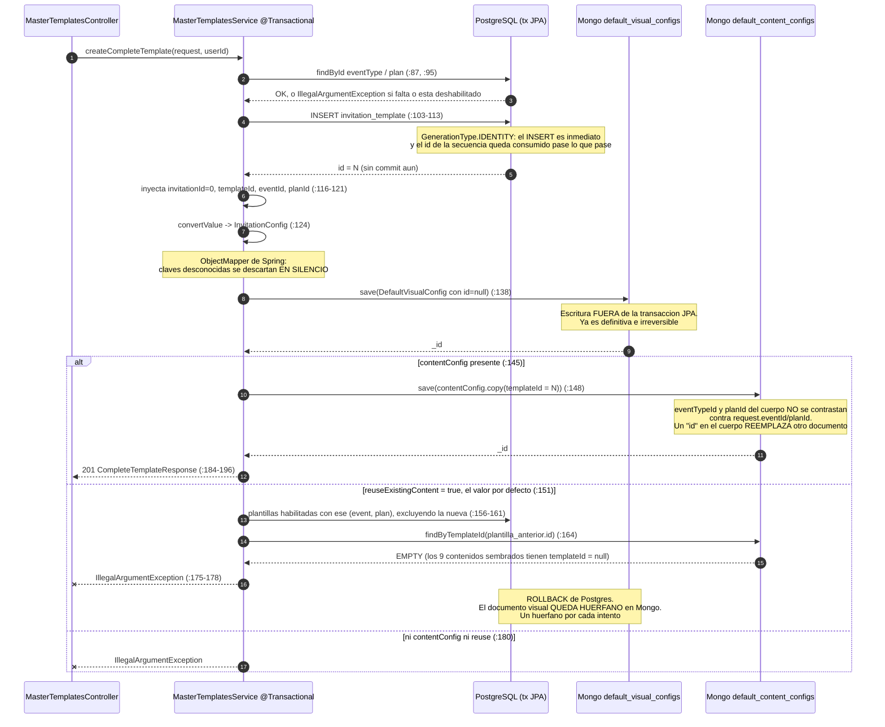
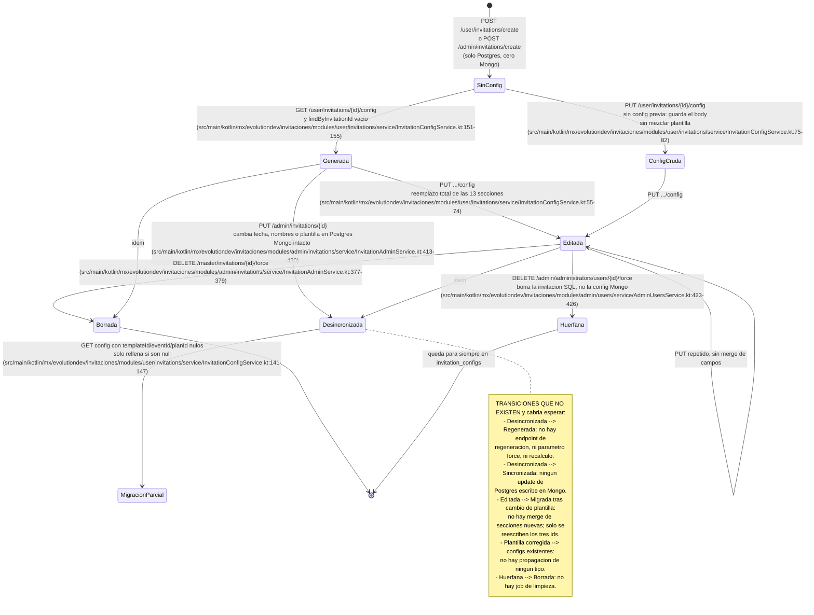

# Auditoría del subsistema de generación de plantillas

| | |
|---|---|
| **Fecha** | 2026-09-03 |
| **Commit auditado** | `d142778` — *feat: initial commit of Invitaciones backend* (único commit de `src/main`) |
| **Rama** | `claude/rsvp-templates-audit-5iibl7` |
| **Repositorio** | `RSVP---Lino-Sello` — backend Kotlin 1.9.25 / Spring Boot 3.4.1, paquete raíz `mx.evolutiondev.invitaciones` |
| **Método** | 12 sub-agentes en 3 olas: Ola 1 (A, B, C1, C3, D) → Ola 2 (C2, J, X) → Ola 3 (E, H) + redacción (R). Cada informe de fase cita `archivo:línea` y clasifica cada afirmación como VERIFICADO / INFERIDO / NO DETERMINABLE. |
| **Alcance** | **Solo lectura.** No se modificó ningún archivo versionado del repositorio en ninguna fase (`git status --short` → vacío tras cada fase). Las pruebas empíricas de las fases J, X y H se ejecutaron con herramientas alojadas fuera del repositorio. |
| **Fuera de alcance** | El frontend que consume el `InvitationConfig` no está en este repositorio; el estado real de PostgreSQL, MongoDB y S3 de producción no fue consultado. Todo lo que dependa de ellos está marcado **NO DETERMINABLE**. |

### Índice de informes de fase

| Informe | Alcance | Enlace |
|---|---|---|
| **A** | Modelo de datos, claves, resolución, tipado, inventario de plantillas. *Su Hallazgo #1 fue refutado empíricamente por J y X; ver la nota al inicio del archivo.* | [fases/A-modelo-datos.md](fases/A-modelo-datos.md) |
| **B** | Vías de alta, transaccionalidad, comportamiento del seed, duplicados, doc vs. código | [fases/B-alta-plantillas.md](fases/B-alta-plantillas.md) |
| **C1** | `DefaultConfigGeneratorService` líneas 1–828: traza, consultas, settings/cover/couple/gallery/event, hardcodeos | [fases/C1-generacion-parte1.md](fases/C1-generacion-parte1.md) |
| **C2** | `DefaultConfigGeneratorService` líneas 829–2743: gifttable/family/amenities/suggestions/story/dresscode/started, código muerto, visibilidad forzada, módulos extra | [fases/C2-generacion-parte2.md](fases/C2-generacion-parte2.md) |
| **C3** | Regeneración: call sites, idempotencia, propagación, cambio de plantilla, versionado, borrado, concurrencia | [fases/C3-regeneracion.md](fases/C3-regeneracion.md) |
| **D** | Consumo y exposición: endpoints, autorización, validación, URL del correo, errores, pruebas | [fases/D-consumo.md](fases/D-consumo.md) |
| **J** | Inventario de JSON/TS, esquema canónico, matriz de campos, contadores, deserialización (prueba empírica) | [fases/J-inventario-json.md](fases/J-inventario-json.md) |
| **X** | Dirimidor: veredicto empírico sobre la siembra con `invitationId` ausente; correcciones a A y B | [fases/X-dirimidor-seed.md](fases/X-dirimidor-seed.md) |
| **E** | Catálogo de modos de fallo, costo operativo de alta, contrato implícito, acoplamiento con el frontend, deuda | [fases/E-riesgos.md](fases/E-riesgos.md) |
| **H** | Verificación adversarial de las 7 hipótesis de partida; hallazgo nuevo sobre `@get:JsonIgnore` | [fases/H-hipotesis.md](fases/H-hipotesis.md) |

---

## 1. Resumen ejecutivo

**Cómo funciona hoy.** Una "plantilla" no es una entidad: es una fila en PostgreSQL (`invitation_template`) más un documento en MongoDB `default_visual_configs` (obligatorio, unido solo por convención de aplicación, sin FK) más, opcionalmente, un documento en `default_content_configs`. Cuando el usuario abre por primera vez el editor de su invitación (`GET /user/invitations/{id}/config`), y **solo entonces**, `InvitationConfigService.getConfig` invoca `DefaultConfigGeneratorService.generateInitialConfig`, que resuelve la plantilla visual estrictamente por `templateId` y el contenido por `templateId` con caída a `(eventTypeId, planId)`, y luego mezcla, sección por sección, la maqueta visual con los textos por defecto y los datos reales de la invitación leídos de 6 a 16 consultas a PostgreSQL. El resultado — un `InvitationConfig` de unos mil valores de estilo — se guarda **una sola vez** en `invitation_configs` y queda congelado: no existe endpoint de regeneración, ni `force`, ni recálculo (`src/main/kotlin/mx/evolutiondev/invitaciones/modules/user/invitations/service/InvitationConfigService.kt:138`, `:154`). A partir de ahí, el editor solo hace reemplazos totales por `PUT`.

**Por qué el resultado es frágil.** Cinco razones concretas, todas verificadas:

1. **La correspondencia entre los dos almacenes no está garantizada por nada y no se puede reparar.** `defaultVisualConfigRepository.findByTemplateId(...).orElseThrow { DefaultVisualTemplateNotFoundException(...) }` (`src/main/kotlin/mx/evolutiondev/invitaciones/modules/user/invitations/service/DefaultConfigGeneratorService.kt:47-54`) no tiene ningún fallback: una fila de PostgreSQL sin su documento de Mongo hace que **toda** invitación de esa plantilla devuelva un 500 al abrir el editor, y no existe ninguna llamada de borrado ni de reparación sobre esas colecciones en todo `src/main`.

2. **El merge depende de convenciones textuales y posicionales que nadie escribió y que el propio equipo incumple.** `mergeFamilySection` empareja los grupos de padres/padrinos comparando el **texto** del título de la plantilla (`src/main/kotlin/mx/evolutiondev/invitaciones/modules/user/invitations/service/DefaultConfigGeneratorService.kt:1685`, `:1703`); en 5 de las 6 plantillas sembradas que llegan a esa rama ese título es `null`, así que **los padres y padrinos que el usuario capturó se descartan en silencio**.

3. **Cuando el usuario no rellena una sección, se publican los datos de la demo.** `mergeStorySection` devuelve la plantilla intacta (`src/main/kotlin/mx/evolutiondev/invitaciones/modules/user/invitations/service/DefaultConfigGeneratorService.kt:2212-2214`) y `mergeFamilySection` también (`:1676-1677`), forzando además `visibility = true`; y `src/main/kotlin/mx/evolutiondev/invitaciones/modules/user/invitations/service/ExtraModuleHelper.kt:10-14` concede los cinco módulos extra a **toda** invitación de plan Premium, con lo que el escenario alcanza a cualquier cliente Premium que deje una sección vacía.

4. **El alta "oficial" de plantillas falla por defecto y deja basura.** `POST /master/templates/complete` con `reuseExistingContent = true` busca el contenido reutilizable por el `templateId` de otra plantilla (`src/main/kotlin/mx/evolutiondev/invitaciones/modules/master/templates/service/MasterTemplatesService.kt:164`) — con la consulta correcta comentada dos líneas encima (`:153-154`) — y como los nueve contenidos sembrados no llevan `templateId`, lanza `IllegalArgumentException` (`:175`) **después** de haber escrito ya el documento visual en Mongo (`:138`), fuera de toda transacción: un huérfano por intento.

5. **Ningún cambio en PostgreSQL llega nunca a MongoDB.** `PUT /admin/invitations/{id}` reasigna incluso la plantilla (`src/main/kotlin/mx/evolutiondev/invitaciones/modules/admin/invitations/service/InvitationAdminService.kt:413`) y borra y recrea las doce tablas de subcomponentes (`src/main/kotlin/mx/evolutiondev/invitaciones/modules/shared/invitations/service/InvitationPersistenceHelper.kt:31-49`) sin tocar `invitation_configs`; la "migración perezosa" de `src/main/kotlin/mx/evolutiondev/invitaciones/modules/user/invitations/service/InvitationConfigService.kt:141` solo rellena campos `null`, así que el invitado sigue viendo la fecha, los nombres y el diseño anteriores para siempre.

**Nota transversal sobre el modo de fallo.** El generador es notablemente disciplinado con los operadores peligrosos: cero `!!`, cero `.single()`, ningún acceso por índice sin comprobación previa de `size` en sus 2743 líneas. Precisamente por eso, de los veinte modos de fallo catalogados en [fases/E-riesgos.md](fases/E-riesgos.md) §2, **trece no lanzan ninguna excepción**: publican una sección vacía, un nombre de la pareja de demo o descartan lo que el usuario capturó. No hay alerta, no hay log; solo un cliente que llama porque su invitación muestra a los padres de otra pareja.

---

## 2. Mapa del subsistema

### 2.1 Diagrama de componentes

**Lecturas clave del diagrama** (todas verificadas):

- **`invitation_configs` solo tiene un escritor de generación**: `generateInitialConfig` tiene un único call site en todo el repositorio (`src/main/kotlin/mx/evolutiondev/invitaciones/modules/user/invitations/service/InvitationConfigService.kt:154`), y solo se alcanza si `findByInvitationId` devuelve vacío (`:136`, `:138`).
- **El seed nunca toca `invitation_configs`** salvo para crear su índice único (`src/main/kotlin/mx/evolutiondev/invitaciones/core/data/MongoDataInitializer.kt:65-72`); sus escrituras van a `default_visual_configs` y `default_content_configs`.
- **La flecha de vuelta Mongo → PostgreSQL existe y es una sola**: `syncGiftRegistryTitles` (`src/main/kotlin/mx/evolutiondev/invitaciones/modules/user/invitations/service/InvitationConfigService.kt:186-187`) escribe título y mensaje de las mesas de regalo físicas, emparejando **por posición**.
- **El flujo público de RSVP no lee Mongo en absoluto**: el `templateId` que recibe el invitado sale siempre de PostgreSQL (véase [fases/D-consumo.md](fases/D-consumo.md) §4).

### 2.2 Diagrama de datos

**Claves reales y su garantía** (fuente: [fases/A-modelo-datos.md](fases/A-modelo-datos.md) §2 y §4):

| Relación | Tipo de garantía | Evidencia |
|---|---|---|
| `invitation_template.event_type_id → event_type.id` | **FK real de PostgreSQL** | `src/main/resources/db/migration/V1__initial_schema.sql:1710-1711` |
| `invitation_template.invitation_plan_id → invitation_plan.id` | **FK real** | `src/main/resources/db/migration/V1__initial_schema.sql:1846-1847` |
| `invitation.template_id → invitation_template.id` | **FK real**, `nullable = false` | `src/main/kotlin/mx/evolutiondev/invitaciones/modules/admin/invitations/repository/model/InvitationEntity.kt:18-23` |
| `default_visual_configs.templateId → invitation_template.id` | **Solo convención.** Nada la valida en ningún sentido | `src/main/kotlin/mx/evolutiondev/invitaciones/modules/user/invitations/model/defaults/DefaultVisualConfig.kt:23-24`; `src/main/kotlin/mx/evolutiondev/invitaciones/modules/user/invitations/service/DefaultConfigGeneratorService.kt:47-54` |
| `default_content_configs → (eventTypeId, planId)` | **Solo convención**, y el diseño *admite* duplicados por nombre de método | `src/main/kotlin/mx/evolutiondev/invitaciones/modules/user/invitations/repository/mongo/DefaultContentConfigRepository.kt:31-35` |
| `invitation_configs.invitationId` | **Único garantizado por código**, recreado en cada arranque con `dropIndex` + `ensureIndex` | `src/main/kotlin/mx/evolutiondev/invitaciones/core/data/MongoDataInitializer.kt:65-72` |
| `invitation_template_extra_modules.template_id` | **FK real pero apunta a la tabla equivocada**: `REFERENCES public.invitation(id)` | `src/main/resources/db/migration/V1__initial_schema.sql:1718-1719` |

### 2.3 Flujo end-to-end

---

## 3. Anatomía de `DefaultConfigGeneratorService`

Archivo: `src/main/kotlin/mx/evolutiondev/invitaciones/modules/user/invitations/service/DefaultConfigGeneratorService.kt`, **2743 líneas** (2744 contando la última sin salto final). Una sola clase, de la línea 17 a la 2744; **no hay ninguna función de nivel superior** — `mergeGiftTableSection` (979), `createDefaultFamilyItem` (1828) y `createDefaultFamilyGroup` (1837) están indentadas a columna 0 pero siguen dentro de la clase, verificado por conteo de llaves en [fases/C2-generacion-parte2.md](fases/C2-generacion-parte2.md) §2 y reproducido de forma independiente en [fases/H-hipotesis.md](fases/H-hipotesis.md) §1. Por eso acceden a los 15 repositorios inyectados sin recibirlos por parámetro.

### 3.1 Tabla sección por sección

En toda la tabla, la columna **Evidencia** cita el mismo archivo salvo indicación en contra: `src/main/kotlin/mx/evolutiondev/invitaciones/modules/user/invitations/service/DefaultConfigGeneratorService.kt`.

| # | Sección | Entradas (visual / contenido / datos reales) | Regla de merge y precedencia | Dependencia posicional | Menos ítems / más ítems / `null` | Hardcodeos principales | Riesgo | Evidencia (líneas) |
|---|---|---|---|---|---|---|---|---|
| 1 | **settings** | visual `ModelSettings`; contenido `music.url`, `hashtags`; real `hasMusic`, `hashtag`, `childrenAllowed`, `youngAllowed` | `name`: usuario → contenido → visual. `music`: usuario → contenido → visual, **pero con `hasMusic == false` se fuerza `""`**, no `null` ni la de la plantilla. `child_friendly`/`young_friendly`: **siempre** el dato real, sin fallback. `primaryColor`/`secondaryColor`: siempre visual | `.firstOrNull()` sobre música (`:193`) y sobre `hashtags` (`:202`) | No hay listas de salida. `visualSettings == null` → sección omitida | `""` como centinela de "sin música" (`:197`); `hashtags` leídos con `as? List<*>` + `toString()` (`:201-202`) | Medio | `:182`, `:187-206` |
| 2 | **cover** | visual `SectionCoverProps`; contenido `texts["coverSubtitle"]`, `images.coverPhoto`; real `people`, `date`, `time`, `coverPhotoUrl` | `subtitle`: **contenido → visual**. `title`: **siempre** datos reales unidos con `" & "`; si no hay personas, literal `"Nuestra Celebración"` — el contenido nunca se consulta para el título. `coverImage`: real → contenido (**el visual nunca es último recurso**) | Ninguna | `visualCover == null` → sección omitida; `subtitle` conserva `null` porque usa `?.copy` | `" & "` (`:219`), `"Nuestra Celebración"` (`:221`), clave `"coverSubtitle"` (`:226`) | Medio | `:209`, `:214-241` |
| 3 | **couple** | visual `SectionCoupleData`; contenido `texts`, `celebrantName`, `images.people`, `images.backgrounds`, `phrases`; real `people`, `phrases`, `date`, `time` | Se bifurca en `val isWedding = eventTypeId == 1L` (`:255`). Rama **no-boda**: `namePersonEvent` = persona real (no blank) → `celebrantName` → visual (salvo si es exactamente `"Nuestra Quinceañera"`) → `"Nuestra Quinceañera"`; **ignora `contentTemplate.phrases` por completo**. Rama **boda**: `groomName`/`brideName` = persona real **sin comprobar blank** → visual → `""`; sí usa `phrases` | `images.people[0]` = novio/festejado, `[1]` = novia (`:290`, `:360`, `:366`). Géneros de `people` solo en inglés (`:314-315`) frente a frases en ES+EN (`:319-320`, `:324-325`) | `visualCouple == null` → sección omitida. Los campos usan `?.copy` **salvo** `imageTopBg`/`imageBottomBg`, que se **crean** con `createDefaultEditImage(null)` aunque la plantilla no los tenga (`:397-404`) | `1L` (`:255`), `"Save the date!"` (`:268`, `:339`), `"Nuestra Quinceañera"` (`:283`, `:285`), `"male"`/`"female"` (`:314-315`), `"Pareja"` (`:327`), `"topBg"`/`"bottomBg"` (`:305`, `:309`, `:398`, `:402`) | **Alto** | `:244`, `:249-406` |
| 4 | **gallery** | visual `SectionGalleryData`; contenido `texts["galleryTitle"/"galleryIntro"]`, `images.gallery`; real `hasGallery`, fotos, `hashtag` | `title`/`intro`: contenido → visual → literal. `items`: real → contenido, **lista completa reemplazada**. `hashtags[].content`: real con `#` normalizado → visual; **`url` e `icon` nunca se tocan** | **Ninguna**: `items?.firstOrNull()` es la **única** fuente de estilo para todos los ítems (`:433`, `:442-444`) | El nº de ítems de salida = nº de URLs, **ignorando el nº de huecos de la plantilla**. Con `items == null`, estilos por defecto 100×100 | `"gallery-${index+1}"` (`:438`), `"Galería"` y `""` (`:473`, `:476`), `"#"` (`:461`), tripleta `14L`/`7L`/`2L` (`:420`) y `label = null` si no es esa tripleta (`:446-451`) | **Alto** | `:409`, `:414-480` |
| 5 | **event** | visual `SectionEventData`; contenido `texts["itineraryTitle"]`, `itinerary`; real `itinerary`, `date`, `allEventsSameLocation` | `title`: contenido → visual → `"Itinerario"`. `items`: **usuario si no está vacío, si no el contenido; nunca mezcla**. Dentro de cada tarjeta: texto = dato real siempre; estilo = `items[index]` → `items[0]` → `itemsSinglePlace[0]` → defaults. `singleplace`: **siempre** `invitation.allEventsSameLocation` | `items?.getOrNull(index)` (`:527`, `:646`) con caída a `[0]` (`:492-493`) | Menos ítems de usuario que de plantilla: **las tarjetas sobrantes se pierden**. Más ítems: estilo del ítem 0 e **`id` UUID aleatorio** en vez de `event-N`. Nunca lanza | `"fas fa-clock"` (`:541`, `:660`), `"fas fa-calendar"` (`:597`, `:716`), `"4:30 PM"` (`:562`, `:681`), `"5:30 PM"` (`:584`, `:703`), `"(Dale clic"` (`:628`, `:747`), `"Itinerario"` (`:767`) | **Alto** | `:483`, `:488-771` |
| 6 | **gifttable** | visual: estructura y estilos de `items`; contenido: **solo `texts["giftTableTitle"]`**; real: `invitation_gift_registry` | Título de sección: contenido → literal `"Mesa de Regalos"`; **el `title.content` de la plantilla ya no se consulta** (la versión comentada sí lo hacía, `:972`). Ítems: 100 % datos reales; la plantilla solo aporta estilo e `id`. **`contentTemplate.giftRegistry` no aparece en ninguna línea viva del archivo** | `resolveTemplate` empareja **por tipo inferido** con `firstOrNull` (`:1029-1049`), y solo cae a `items.getOrNull(index)` (`:1048`). `bodyFromTemplate`: `body.getOrNull(i) ?: body.firstOrNull()` (`:1066-1068`) | Menos datos: los ítems sobrantes de la plantilla **se pierden**. **Cero datos: `emptyList()` y sección visible y vacía**. Más datos del mismo tipo: **ids duplicados** | 9 ids `"msj1"`..`"msj9"` (`:1158-1219`), `"Banco:"`, `"Titular:"`, `"Cuenta CLABE:"`, `"Número de tarjeta:"`, `"fas fa-copy"`, `"fa-solid fa-link"` (`:1144`), `"fa-solid fa-gift"` (`:1262`), `"MESA DIGITAL"`, `"DEPÓSITO O TRANSFERENCIA"`, `"LLUVIA DE SOBRES"`, `"Mesa de Regalos"` (`:1294`), `linkHref = null` (`:1287`) | **Alto** | `:979-1298`, `:1052`, `:1291-1296` |
| 7 | **family** | visual: grupos, ítems e `intro`; contenido: **solo imágenes** de reserva (`parents.*.image`, `images.parents`, `images.godparents`); real: `invitation_parent`, `invitation_godparent`, frases `family_intro_*` | `intro`: frases reales → intro de la plantilla con `id` inyectado. Nombres y etiquetas: reales → **nada**. Fotos: real → `contentTemplate.parents.*.image` → `images.parents[...]` → `""`. **Los `names` de `contentTemplate.parents` nunca se usan** (solo los leía `getFallbackFamilyText`, función muerta) | **No-boda**: empareja por el **texto** del título, `title.content.contains("Padre"/"Padrino")` (`:1685`, `:1703`); dentro del grupo, `getOrNull(index) ?: firstOrNull()`. **Boda**: posicional puro, `items[0]` = padres del novio, `items[1]` = de la novia, `drop(2)` = padrinos (`:1747`, `:1773`, `:1799`) | **Sin datos del usuario: devuelve la plantilla y fuerza `visibility = true`** (`:1676-1677`) → placeholders de demo publicados. Con menos ítems que padrinos, `getOrNull ?: firstOrNull` reutiliza el primero | `"family_intro_"` (`:1651`), `"intro-$index"`, `"p-$index"`, `"gp-$index"`, `"f${2+index}"` (`:1813`), `"Padres de $groomName"` (`:1763`), `"la pareja"`, `"male"`/`"female"`, `"groom_mother"`…, `showImage = true` forzado | **Alto** | `:1639-1825`, `:1685`, `:1697`, `:1721` |
| 8 | **amenities** | visual `items` y `title`; contenido `amenities[]` o `images.amenities[]`; real `invitation_activity` | Título: `texts["amenitiesTitle"]` → `title.content` → `"Amenidades"`. Ítems: reales → `contentTemplate.amenities` → `images.amenities` → `items` sin tocar (`:1945`) | `items.getOrNull(index) ?: items.firstOrNull()` (`:1864`, `:1910`, `:1934`) | La salida tiene tantos ítems como la fuente ganadora; el resto de la plantilla se descarta. El `body` se **colapsa a un solo elemento** aunque la plantilla traiga varios | `"Tel: "` (`:1872`), `" \| "` (`:1877`), `"amenities-N"` (`:1880`), `"amenities-default-N"` (`:1911`), `"amenities-img-N"` (`:1935`), `"Amenidad"`, `"Amenidades"` (`:1951`) | Medio | `:1852-1955` |
| 9 | **suggestions** | igual que amenities pero con `recommendations` e `invitation_recommendation` | Cadena idéntica; título → `"Recomendaciones"` (`:2198`). **Conserva** el id de la plantilla, a diferencia de amenities | `getOrNull(index) ?: firstOrNull()` (`:2116`, `:2150`, `:2172`) | Igual que amenities; **además** si `templateId == 12L` se añade un segundo body sintético con estilos cableados | `templateId == 12L` (`:2129`, `:2156`, `:2177`), `"msj-2"` (`:2079`), `"Ver recomendación"` (`:2081`), `url = "#"` (`:2082`), colores RGBA `[192,223,250,1]` y `[65,84,116,1]` (`:2089-2090`), `fontSize 16.0` | Medio-**Alto** por el `12L` | `:2062-2202`, `:2074-2111` |
| 10 | **story** | visual `items`; contenido `story[]` e `images.story[]`; real `invitation_story` | En la práctica **dos únicos resultados**: con filas reales gana el usuario campo a campo; **sin filas devuelve la plantilla intacta** si era visible, si no `null`. La rama que leería `contentTemplate.story` (`:2240-2266`) es **inalcanzable** tras el early-return de `:2212` | `visualStory.items.getOrNull(index)` (`:2219`) | Más filas que ítems: `template = null` → `createDefault*` con estilo genérico Poppins gris. Menos filas: los ítems de plantilla se descartan | Ninguno propio; hereda los de `createDefaultEditImage`/`createDefaultEditText` | **Alto** (fuga de datos de demo) | `:2203-2269`, `:2212-2214` |
| 11 | **dresscode** | visual `items` (2 en todos los JSON) y `title`; contenido `dressCode.women/men`; real `invitation_dress_code` con **`.firstOrNull()`** | Título: `userDressCode.name` → `title.content` → `texts["dressCodeTitle"]` → `"Código de Vestir"`. Ítems según `type`: `"link"`, `"predefined"`, `"standard"`, `else`. En `predefined`/`standard`, foto y descripción del usuario con títulos **hardcodeados** `"Mujeres"`/`"Hombres"` | `items.getOrNull(0)` = mujer, `getOrNull(1)` = hombre — posicional puro, repetido 16 veces | `"link"` genera **un solo ítem**: si la plantilla tiene 2, el segundo desaparece. Un `type` desconocido → `items` sin tocar (`:2605`). Sin fila de usuario y plantilla no visible → `null` | `"Mujeres"` (`:2401`, `:2514`), `"Hombres"` (`:2430`, `:2543`), `"Código de Vestir"` (`:2322`, `:2336`), `"Código de Vestimenta"` (`:2364`), `"Haz clic en el botón para ver más detalles"` (`:2373`), **URL de S3** (`:2357`) | **Alto** | `:2271-2662`, `:2279`, `:2281` |
| 12 | **started** (RSVP) | visual: todo; contenido `texts["rsvpTitle"]`, `rsvp["message"]`, `rsvp["note"]`, `images.backgrounds["rsvpBg"]`; real: **ninguno** | contenido → visual → literal. Es la **única** sección donde el contenido por defecto gana siempre sobre la plantilla visual | Ninguna | No hay listas. Sección omitida si el visual es `null` | `"Confirma tu asistencia"` (`:2675`), `"Por favor confirma tu asistencia antes del evento."` (`:2680`) | Bajo | `:2664-2691` |

`sectionFooter` no aparece en la tabla porque no tiene función de merge: se copia sin transformar (`src/main/kotlin/mx/evolutiondev/invitaciones/modules/user/invitations/service/DefaultConfigGeneratorService.kt:178`).

**Invariante uniforme de las 12 secciones.** Todas abren con `if (visualX == null) return null` en `src/main/kotlin/mx/evolutiondev/invitaciones/modules/user/invitations/service/DefaultConfigGeneratorService.kt` (`:187`, `:214`, `:249`, `:414`, `:488`, `:985`, `:1644`, `:1857`, `:2067`, `:2208`, `:2276`, `:2669`) y `mergeConfiguration` las encadena con `?.copy(visibility = true)`. Nunca se fabrica una sección desde cero: sin maqueta visual, la sección desaparece del JSON.

#### Desglose de la sección más compleja: `mergeCoupleSection`

Es la única sección con dos ramas completas y mutuamente excluyentes, 160 líneas, y la que concentra más decisiones de precedencia distintas. Se detalla porque es donde más caro sale equivocarse y donde vive el `eventTypeId == 1L` de H-20. Todas las citas son de `src/main/kotlin/mx/evolutiondev/invitaciones/modules/user/invitations/service/DefaultConfigGeneratorService.kt`.

**Rama no-boda** (`eventTypeId != 1`, `:255-312`):

| Campo | Precedencia, de mayor a menor | Evidencia |
|---|---|---|
| `heading` | contenido `texts["coupleHeading"]` → visual → `"Save the date!"` | `:267-269` |
| `datetime` | `"${date} ${time}"` si no está en blanco → visual. **Nunca consulta el contenido**, y no formatea (H-27) | `:270-277` |
| `namePersonEvent` | persona real no vacía → `contentTemplate.celebrantName` → visual (**salvo si el visual es exactamente `"Nuestra Quinceañera"`**) → `"Nuestra Quinceañera"` | `:278-286` |
| `photoPersonEvent` | foto real no vacía → `images.people[0]` → visual | `:287-292` |
| `message` | frase del usuario con `gender` en `intro`/`celebrated`/`quinceañera`/`festejado` → visual → `null`. **Nunca usa `contentTemplate.phrases`** | `:293-303` |
| `imageTopBg` / `imageBottomBg` | contenido `backgrounds["topBg"]`/`["bottomBg"]` → visual. **Se crea el objeto** si el visual no lo trae | `:304-311` |

**Rama boda** (`eventTypeId == 1`, `:313-405`):

| Campo | Precedencia, de mayor a menor | Evidencia |
|---|---|---|
| `groomName` / `brideName` | persona real **sin comprobar si está en blanco** → visual → `""`. Asimetría verificada: las fotos sí usan `takeIf { isNotBlank() }` y la rama no-boda también lo usa para el nombre; aquí no. Como `InvitationPersonEntity.name` es `String` no nulo con valor por defecto `""` (`src/main/kotlin/mx/evolutiondev/invitaciones/modules/admin/invitations/repository/model/InvitationEntity.kt:181`), una fila con nombre vacío **blanquea** el nombre en la portada de la pareja en vez de caer al placeholder | `:349-356` frente a `:359`, `:365` y `:280` |
| `groomPhoto` / `bridePhoto` | foto real no vacía → `images.people[0]` / `[1]` → visual | `:357-368` |
| `groomText` / `brideText` | frase del usuario → `phrases["hombre"]`/`["male"]` (primera) → visual → `""` | `:369-380` |
| `message` | frase "Pareja" del usuario → `phrases["Pareja"]`/`["pareja"]` (primera) → visual → `null`. Si la plantilla no define `message` — y `default_visual_boda_premium.json` no lo hace — el texto se fabrica con `createDefaultEditText`, es decir en **Poppins gris 16 px**, ajeno al diseño | `:381-396`, `:385`, `:390` |
| `imageTopBg` / `imageBottomBg` | igual que la rama no-boda, **también en boda**, aunque las plantillas de boda no tienen esos campos: se inyectan dos `ModelEditImage` con `content = null` y geometría 100×100 en cada configuración | `:397-404` |

**Riesgo estructural de esta sección**: la elección de rama depende de un id numérico y no de `event_type.is_wedding` (H-20); el reparto novio/novia depende del orden de `images.people` (§6.2); y el reconocimiento de género de las personas es **solo en inglés** (`:314-315`) mientras el de las frases acepta español e inglés (`:319-320`, `:324-325`), lo que hace que un cliente que envíe `"hombre"`/`"mujer"` para las personas obtenga `groom` y `bride` a `null` sin ningún error (§8.1, pregunta 5).

### 3.2 Traza de `generateInitialConfig` y coste en consultas

En este apartado, las citas abreviadas de la forma `:NNN` se refieren siempre a `src/main/kotlin/mx/evolutiondev/invitaciones/modules/user/invitations/service/DefaultConfigGeneratorService.kt`.

`generateInitialConfig` (`src/main/kotlin/mx/evolutiondev/invitaciones/modules/user/invitations/service/DefaultConfigGeneratorService.kt:36`) ejecuta siete pasos: (1) `invitationRepository.findById(...).orElseThrow` (`:38-41`); (2) lectura de `invitation.template.id`, `.eventType.id` y `.invitationPlan.id`, que **no cuestan consulta extra** porque las tres asociaciones son `@ManyToOne` sin `fetch` explícito, es decir EAGER; (3) resolución visual estricta por `templateId`, sin fallback (`:47-54`); (4) un bloque comentado de once líneas con la resolución de contenido anterior (`:58-68`); (5) resolución de contenido con `findByTemplateId` (`:70`) y caída perezosa por `orElseGet` a `findFirstByEventTypeIdAndPlanId` (`:72`); (6) `mergeConfiguration` (`:81`, definida en `:90-180`), que parte de `visualTemplate.copy(...)` (`:98`) — es decir, **todo lo que no se nombra se hereda tal cual de la plantilla visual** — fija `invitationId = invitation.id` (`:99`) y llama a las 12 funciones de sección, cinco de ellas tras la puerta de `invitation.extraModulesIncluded` (`:129`, `:138`, `:147`, `:156`, `:165`); y (7) un `copy` final que fija `templateId`, `eventId` y `planId` (`:83-87`).

**Coste medido** ([fases/C1-generacion-parte1.md](fases/C1-generacion-parte1.md) §2):

| Almacén | Mínimo | Máximo | Detalle |
|---|---|---|---|
| MongoDB | 3 | 3 | 1 visual + 2 de contenido. **Siempre 3** con los datos sembrados, porque `findByTemplateId` sobre `default_content_configs` (`:70`) es un round-trip *siempre* fallido: ninguno de los nueve `default_content_*.json` declara `templateId` |
| PostgreSQL | **6** | **16** | Mínimo sin música, sin galería y sin módulos extra: `findById` + personas ×2 + frases ×1 + itinerario + mesa de regalos. Máximo con música, galería y los 5 módulos |
| **De los cuales, redundantes** | — | **3** | `invitationPersonRepository.findAllByInvitationId` en `:216` (cover), `:252` (couple) y `:1726` (family); `invitationPhraseRepository.findAllByInvitationId` en `:253` y `:1650` |

No hay N+1 por ítem: todas las lecturas son `findAllByInvitationId` de lote, y las colecciones `@OneToMany` LAZY de `InvitationEntity` no se tocan nunca, lo que hace al servicio inmune a `LazyInitializationException` pese a carecer de `@Transactional`.

### 3.3 Código muerto y duplicación, en cifras

Todas las cifras proceden de [fases/E-riesgos.md](fases/E-riesgos.md) §6, [fases/C2-generacion-parte2.md](fases/C2-generacion-parte2.md) §4 y [fases/H-hipotesis.md](fases/H-hipotesis.md) §4, y se refieren a `src/main/kotlin/mx/evolutiondev/invitaciones/modules/user/invitations/service/DefaultConfigGeneratorService.kt` salvo indicación en contra.

| Métrica | Cifra | Detalle |
|---|---|---|
| Líneas que empiezan por `//` | **607 de 2743 (22,1 %)** | 594 en el tramo 829-2743, 13 en 1-828. Conteo directo de E; C2 reporta ≈556 contando solo bloques contiguos de ≥3 líneas — dos métricas distintas, ambas correctas bajo su definición |
| Bloques comentados contiguos de ≥10 líneas | **18** | `:58-68`, `:838-847`, `:856-883`, `:885-909`, `:918-929`, `:953-968`, `:1221-1248`, `:1345-1400`, `:1415-1450`, `:1452-1487`, `:1519-1530`, `:1565-1584`, `:1586-1600`, `:1602-1612`, `:1620-1629`, `:1973-1983`, `:1985-2011`, `:2025-2052` |
| Funciones completas duplicadas y comentadas, conviviendo con su reemplazo | **3** | `mergeGiftTableSection` (`:829-976` comentada vs `:979-1298` viva), `mergeFamilySection` (`:1302-1636` vs `:1639-1825`), `mergeSuggestionsSection` (`:1957-2060` vs `:2062-2202`) |
| Funciones definidas y **nunca llamadas** | **4** | `buildTimeRange` (`:774`, cero referencias en todo `src/main/kotlin`), `getFallbackFamilyText` (`:1844`, cero referencias), `createDefaultFamilyItem` (`:1828`, 9 referencias **todas comentadas**), `createDefaultFamilyGroup` (`:1837`, 5 referencias todas comentadas) |
| Ramas `if` con brazos **idénticos byte a byte** | **2** | `usesSplitBankLayout` (`:1025-1027`) decide entre `:1157-1185` y `:1189-1220`, idénticos tras normalizar espacios; `mergeDressCodeSection` tiene `"predefined"` (`:2379-2490`) y `"standard"` (`:2492-2602`) idénticos, ≈110 líneas |
| Condicional sin efecto, duplicado | **2** | `if (item.eventLocation.contains("(Dale clic")) item.eventLocation else "${item.eventLocation}"` en `:627-633` y `:746-752`: ambas ramas devuelven el mismo `String` |
| Código **inalcanzable sin comentar** | **≈79 líneas** | `:2240-2266` (tras el early-return de `:2212`, `userStory.isNotEmpty()` de `:2217` es siempre cierto) y `:2608-2659` (tras `:2281`, `userDressCode != null` de `:2341` es siempre cierto por smart-cast) |
| Código muerto **por anotación**, sin ninguna señal en el fuente | **17 referencias + 1 clase** | `@get:JsonIgnore` sobre `itemsSinglePlace` (`src/main/kotlin/mx/evolutiondev/invitaciones/modules/user/invitations/model/editor/EditorModels.kt:234-235`) bloquea también la **deserialización**, así que `styleSourceSingle` (`:493`) es siempre `null` y sus 17 usos nunca se ejecutan; `EventSinglePlaceCard` (`src/main/kotlin/mx/evolutiondev/invitaciones/modules/user/invitations/model/editor/EditorModels.kt:255`) es inalcanzable |
| Bloque de fallback de dress code repetido | **4 copias** | `:2285-2313`, `:2444-2484`, `:2556-2596`, `:2609-2656` (la cuarta, inalcanzable) |
| Parámetros y valores por defecto muertos | **3** | `createDefaultEditText(content, id = null)` (`:2720`, ninguna de las ~60 llamadas pasa `id`); el default `id = "msj${bodyIndex+1}"` de `bodyFromTemplate` (`:1062`, ninguna llamada lo omite); `mergeStartedSection(invitation, ...)` (`:2665`) recibe `invitation` y no lo usa |
| Método de repositorio muerto | **1** | `findByEventTypeIdAndPlanIdAndTemplateId` (`src/main/kotlin/mx/evolutiondev/invitaciones/modules/user/invitations/repository/mongo/DefaultContentConfigRepository.kt:37-41`) |
| Data class muerta | **1** | `FamilySubItem` (`src/main/kotlin/mx/evolutiondev/invitaciones/modules/user/invitations/model/editor/EditorModels.kt:423`): `FamilyItem.items` es recursivo sobre `FamilyItem`, no sobre ella |

**Lo que importa de estas cifras** no es el volumen sino que **las versiones comentadas codifican una regla de precedencia distinta de la viva**, y por tanto leerlas desinforma activamente. El caso más caro: `contentTemplate.giftRegistry` aparece en **una sola línea de todo el archivo, la `:902`, comentada**; la versión viva eliminó el respaldo a la mesa de regalos por defecto, y de ahí sale la sección vacía y visible del hallazgo H-06.

---

## 4. Ciclo de vida de una plantilla

### 4.1 Las seis vías de alta, comparadas

Ninguna produce el mismo estado. La matriz siguiente consolida [fases/B-alta-plantillas.md](fases/B-alta-plantillas.md) §2 y la matriz de divergencia de [fases/H-hipotesis.md](fases/H-hipotesis.md) §6, ambas verificadas línea a línea.

| Vía | Punto de entrada | Escribe en PostgreSQL | Escribe en Mongo *visual* | Escribe en Mongo *contenido* | Valida | Transaccionalidad | Campos que quedan distintos | Idempotencia |
|---|---|---|---|---|---|---|---|---|
| **A. Flyway V1** | `src/main/resources/db/migration/V1__initial_schema.sql:1133-1136` | `invitation_template` ids **4 y 5** vía `COPY`; `setval(...,5)` en `:1385` | No | No | Solo las FK a `event_type` (`:1710-1711`) y `invitation_plan` (`:1846-1847`) | Transacción de Flyway (solo SQL) | **`name` = cadena vacía**; `created_by` null. Depende de que el seeder Mongo tenga los ficheros con `templateId` 4 y 5 | Sí (migración versionada) |
| **B. Flyway V24 / V25** | `src/main/resources/db/migration/V24__add_new_event_types_and_xv_template.sql:10-17`; `src/main/resources/db/migration/V25__add_remaining_templates.sql:2-10` | Ids **6** (V24) y **7-10** (V25) con id explícito + `setval` (V25 lo deja en **10**) | No | No | `ON CONFLICT (id) DO NOTHING` | Transacción de Flyway | `name` sí poblado; `created_by` null. El pareo con Mongo es por convención de nombres de fichero | Sí |
| **C. Seed de arranque** | `src/main/kotlin/mx/evolutiondev/invitaciones/core/data/MongoDataInitializer.kt:29-63` (`CommandLineRunner`) | **No** | Sí: **upsert destructivo por `templateId`**, conservando el `_id` (`:83-90`) | Sí: upsert por `templateId` si el JSON lo trae (`:106-116`); si no —el caso de los 9 ficheros— **skip-if-exists** por `(eventTypeId, planId)` (`:118-123`) | Solo la existencia del recurso en el classpath (`:77`, `:99`) | Ninguna; cada fichero en su propio `try/catch` (`:91-93`, `:124-126`) | **Único que sobrescribe.** Los contenidos quedan con `templateId = null`; dentro del documento visual, `config.templateId/eventId/planId` quedan **`null`** y `config.invitationId` queda **`0`** (medido en [fases/X-dirimidor-seed.md](fases/X-dirimidor-seed.md) §3). **`itemsSinglePlace` se pierde** al deserializar | Sí para el visual (upsert); sí para el contenido (skip) |
| **D. `POST /master/templates`** | `src/main/kotlin/mx/evolutiondev/invitaciones/modules/master/templates/presentation/MasterTemplatesController.kt:26-34` → `src/main/kotlin/mx/evolutiondev/invitaciones/modules/master/templates/service/MasterTemplatesService.kt:35-70` | Fila nueva con `created_by` | **No** | **No** | `eventType` y `plan` existen y están habilitados (`:36-48`) | `@Transactional` de JPA (basta: no toca Mongo) | Plantilla **sin nombre** (`InvitationTemplateRequest` no tiene campo `name`, `src/main/kotlin/mx/evolutiondev/invitaciones/modules/master/templates/presentation/model/InvitationTemplateRequest.kt:7-26`) y **sin configuración visual** → toda invitación que la use da 500 | **No**: cada llamada crea fila e id nuevos |
| **E. `POST /master/templates/complete`** | `src/main/kotlin/mx/evolutiondev/invitaciones/modules/master/templates/presentation/MasterTemplatesController.kt:50-58` → `src/main/kotlin/mx/evolutiondev/invitaciones/modules/master/templates/service/MasterTemplatesService.kt:84-197` | Fila nueva con `name` y `created_by` (`:103-113`) | Sí: **insert siempre** (`id = null`, `:138`), nunca actualiza | Sí **solo** si viene `contentConfig` (`:145-150`); en modo *reuse* **no escribe nada** (`:151-179`) | `eventType`/`plan` existen y habilitados (`:87-100`); forma del visual vía `convertValue` (`:124`) | `@Transactional` **solo JPA**. La escritura de `:138` es definitiva e irreversible | **Único que puebla `config.templateId/eventId/planId` e `invitationId = 0`** dentro del documento (`:116-121`, `:131-136`). En modo *reuse* deja la plantilla **sin contenido propio**. **`itemsSinglePlace` también se pierde** (mismo Jackson) | **No**: dos POST iguales = dos filas + dos documentos |
| **F. Scripts `mongosh` + `psql`** | `scripts/apply_template_11_12_local.sh:29-64`; `scripts/upsert_template_11_12.js:22-68` | **Solo `UPDATE`** de los ids 11 y 12 y `is_enabled=false` de 16 y 17 (`:30-53`) — **nunca `INSERT`** | Sí, `updateOne(..., {upsert:true})` (`:36-56`) | Sí, `updateOne({templateId}, {$set: contentConfig}, upsert:true)` (`:58-68`) | **Nada.** Un `UPDATE` de 0 filas es silencioso y `set -euo pipefail` no lo detecta | Ninguna | Documentos **sin `_class`** (INFERIDO); contenido **con `templateId`** poblado; y es el **único camino que preserva `itemsSinglePlace`**, porque escribe JSON crudo sin pasar por Jackson | Sí (upsert por `templateId`) |
| **G. Edición manual** | No versionada. Se infiere de `scripts/apply_template_11_12_local.sh:50-53` ("duplicados operativos 16 y 17") y de `HOTFIX_ADD_TEMPLATES_CAMBIOS.md:211` | — | — | — | — | — | **NO DETERMINABLE** desde el repositorio | — |

Dos matices que acotan la tabla, ambos de [fases/H-hipotesis.md](fases/H-hipotesis.md) §6: **V24 y V25 son estructuralmente idénticas** entre sí (`INSERT` con id explícito + `ON CONFLICT (id) DO NOTHING` + `setval`), y `scripts/create_complete_template.sh:87-90` **no es una séptima vía**: es un envoltorio de `curl` sobre la vía E y produce exactamente su mismo resultado (incrusta, eso sí, credenciales MASTER en `scripts/create_complete_template.sh:5-6`).

La consecuencia que más duele: **solo dos de las seis vías escriben el documento visual**, así que la D y la F pueden dejar una plantilla relacional sin configuración visual, y `src/main/kotlin/mx/evolutiondev/invitaciones/modules/user/invitations/service/DefaultConfigGeneratorService.kt:47-54` no tiene ningún fallback para eso.

### 4.2 Flujo de `createCompleteTemplate` y sus fallos parciales

**Escenarios de fallo parcial** ([fases/B-alta-plantillas.md](fases/B-alta-plantillas.md) §4):

| Escenario | Queda en PostgreSQL | Queda en Mongo | ¿Compensación? | ¿Reintento idempotente? | Evidencia |
|---|---|---|---|---|---|
| (a) Falla Mongo al guardar el visual, tras el INSERT relacional | Nada: rollback. **La secuencia sí queda consumida** (IDENTITY no es transaccional) | Nada | No | No: crea fila e id nuevos | `src/main/kotlin/mx/evolutiondev/invitaciones/modules/master/templates/service/MasterTemplatesService.kt:84`, `:103-113`, `:138`; `src/main/kotlin/mx/evolutiondev/invitaciones/modules/master/templates/repository/model/InvitationTemplateEntity.kt:17` |
| (b) Falla el save de contenido después del visual | Nada: rollback | **Documento visual huérfano** con un `templateId` que ya no existe en PostgreSQL | No | No: un huérfano por intento | `src/main/kotlin/mx/evolutiondev/invitaciones/modules/master/templates/service/MasterTemplatesService.kt:138` vs `:148` |
| **(c) `reuseExistingContent = true` sin contenido atado por `templateId` — el caso normal en un entorno recién migrado** | Nada: rollback | **Documento visual huérfano** | No | No | `src/main/kotlin/mx/evolutiondev/invitaciones/modules/master/templates/service/MasterTemplatesService.kt:156-178`; `src/main/kotlin/mx/evolutiondev/invitaciones/core/data/MongoDataInitializer.kt:118-123` |
| (d) `contentConfig` con un `id` de un documento existente | Fila creada, si el resto va bien | El documento de contenido **de otra plantilla queda reemplazado** | No | No aplica | `src/main/kotlin/mx/evolutiondev/invitaciones/modules/master/templates/service/MasterTemplatesService.kt:147-148`; `src/main/kotlin/mx/evolutiondev/invitaciones/modules/user/invitations/model/defaults/DefaultContentConfig.kt:16-17` |
| (e) Éxito y reintento del operador (doble POST) | **Dos filas** con el mismo `(event, plan)` | **Dos documentos visuales** y dos de contenido | No | No | No hay `findBy…` previo, ni `_id` determinista, ni clave de idempotencia en el request |
| (f) Validación fallida *antes* del INSERT | Nada | Nada | N/A | Sí, no hay efecto lateral | `src/main/kotlin/mx/evolutiondev/invitaciones/modules/master/templates/service/MasterTemplatesService.kt:87-100` |

**Por qué no hay transacción y por qué no podría haberla.** No existe ningún `MongoTransactionManager`, `ChainedTransactionManager` ni `@EnableTransactionManagement` en todo `src/main`; `src/main/resources/application.yml:47-48` configura Mongo solo con `uri`; y `docker-compose.yml:24` levanta `image: mongo:6` **standalone, sin replica set**, donde las transacciones multidocumento no están disponibles ni aunque se configurara el gestor. No hay compensación de ningún tipo: no hay un `try/catch` alrededor de las escrituras de Mongo, ni un `TransactionSynchronization`, ni un borrado del documento visual. De hecho **no existe una sola llamada de borrado sobre `defaultVisualConfigRepository` ni `defaultContentConfigRepository` en todo `src/main`**.

### 4.3 Qué hace exactamente el seed en cada arranque

`src/main/kotlin/mx/evolutiondev/invitaciones/core/data/MongoDataInitializer.kt` es un `CommandLineRunner`, es decir corre **después** de Flyway y del arranque del contexto. Su `run()` (`:29-63`) hace tres cosas: crea el índice único de `invitation_configs.invitationId` (`:32` → `:65-72`), siembra 8 ficheros visuales de una lista hardcodeada (`:34-44`) y siembra 8 ficheros de contenido de otra (`:48-58`).

| Situación | Qué ocurre | Evidencia |
|---|---|---|
| Documento visual con un `templateId` de la lista | **Sobrescritura total conservando el `_id`**: `config.copy(id = existing.id)` + `save`. El único aviso es un `logger.info("...actualizada")` | `src/main/kotlin/mx/evolutiondev/invitaciones/core/data/MongoDataInitializer.kt:83-90` |
| Documento de contenido, JSON **sin** `templateId` (los 9 del repo) | **Skip-if-exists**: si ya hay documento para ese `(eventTypeId, planId)`, solo registra `"…ya existe. Omitiendo."` y no escribe nada | `src/main/kotlin/mx/evolutiondev/invitaciones/core/data/MongoDataInitializer.kt:118-123` |
| Documento de contenido con `templateId` | Upsert destructivo, igual que el visual | `src/main/kotlin/mx/evolutiondev/invitaciones/core/data/MongoDataInitializer.kt:106-116` |
| Plantilla creada por API cuyo `templateId` **no** está en las listas | Intacta | `src/main/kotlin/mx/evolutiondev/invitaciones/core/data/MongoDataInitializer.kt:34-44` |
| Plantilla creada por API cuyo `templateId` **sí** está en las listas | Su diseño queda reemplazado por el JSON del repositorio. **El escenario no es hipotético**: `src/main/resources/db/migration/V25__add_remaining_templates.sql:10` deja la secuencia en 10, así que los ids que la API asigna son 11, 12 y **13** — y `default_visual_evento.json` está sembrado con `templateId = 13` | `src/main/kotlin/mx/evolutiondev/invitaciones/core/data/MongoDataInitializer.kt:43`, `:83-90` |
| Edición manual en Mongo de una plantilla sembrada | Se pierde en el siguiente arranque, sin más aviso que un `logger.info` | `src/main/kotlin/mx/evolutiondev/invitaciones/core/data/MongoDataInitializer.kt:86` |
| Dos documentos de contenido con el mismo `(eventTypeId, planId)` | `findByEventTypeIdAndPlanId` es la variante **estricta**: lanza `IncorrectResultSizeDataAccessException`, que traga el `catch` de `:124-126` → **ese contenido deja de sembrarse para siempre**, con un `logger.error` sin stack trace como única señal | `src/main/kotlin/mx/evolutiondev/invitaciones/core/data/MongoDataInitializer.kt:118`, `:124-126` vs `src/main/kotlin/mx/evolutiondev/invitaciones/modules/user/invitations/service/DefaultConfigGeneratorService.kt:72` |
| Un JSON que no parsea (clave desconocida en una de las 10 clases sin `@JsonIgnoreProperties`) | Ese fichero entero (85–155 KB) **no se siembra**; la aplicación arranca igual | `src/main/kotlin/mx/evolutiondev/invitaciones/core/data/MongoDataInitializer.kt:27`, `:91-93` |
| Mongo no responde durante el arranque | **La aplicación arranca perfectamente**, con cero configuraciones sembradas y **sin índice único**. `ensureUniqueIndexes()` tiene dos `catch (e: Exception) {}` **completamente vacíos** | `src/main/kotlin/mx/evolutiondev/invitaciones/core/data/MongoDataInitializer.kt:68`, `:71` |
| Ficheros presentes en disco pero **comentados** en las listas | `default_visual_boda_premium_2.json` (`templateId = 11`) y `default_content_boda_premium_2.json` no se siembran nunca | `src/main/kotlin/mx/evolutiondev/invitaciones/core/data/MongoDataInitializer.kt:36`, `:50` |
| `invitation_configs` | **El seed nunca lo toca**, salvo para el índice. Las invitaciones ya generadas están congeladas y ningún reinicio las afecta | `src/main/kotlin/mx/evolutiondev/invitaciones/core/data/MongoDataInitializer.kt:65-72`; `src/main/kotlin/mx/evolutiondev/invitaciones/modules/user/invitations/service/InvitationConfigService.kt:138` |

**Matiz que agrava el pisado** ([fases/H-hipotesis.md](fases/H-hipotesis.md), hipótesis 7): como las invitaciones ya generadas quedan congeladas, tras un pisado las invitaciones **anteriores** al reinicio conservan el diseño que puso la API y las **posteriores** reciben el del repositorio, ambas bajo el mismo `templateId`. La desincronización no es entre dos almacenes: es entre **dos cohortes de invitaciones**.

**Matiz que atenúa**: el upsert es, en su intención, correcto — `config.copy(id = existing.id)` preserva el `_id` de Mongo y evita duplicar documentos al reiniciar. El defecto no está en el upsert, sino en que la lista de qué sembrar sea una constante de código y no un dato con dueño.

### 4.4 Desactivación, borrado y versionado

| Operación | Qué ocurre en PostgreSQL | Qué ocurre en Mongo | Evidencia |
|---|---|---|---|
| `deactivateTemplate` / `activateTemplate` | `is_enabled = false` + `deleted_by`; cuenta las invitaciones activas afectadas **solo para el mensaje**, no bloquea | **Nada.** Los documentos quedan indefinidamente y siguen siendo candidatos del fallback por `(eventTypeId, planId)` | `src/main/kotlin/mx/evolutiondev/invitaciones/modules/master/templates/service/MasterTemplatesService.kt:277-316` |
| Efecto sobre invitaciones existentes de una plantilla desactivada | **Ninguno**, porque el generador **no consulta `isEnabled`**. Lo que sí se bloquea es crear invitaciones nuevas con ella | El comportamiento correcto se obtiene por **omisión**, no por decisión | `src/main/kotlin/mx/evolutiondev/invitaciones/modules/user/invitations/service/DefaultConfigGeneratorService.kt:43-55`; `src/main/kotlin/mx/evolutiondev/invitaciones/modules/shared/invitations/service/InvitationValidationService.kt:17-31` |
| Borrado de plantilla | **No existe.** `InvitationTemplateEntity` declara `@SQLDelete` pero ningún código llama a `delete` sobre `invitationTemplateRepository` | No existe borrado | `src/main/kotlin/mx/evolutiondev/invitaciones/modules/master/templates/repository/model/InvitationTemplateEntity.kt:14` |
| Corrección de una plantilla ya sembrada | `MasterTemplatesService.updateTemplate` **solo toca PostgreSQL** — incluso reasigna `eventType` y `invitationPlan` de una plantilla existente | **No hay ningún endpoint que actualice `default_visual_configs`.** El único mecanismo de corrección es reiniciar la aplicación para que el seeder reescriba los 8 JSON; corregir una plantilla creada por API exige tocar Mongo a mano | `src/main/kotlin/mx/evolutiondev/invitaciones/modules/master/templates/service/MasterTemplatesService.kt:246-275`, `:268-269` |
| Versionado | **No existe en ninguna forma**: ni `@Version`, ni `@CreatedDate`/`@LastModifiedDate`, ni campo `templateVersion`, ni histórico, en `EditorModels.kt`, `DefaultVisualConfig.kt` ni `DefaultContentConfig.kt` | Idem | [fases/C3-regeneracion.md](fases/C3-regeneracion.md) §6 |
| Borrado duro de **invitación** (`DELETE /master/invitations/{id}/force`) | Borra la fila | **Sí borra** la config de Mongo | `src/main/kotlin/mx/evolutiondev/invitaciones/modules/admin/invitations/service/InvitationAdminService.kt:377-379` |
| Borrado duro de **usuario** (`DELETE /admin/administrators/users/{id}/force`) | Borra sus invitaciones | **No borra nada en Mongo** → configs huérfanas permanentes. No hay job de limpieza (`@Scheduled` → cero ocurrencias en el repositorio) | `src/main/kotlin/mx/evolutiondev/invitaciones/modules/admin/users/service/AdminUsersService.kt:423-426` |

### 4.5 Estados de la configuración de una invitación

### 4.6 Inventario de plantillas conocidas

Consolidado de [fases/A-modelo-datos.md](fases/A-modelo-datos.md) §6 y [fases/J-inventario-json.md](fases/J-inventario-json.md) §2. La línea divisoria es nítida: **los `templateId` 4 a 10 son los únicos reproducibles desde el repositorio**, y del 11 en adelante empieza la deriva.

| `templateId` | Nombre | Evento / Plan | Fuente en PostgreSQL | JSON visual | JSON de contenido | Observación |
|---|---|---|---|---|---|---|
| **4** | (nombre **vacío** en el dump) | 1 Boda / 1 Básico | `src/main/resources/db/migration/V1__initial_schema.sql:1133-1136` | `default_visual_boda_basico.json`, sembrado | `default_content_boda_basico.json` (1,1), sembrado | Coincidencia 1:1. Es la única plantilla que declara `visibility: false` en cinco secciones, y el generador lo ignora (H-24) |
| **5** | (nombre **vacío** en el dump) | 1 Boda / 2 Premium | `src/main/resources/db/migration/V1__initial_schema.sql:1133-1136` | `default_visual_boda_premium.json`, sembrado | `default_content_boda_premium.json` (1,2), sembrado | Coincidencia 1:1. Es la plantilla que incumple H-02 (label/text nulos, orden invertido) y H-28 (`s1` y `s4` ambos `digital`) |
| **6** | XV Años Elegance Premium | 2 Quince años / 2 Premium | `src/main/resources/db/migration/V24__add_new_event_types_and_xv_template.sql:10-13` | `default_visual_xv_premium.json`, sembrado | `default_content_xv_premium.json` (2,2), sembrado | La **única** plantilla no-boda que cumple la convención de títulos de familia. También incumple H-28 |
| **7** | Bautizo Premium Elegance | 3 Bautizo / 2 Premium | `src/main/resources/db/migration/V25__add_remaining_templates.sql:4` | `default_visual_bautizo.json`, sembrado | `default_content_bautizo.json` (3,2), sembrado | Títulos de familia `null` → incumple H-01. `sectionStory` es `null` → incumple H-18 |
| **8** | Comunión Premium Elegance | 4 Comunión / 2 Premium | `src/main/resources/db/migration/V25__add_remaining_templates.sql:5` | `default_visual_comunion.json`, sembrado | `default_content_comunion.json` (4,2), sembrado | Igual que la 7 |
| **9** | Confirmación Premium Elegance | 5 Confirmación / 2 Premium | `src/main/resources/db/migration/V25__add_remaining_templates.sql:6` | `default_visual_confirmacion.json`, sembrado | `default_content_confirmacion.json` (5,2), sembrado | Igual que la 7 |
| **10** | Cumpleaños Premium Elegance | 6 Cumpleaños / 2 Premium | `src/main/resources/db/migration/V25__add_remaining_templates.sql:7` | `default_visual_cumpleanos.json`, sembrado | `default_content_cumpleanos.json` (6,2), sembrado | Igual que la 7. `V25:10` deja aquí la secuencia, en **10** |
| **11** | "Boda Premium 2" (nombre solo en un script) | 1 Boda / 2 Premium | **Ninguna migración.** Solo `scripts/apply_template_11_12_local.sh:29-38`, que hace `UPDATE`, no `INSERT` | `default_visual_boda_premium_2.json` existe con `templateId = 11` pero está **comentado** en `src/main/kotlin/mx/evolutiondev/invitaciones/core/data/MongoDataInitializer.kt:36` | `default_content_boda_premium_2.json`, también **comentado** en `:50`; choca en `(1,2)` con el de la plantilla 5 | El arte está en el repositorio, listo y apagado. En un entorno nuevo, la plantilla 11 **no tiene configuración visual** → H-10 |
| **12** | "XV Premium 2" (nombre solo en un script) | 2 Quince años / 2 Premium | **Ninguna migración.** Solo `scripts/apply_template_11_12_local.sh:40-48` | **Ninguno.** Existe `payload-template-xv-2.json`, que `scripts/upsert_template_11_12.js:28-32` usa inyectando `templateId = 12` en tiempo de ejecución | mismo fichero, campo `contentConfig` | **Tiene lógica de negocio dedicada en Kotlin** (`:2129`, `:2156`, `:2177`) y ni fila versionada ni JSON de siembra (H-11) |
| **13** | Sin nombre conocido | ¿7? / ¿2? (inferido) | **Ninguna fila en ninguna fuente del repositorio** | `default_visual_evento.json`, **sí sembrado** (`src/main/kotlin/mx/evolutiondev/invitaciones/core/data/MongoDataInitializer.kt:43`) | `default_content_evento.json` (7,2), sembrado | **Hueco inverso**: documento sin fila. Y es el id con el que colisiona la tercera plantilla creada por API (H-09) |
| **14** | "Graduación" (nombre solo en un payload) | 7 (hardcodeado) / 2 (hardcodeado) | **Ninguna fila.** Solo referenciado desde `src/main/kotlin/mx/evolutiondev/invitaciones/modules/user/invitations/service/DefaultConfigGeneratorService.kt:420` | **Ningún JSON declara `templateId = 14`** | `payload-template-graduacion.json` existe con `eventId = 7`, `planId = 2`, pero no está conectado a ningún script | **Hueco crítico**: la lógica de negocio depende de que exista, y no existe en el repositorio (H-11). Si tampoco existe en Mongo de producción, toda invitación con `templateId = 14` da 500 |
| **16, 17** | "duplicados operativos" | Desconocidos | **Ninguna fila.** Solo mencionados en `scripts/apply_template_11_12_local.sh:50-53` (`SET is_enabled=false WHERE id IN (16,17)`) y en `HOTFIX_ADD_TEMPLATES_CAMBIOS.md:211` | Ninguno | Ninguno | Consistentes con reintentos de `POST /master/templates/complete`, que no tiene protección de idempotencia (H-07, escenario (e)) |
| **1, 2, 3** | — | — | La secuencia arranca en 1 pero la primera fila del dump es la 4 | — | — | **NO DETERMINABLE** si existieron y se borraron o si nunca se usaron |

Dos observaciones de cierre sobre el inventario:

- **`invitaciones.sql` (raíz del repositorio) no es fuente de verdad.** Es un volcado casi idéntico a `V1__initial_schema.sql` — cuatro líneas de diferencia — y **no incluye ninguno** de los cambios de V24 a V28: solo contiene `event_type` 1-2, `invitation_plan` 1-2 e `invitation_template` 4-5. Está desactualizado respecto a las migraciones versionadas.
- **Los cinco `data*Premium.ts` de la raíz** son objetos `InvitationConfig` completos con `invitationId = 82` fijo y `templateId` 6, 7, 8, 9 y 10. Estructura de secciones idéntica a su `default_visual_*.json` correspondiente, recuento de ítems idéntico salvo `dataCumplePremium.ts` (4 ítems de evento frente a 2), y una diferencia sistemática de `content: "texto real"` (TS) → `content: null` (JSON). Son, con alta probabilidad (**INFERIDO**, no hay historia de Git que lo confirme), la exportación de una invitación real de demostración de la que se derivaron esas cinco plantillas. Ningún código ni script del repositorio los lee.

---

## 5. Catálogo de hallazgos

**60 hallazgos, ordenados por severidad: 20 altos (H-01 a H-20), 33 medios (H-21 a H-53) y 7 bajos (H-54 a H-60).** Cada uno lleva descripción, evidencia con ruta completa y línea, impacto observable para el usuario final, severidad, esfuerzo estimado de corrección con su motivo, e informe de origen. Se marca **NO DETERMINABLE** todo lo que depende del estado real de las bases de datos.

### 5.1 Índice del catálogo

| # | Hallazgo | Severidad | Esfuerzo | Origen |
|---|---|---|---|---|
| H-01 | La sección familia empareja los grupos por el **texto** del título y descarta los padres del usuario | Alta | Bajo | C2#7, H§1, E#5a |
| H-02 | En bodas, la sección familia escribe sobre campos `null` y asume el orden invertido | Alta | Medio | C2#2, E#5b/5c |
| H-03 | Sin datos del usuario, se publican los **datos de demo** de la plantilla, a todo cliente Premium | Alta | Medio | C2#9, E#11a |
| H-04 | Ningún cambio en PostgreSQL se propaga a Mongo, y no existe camino de regeneración | Alta | Alto | C3#2, C3#13, E#12 |
| H-05 | Cambiar la plantilla de una invitación deja un estado mixto permanente, y `GET` y `PUT` se contradicen | Alta | Medio | C3#1, C3#17, D#6 |
| H-06 | La mesa de regalos se emite **vacía y visible** cuando el usuario no capturó ninguna | Alta | Bajo | C2#1, E#11c |
| H-07 | `reuseExistingContent` busca por la clave equivocada: falla siempre en entorno nuevo y deja un huérfano por intento | Alta | Bajo | B#1, B#2, E#8 |
| H-08 | No hay transaccionalidad Mongo, ni compensación, ni borrado, ni podría haberla con esta infraestructura | Alta | Alto | B#3, C3#9, H§2 |
| H-09 | El seed pisa en cada arranque las plantillas cuyo `templateId` esté cableado; la tercera creada por API cae en el 13 | Alta | Bajo | B#5, E#9, H§7 |
| H-10 | Falta la plantilla visual → HTTP 500 en cada apertura del editor, sin ningún fallback | Alta | Medio | A#4, C1#20, E#1 |
| H-11 | Los `templateId` 12 y 14 tienen lógica de negocio dedicada en Kotlin y no existen en ninguna migración ni JSON | Alta | Medio | A#5, C1#7, C2#18 |
| H-12 | `@get:JsonIgnore` sobre `itemsSinglePlace` borra el campo **también al deserializar**: 17 referencias y una clase muertas | Alta | Bajo | H§5 |
| H-13 | El `_id` de Mongo viaja en el body del `PUT` y permite reemplazar la config de otra invitación | Alta | Bajo | D#1, C3#3, E#18 |
| H-14 | Las excepciones tipadas de plantilla las traga un `catch (Exception)` y el cliente recibe un 500 genérico | Alta | Bajo | C1#20, D#4, X§5 |
| H-15 | El índice único que sostiene toda la idempotencia se crea dentro de un `catch` vacío; los `@Indexed` son inertes | Alta | Bajo | C3#5, B#9, A§4 |
| H-16 | `POST /master/templates` sigue vivo y crea plantillas sin nombre y sin configuración visual | Alta | Bajo | B#11, H§2 |
| H-17 | Si Mongo no responde al arrancar, la aplicación arranca igual, sin plantillas y sin índice | Alta | Bajo | B#17, C3#5, E#16 |
| H-18 | Todo plan Premium recibe los 5 módulos extra, y las secciones que la plantilla no define se pierden sin traza | Alta | Medio | C2#10, E#14 |
| H-19 | Cero pruebas, con siete dependencias de test declaradas | Alta | Alto | D#7, E§6 |
| H-20 | `eventTypeId == 1L` es la única definición de "boda" del generador, teniendo `event_type.is_wedding` disponible | Alta | Bajo | C1#8, E#13 |
| H-21 | La resolución de contenido hace un round-trip siempre fallido y luego elige un documento arbitrario | Media | Bajo | C1#17, C1#18, J#11 |
| H-22 | Un duplicado en `default_content_configs` rompe la siembra de ese fichero **para siempre**, en silencio | Media | Bajo | B#10, E#3c |
| H-23 | Dos documentos con el mismo `templateId` en `default_visual_configs` dejan la plantilla inservible | Media | Bajo | A#6, B#9, E#3a |
| H-24 | `mergeConfiguration` fuerza `visibility = true` y pisa el `visibility: false` deliberado del plan Básico | Media | Bajo | C2#21, E#15 |
| H-25 | La galería descarta ids y estilos de la plantilla y su número de ítems lo dicta el número de fotos | Media | Medio | C1#6, E#5f |
| H-26 | Los hashtags muestran el texto del usuario y enlazan al hashtag de la pareja de demo | Media | Bajo | C1#5, E#11b |
| H-27 | `sectionCouple` emite la fecha sin formatear y `sectionCover.date.hours` en un formato distinto al del placeholder | Media | Bajo | C1#3, C1#4 |
| H-28 | Dos mesas de regalo del mismo tipo producen dos ítems con el **mismo id** | Media | Bajo | C2#3, H§3 |
| H-29 | La CLABE se publica dos veces, la segunda bajo la etiqueta "Número de tarjeta:" | Media | Bajo | C2#6, E#5e |
| H-30 | El bloque de banco emite siempre 9 elementos de `body` sobre plantillas diseñadas con 4 | Media | Medio | C2#19, E#5e |
| H-31 | El título de la mesa de regalos ya no respeta la plantilla: en boda es siempre el literal `"Mesa de Regalos"` | Media | Bajo | C2#25 |
| H-32 | Las etiquetas de padre y madre salen en inglés, y `label` y `text` quedan intercambiados | Media | Bajo | C2#8 |
| H-33 | Amenities y Suggestions colapsan el `body` de la plantilla a un elemento y concatenan tres campos con `" \| "` | Media | Medio | C2#23 |
| H-34 | Una URL concreta de un bucket S3 está embebida en Kotlin como imagen por defecto | Media | Bajo | C2#26, E§5 |
| H-35 | Asimetría de `ObjectMapper` entre el seeder y la API ante claves desconocidas, sobre 10 clases sin `@JsonIgnoreProperties` | Media | Bajo | B#15, J#4, X§3.1 |
| H-36 | El `contentConfig` del request se guarda sin contrastar sus claves de negocio, y un `id` reemplaza otro documento | Media | Bajo | B#12, B#13 |
| H-37 | El borrado duro de usuario deja configuraciones huérfanas en Mongo | Media | Bajo | C3#4 |
| H-38 | La única sincronización Mongo → PostgreSQL empareja por posición sin `ORDER BY`, y su `@Transactional` es inerte | Media | Medio | C3#7, C3#8, C2#28 |
| H-39 | Un `PUT` antes del primer `GET` se salta la plantilla por completo | Media | Bajo | C3#11 |
| H-40 | La URL del correo está hardcodeada, ignora `frontendUrl` y calcula un `templateId` que no usa | Media | Bajo | D#2 |
| H-41 | `apply_template_11_12_local.sh` promete un alta y solo hace `UPDATE`; escribe Mongo aunque afecte 0 filas | Media | Bajo | B#8, E§3 |
| H-42 | Se siembran configuraciones para entidades que no existen en PostgreSQL, y la del `templateId` 11 está comentada | Media | Bajo | B#6, B#7, A§6 |
| H-43 | Tres round-trips redundantes a PostgreSQL por generación | Media | Bajo | C1#16 |
| H-44 | Carrera al retirar el lock por invitación, y el lock es por JVM | Media | Medio | C3#10 |
| H-45 | `PUT .../config` no tiene `@Valid`, ni Bean Validation, ni límite de tamaño de cuerpo | Media | Medio | D#8 |
| H-46 | `GET`/`PUT /user/template/{invitationId}` son *stubs* que responden 200 y no persisten nada | Media | Bajo | D#7, C3#14 |
| H-47 | `HOTFIX_ADD_TEMPLATES_CAMBIOS.md` contradice al código en al menos siete afirmaciones | Media | Bajo | B§7 |
| H-48 | Credenciales en texto plano en `application.yml` y en el script de alta de plantillas | Media | Medio | D#9, E§6 |
| H-49 | `DefaultItineraryItem` no tiene `locationButton` ni `locationDatetime`: el contenido por defecto no puede poblarlos | Media | Bajo | H§5 |
| H-50 | Un `type` de mesa de regalos no reconocido genera un ítem con título y sin cuerpo | Media | Bajo | C2#20 |
| H-51 | `mergeDressCodeSection` ignora todas las filas de dress code menos la primera | Media | Bajo | C2#27 |
| H-52 | La misma situación de "sin permiso" devuelve 403 o 400 según la capa que valide | Media | Bajo | D#5 |
| H-53 | La FK de `invitation_template_extra_modules` apunta a la tabla equivocada | Media | Medio | B#21, C1#23 |
| H-54 | 607 líneas comentadas, 3 funciones duplicadas, 2 ramas idénticas y ~79 líneas inalcanzables en un solo archivo | Baja | Alto | C2#32, E§6, H§4 |
| H-55 | Condicional muerto: la pista "(Dale clic para ver la ubicación)" se pierde en toda invitación real | Baja | Bajo | C1#1 |
| H-56 | Cuatro comentarios contradicen al código que documentan | Baja | Bajo | C2#5, C2#30, C1#22 |
| H-57 | `?: null` redundante que sustituye la imagen de la plantilla por `null` | Baja | Bajo | C2#29 |
| H-58 | Excepción, método de repositorio, data class y parámetros declarados y nunca usados | Baja | Bajo | D#3, A#8, J#6, C2#17 |
| H-59 | Basura empaquetada en el JAR y 358 KB de payloads huérfanos | Baja | Bajo | B#20, J#2, J#10 |
| H-60 | Una clave `type` de más en `sectionSuggestions` de una plantilla, y un `.ts` que diverge de su JSON | Baja | Bajo | J#5, J#9 |

### 5.2 Hallazgos de severidad ALTA

---

**H-01 — La sección familia empareja los grupos por el texto del título y descarta los padres del usuario.**
`mergeFamilySection`, en la rama no-boda, decide qué grupo de la plantilla corresponde a los padres y cuál a los padrinos con `groupTemplate.title?.content?.contains("Padre" / "Padrino", ignoreCase = true) == true`. Con `title.content = null`, el safe-call propaga `null`, `null == true` es `false`, ambas ramas fallan y se cae al `else -> groupTemplate`: se publica la plantilla con sus placeholders y **los padres y padrinos capturados por el usuario se descartan en silencio**. De las 6 plantillas sembradas que alcanzan esta rama (`templateId` 6, 7, 8, 9, 10, 13), **fallan 5**: solo `default_visual_xv_premium.json` cumple, con títulos `"Mis Padres"` y `"Mis Padrinos"`.
- **Evidencia:** `src/main/kotlin/mx/evolutiondev/invitaciones/modules/user/invitations/service/DefaultConfigGeneratorService.kt:1685`, `:1703`, `:1721`; títulos `null` verificados en `src/main/resources/data/mongo/default_visual_bautizo.json`, `default_visual_comunion.json`, `default_visual_confirmacion.json`, `default_visual_cumpleanos.json` y `default_visual_evento.json`.
- **Impacto:** el cliente rellena los nombres de sus padres y padrinos en el editor y la invitación publicada no los muestra; muestra los placeholders vacíos de la plantilla. Sin error, sin log.
- **Severidad: ALTA. Esfuerzo: bajo** — bastan dos líneas: emparejar por índice o por una clave estructural del grupo en vez de por el texto del título, o poblar el título en los cinco JSON. Lo caro no es el arreglo sino decidir cuál de los dos.
- **Origen:** [fases/C2-generacion-parte2.md](fases/C2-generacion-parte2.md) hallazgo 7; [fases/H-hipotesis.md](fases/H-hipotesis.md) hipótesis 1; [fases/E-riesgos.md](fases/E-riesgos.md) modo #5a.

---

**H-02 — En bodas, la sección familia escribe sobre campos `null` y asume el orden invertido.**
La rama boda escribe los nombres con `templateItem.label?.copy(...)` y `templateItem.text?.copy(...)`: si el campo es `null`, el safe-call devuelve `null` y **el nombre no se escribe**. En `default_visual_boda_premium.json` (`templateId` 5, la plantilla de boda premium) los tres grupos de `sectionFamily` tienen `label: null` y `text: null` a nivel de grupo — los nombres viven en `items[].items[]`. Además el código trata `visualFamily.items[0]` como los padres del **novio**, mientras ese mismo JSON tiene `items[0].title = "(Padres de la Novia)"`. De las 2 plantillas de boda sembradas, la 4 sí trae `label` y `text` poblados y no incumple; la 5 sí.
- **Evidencia:** `src/main/kotlin/mx/evolutiondev/invitaciones/modules/user/invitations/service/DefaultConfigGeneratorService.kt:1747-1797`, en particular `:1763-1764` y `:1789-1790`; `src/main/resources/data/mongo/default_visual_boda_premium.json`.
- **Impacto:** en la plantilla de boda de mayor volumen esperable, los nombres de los padres no aparecen; y donde aparecen, los del novio y los de la novia salen intercambiados.
- **Severidad: ALTA. Esfuerzo: medio** — hay que decidir si el contrato correcto es "escribe siempre, creando el `ModelEditText` si falta" (como ya hace `bodyFromTemplate`) o "corrige el JSON", y el orden de los grupos hay que fijarlo por una marca explícita, no por posición.
- **Origen:** [fases/C2-generacion-parte2.md](fases/C2-generacion-parte2.md) hallazgo 2; [fases/E-riesgos.md](fases/E-riesgos.md) modos #5b y #5c.

---

**H-03 — Sin datos del usuario, se publican los datos de demo de la plantilla, a todo cliente Premium.**
`mergeStorySection` devuelve `visualStory` tal cual cuando no hay filas de historia (`return if (visualStory.visibility == true) visualStory else null`), y `mergeFamilySection` hace lo mismo forzando además `visibility = true`. El contenido de esos placeholders no es genérico: en `default_visual_boda_premium.json` es la historia de una pareja ficticia y los nombres `"Raul Estrada Santiago"`, `"Teresa Lopez"`, `"Maria Gomez"`, `"Eduardo Castellanos"`. Como `ExtraModuleHelper.resolveExtraModules` concede **los cinco módulos extra a toda invitación de plan Premium** independientemente de lo que el cliente contratara, el escenario alcanza a cualquier cliente Premium que deje esas secciones vacías.
- **Evidencia:** `src/main/kotlin/mx/evolutiondev/invitaciones/modules/user/invitations/service/DefaultConfigGeneratorService.kt:2212-2214` y `:1676-1677`; `src/main/kotlin/mx/evolutiondev/invitaciones/modules/user/invitations/service/ExtraModuleHelper.kt:10-14`; `src/main/resources/db/migration/V1__initial_schema.sql:1091-1093` (plan 2 con `is_premium = t`).
- **Impacto:** los invitados de una boda real reciben una invitación que presenta como padres de los novios a personas inventadas y cuenta la historia de otra pareja. Es el fallo con peor consecuencia reputacional del catálogo.
- **Severidad: ALTA. Esfuerzo: medio** — el arreglo técnico es trivial (devolver `null` en vez de la plantilla cuando no hay datos), pero exige decidir el comportamiento de producto: ¿sección oculta, sección visible y vacía, o bloqueo de la publicación?
- **Origen:** [fases/C2-generacion-parte2.md](fases/C2-generacion-parte2.md) hallazgo 9; [fases/E-riesgos.md](fases/E-riesgos.md) modo #11a.

---

**H-04 — Ningún cambio en PostgreSQL se propaga a Mongo, y no existe camino de regeneración.**
`PUT /admin/invitations/{id}` reescribe `template`, `date`, `time`, `childrenAllowed`, `youngAllowed`, `hashtag`, `coverPhotoUrl`, `hasMusic`, `hasGallery`, `extraModulesIncluded`, `totalAmount` y `allEventsSameLocation`, y a continuación `syncInvitationSubComponents` **borra en bloque y recrea** las doce tablas de subcomponentes. No hay ni una llamada a `invitationConfigRepository` en toda esa ruta. Y no existe manera de regenerar: `generateInitialConfig` tiene un único call site protegido por `if (existingConfig.isPresent)`, no hay parámetro `force`, ni endpoint de reset, ni acción de administración. Una configuración corrupta solo se recupera borrando el documento a mano en Mongo.
- **Evidencia:** `src/main/kotlin/mx/evolutiondev/invitaciones/modules/admin/invitations/service/InvitationAdminService.kt:413-430`; `src/main/kotlin/mx/evolutiondev/invitaciones/modules/shared/invitations/service/InvitationPersistenceHelper.kt:31-49`; `src/main/kotlin/mx/evolutiondev/invitaciones/modules/user/invitations/service/InvitationConfigService.kt:136-155`, `:138`, `:154`.
- **Impacto:** el administrador corrige la fecha del evento y el invitado sigue viendo la anterior, indefinidamente. Como los endpoints `/user/**` no tienen ninguna ruta mutante de la invitación, **este es el único camino para corregir datos**, y no propaga.
- **Severidad: ALTA. Esfuerzo: alto** — un merge de reconciliación tiene que decidir, campo a campo, qué gana sobre las ediciones que el usuario ya hizo en el editor. Es un rediseño, no un parche (véase §9).
- **Origen:** [fases/C3-regeneracion.md](fases/C3-regeneracion.md) hallazgos 2 y 13; [fases/E-riesgos.md](fases/E-riesgos.md) modo #12.

---

**H-05 — Cambiar la plantilla de una invitación deja un estado mixto permanente, y `GET` y `PUT` se contradicen.**
`InvitationAdminService.updateInvitation` reasigna `invitation.template = template` sin tocar `invitation_configs`. Después, un `GET` de la configuración **deja el `templateId` antiguo**, porque la migración perezosa solo rellena campos `null`; pero un `PUT` posterior **lo reescribe siempre** al nuevo, conservando el diseño de la plantilla anterior. Las dos rutas de lectura y escritura se contradicen entre sí. Encima, `validateEnabledComponents` solo comprueba `isEnabled` de plantilla, evento y plan, y `validateExtraModulesRules` está **vacía**: nada impide mover una invitación de boda premium a una plantilla de bautizo básico.
- **Evidencia:** `src/main/kotlin/mx/evolutiondev/invitaciones/modules/admin/invitations/service/InvitationAdminService.kt:413`; `src/main/kotlin/mx/evolutiondev/invitaciones/modules/user/invitations/service/InvitationConfigService.kt:71-73` frente a `:141-147`; `src/main/kotlin/mx/evolutiondev/invitaciones/modules/shared/invitations/service/InvitationValidationService.kt:17-31` y `:59-62`.
- **Impacto:** una invitación que dice pertenecer a una plantilla y contiene el diseño de otra; secciones que la plantilla nueva define y la configuración no tiene quedan `null` para siempre.
- **Severidad: ALTA. Esfuerzo: medio** — bloquear el cambio de plantilla cuando ya hay configuración generada es una línea; permitirlo bien exige el mismo rediseño de H-04.
- **Origen:** [fases/C3-regeneracion.md](fases/C3-regeneracion.md) hallazgos 1 y 17; [fases/D-consumo.md](fases/D-consumo.md) hallazgo 6.

---

**H-06 — La mesa de regalos se emite vacía y visible cuando el usuario no capturó ninguna.**
`val items = userGiftRegistry.mapIndexed { … }` sobre una lista vacía produce `emptyList()`, y `mergeConfiguration` fuerza `visibility = true` sobre la sección. La versión anterior de la función, hoy comentada, tenía un `else` que la rellenaba desde `contentTemplate.giftRegistry`; ese campo **aparece en una sola línea de todo el archivo, la 902, comentada**. Además `CreateInvitationRequest` valida la lista solo con `@NotNull`, no con `@NotEmpty`, así que una lista vacía es aceptada.
- **Evidencia:** `src/main/kotlin/mx/evolutiondev/invitaciones/modules/user/invitations/service/DefaultConfigGeneratorService.kt:1052`, `:1291-1296`, `:127`, y `:902` (única aparición, comentada); `src/main/kotlin/mx/evolutiondev/invitaciones/modules/user/invitations/service/model/CreateInvitationRequest.kt:22-23`.
  *(Nota de citación: los informes C2 y E citan `:1071` para el `mapIndexed`; la línea real, verificada durante la redacción, es `:1052`. Véase §8.)*
- **Impacto:** el invitado ve un bloque titulado "Mesa de Regalos" sin ningún contenido.
- **Severidad: ALTA. Esfuerzo: bajo** — dos opciones de una línea cada una: no forzar `visibility` cuando `items` está vacío, o restaurar el fallback a `contentTemplate.giftRegistry` que la versión comentada tenía.
- **Origen:** [fases/C2-generacion-parte2.md](fases/C2-generacion-parte2.md) hallazgo 1; [fases/E-riesgos.md](fases/E-riesgos.md) modo #11c.

---

**H-07 — `reuseExistingContent` busca por la clave equivocada: falla siempre en entorno nuevo y deja un huérfano por intento.**
En modo *reuse* — que es el **valor por defecto** del request — el servicio busca las plantillas de PostgreSQL con el mismo `(eventId, planId)`, toma la de mayor id y busca el contenido **por el `templateId` de esa plantilla anterior**. Como los nueve `default_content_*.json` se siembran sin `templateId` (van por la rama de `(eventTypeId, planId)`), esa consulta **nunca acierta** y la petición lanza `IllegalArgumentException` aunque exista un contenido perfectamente válido y reutilizable. La consulta correcta está **comentada dos líneas encima**. Y el fallo ocurre después de haber persistido el documento visual.
- **Evidencia:** `src/main/kotlin/mx/evolutiondev/invitaciones/modules/master/templates/service/MasterTemplatesService.kt:151-179`, en particular `:153-154` (comentada), `:164` y `:175-178`; el `save` previo en `:138`; `src/main/kotlin/mx/evolutiondev/invitaciones/core/data/MongoDataInitializer.kt:118-123`.
- **Impacto:** el operador recibe un 400 con el mensaje "No existe configuración de contenido para (eventId, planId)" *aunque exista*, y cada reintento acumula un documento visual huérfano más en Mongo.
- **Severidad: ALTA. Esfuerzo: bajo** — descomentar `:153-154` y borrar el bloque `:156-166`. La corrección literal ya está escrita en el archivo.
- **Origen:** [fases/B-alta-plantillas.md](fases/B-alta-plantillas.md) hallazgos 1 y 2; [fases/E-riesgos.md](fases/E-riesgos.md) modo #8.

---

**H-08 — No hay transaccionalidad Mongo, ni compensación, ni borrado, ni podría haberla con esta infraestructura.**
Cero apariciones de `MongoTransactionManager`, `ChainedTransactionManager` o `@EnableTransactionManagement` en todo `src/main`; `application.yml` configura Mongo solo con `uri`; y `docker-compose.yml` levanta `mongo:6` **standalone, sin replica set**, donde las transacciones multidocumento no están soportadas. Tampoco hay compensación: no existe una sola llamada de borrado sobre `defaultVisualConfigRepository` ni `defaultContentConfigRepository` en todo `src/main`. Los `@Transactional` de `InvitationConfigService` tampoco cubren Mongo: la escritura de `:84` no se revierte si falla lo que viene después en `:87`.
- **Evidencia:** `src/main/resources/application.yml:47-48`; `docker-compose.yml:24`; `src/main/kotlin/mx/evolutiondev/invitaciones/modules/user/invitations/service/InvitationConfigService.kt:44`, `:84`, `:87`, `:111`; `src/main/kotlin/mx/evolutiondev/invitaciones/modules/master/templates/service/MasterTemplatesService.kt:84`, `:138`.
- **Impacto:** cualquier fallo a mitad de un alta o de un guardado deja datos parciales que nadie limpia jamás. El volumen real acumulado es **NO DETERMINABLE** sin acceso a la base.
- **Severidad: ALTA. Esfuerzo: alto** — habilitar transacciones exige un replica set (cambio de infraestructura). La alternativa realista es reordenar las escrituras y añadir compensación explícita, que es trabajo de diseño, no de una línea.
- **Origen:** [fases/B-alta-plantillas.md](fases/B-alta-plantillas.md) hallazgo 3; [fases/C3-regeneracion.md](fases/C3-regeneracion.md) hallazgo 9; [fases/H-hipotesis.md](fases/H-hipotesis.md) hipótesis 2.

---

**H-09 — El seed pisa en cada arranque las plantillas cuyo `templateId` esté cableado; la tercera creada por API cae en el 13.**
`loadAndSaveVisualConfig` hace `config.copy(id = existing.id)` + `save`, que **reemplaza el documento entero** conservando el `_id`. El único rastro es un `logger.info("...actualizada")`. La colisión no es hipotética: `V25` deja `invitation_template_id_seq` en **10**, la entidad usa `GenerationType.IDENTITY`, así que la API asigna 11, 12 y **13** — y `default_visual_evento.json` está sembrado con `templateId = 13`. La tercera plantilla creada por API en un entorno recién migrado pierde su diseño en el siguiente reinicio.
- **Evidencia:** `src/main/kotlin/mx/evolutiondev/invitaciones/core/data/MongoDataInitializer.kt:83-90` y `:43`; `src/main/resources/db/migration/V25__add_remaining_templates.sql:10`; `src/main/kotlin/mx/evolutiondev/invitaciones/modules/master/templates/repository/model/InvitationTemplateEntity.kt:17`.
- **Impacto:** una plantilla de pago diseñada y publicada aparece de golpe con el diseño genérico de "Evento" tras un despliegue. Además, como las invitaciones ya generadas están congeladas, quedan **dos cohortes** de invitaciones con el mismo `templateId` y diseños distintos.
- **Severidad: ALTA. Esfuerzo: bajo** — reservar un rango de ids para las plantillas sembradas (por ejemplo, avanzar la secuencia a 100 en una migración) elimina la colisión sin tocar código.
- **Estado del alcance real: NO DETERMINABLE** — depende del valor actual de la secuencia en cada entorno.
- **Origen:** [fases/B-alta-plantillas.md](fases/B-alta-plantillas.md) hallazgo 5; [fases/E-riesgos.md](fases/E-riesgos.md) modo #9; [fases/H-hipotesis.md](fases/H-hipotesis.md) hipótesis 7.

---

**H-10 — Falta la plantilla visual → HTTP 500 en cada apertura del editor, sin ningún fallback.**
`defaultVisualConfigRepository.findByTemplateId(templateId).orElseThrow { DefaultVisualTemplateNotFoundException(...) }` no degrada a ningún valor por defecto. Cualquier desincronización entre `invitation_template` y `default_visual_configs` convierte esa plantilla en inservible para todas sus invitaciones. El riesgo es concreto para los `templateId` 11 (su JSON existe pero está comentado en el seeder), 12 (no existe JSON) y 14 (no existe JSON y sí lógica de negocio).
- **Evidencia:** `src/main/kotlin/mx/evolutiondev/invitaciones/modules/user/invitations/service/DefaultConfigGeneratorService.kt:47-54`; `src/main/kotlin/mx/evolutiondev/invitaciones/core/data/MongoDataInitializer.kt:36`.
- **Impacto:** la invitación **no se puede abrir en el editor**; el cliente ve un error 500 genérico.
- **Severidad: ALTA. Esfuerzo: medio** — la estrictez es correcta y no debe relajarse (un fallback silencioso serviría el diseño de otra plantilla, que es peor). Lo que hay que construir es la validación en el alta: no permitir que exista una fila sin su documento.
- **Origen:** [fases/A-modelo-datos.md](fases/A-modelo-datos.md) hallazgo 4; [fases/C1-generacion-parte1.md](fases/C1-generacion-parte1.md) §6; [fases/E-riesgos.md](fases/E-riesgos.md) modo #1.

---

**H-11 — Los `templateId` 12 y 14 tienen lógica de negocio dedicada en Kotlin y no existen en ninguna migración ni JSON.**
`val isGraduacion = templateId == 14L && eventTypeId == 7L && planId == 2L` gobierna si los ítems de galería conservan su `label`; y tres comparaciones `templateId == 12L` deciden si se añade un segundo body a las recomendaciones. Ninguna migración crea el `templateId` 14, el 12 ni el `event_type.id = 7`; ningún `default_visual_*.json` declara `templateId` 12 o 14. Si esas plantillas se recrean con otro id, las ramas dejan de aplicarse en silencio.
- **Evidencia:** `src/main/kotlin/mx/evolutiondev/invitaciones/modules/user/invitations/service/DefaultConfigGeneratorService.kt:420` y `:446-451`; `:2129`, `:2156`, `:2177` (comparaciones reales; `:2069` es la asignación de la variable); `src/main/resources/db/migration/V25__add_remaining_templates.sql:10`; `src/main/kotlin/mx/evolutiondev/invitaciones/core/data/MongoDataInitializer.kt:34-44`.
- **Impacto:** la galería de la plantilla de graduación pierde todas sus etiquetas y el botón de recomendaciones desaparece, sin ningún error, en cuanto los ids cambien. Además, cualquier **otra** plantilla que traiga `label` en su galería lo pierde siempre, porque la condición está atada a esa tripleta y no a `templateItem?.label != null`.
- **Severidad: ALTA. Esfuerzo: medio** — sustituir los tres números mágicos por comprobaciones estructurales (`templateItem?.label != null`, presencia del campo en la plantilla) es mecánico; lo que exige cuidado es no cambiar el aspecto de las plantillas que hoy dependen de ellos.
- **Estado: NO DETERMINABLE** a qué plantillas corresponden hoy los ids 12 y 14 en producción.
- **Origen:** [fases/A-modelo-datos.md](fases/A-modelo-datos.md) hallazgo 5; [fases/C1-generacion-parte1.md](fases/C1-generacion-parte1.md) hallazgo 7; [fases/C2-generacion-parte2.md](fases/C2-generacion-parte2.md) hallazgo 18.

---

**H-12 — `@get:JsonIgnore` sobre `itemsSinglePlace` borra el campo también al deserializar.**
La anotación está colocada sobre el *getter* de un parámetro de constructor, y en Jackson eso bloquea la propiedad **en ambos sentidos**. Verificado empíricamente con control causal en [fases/H-hipotesis.md](fases/H-hipotesis.md) §5: con la anotación, `default_visual_boda_premium.json` entrega 3 tarjetas al parser y el modelo recibe `null`; comentándola, el modelo recibe las 3. Consecuencias encadenadas: el documento que el seeder escribe en Mongo **nunca contiene** esas tarjetas; `val styleSourceSingle = visualEvent.itemsSinglePlace?.firstOrNull()` es siempre `null` y sus **17 usos** nunca se ejecutan; `EventSinglePlaceCard` es una clase inalcanzable; y `singleplace = invitation.allEventsSameLocation` puede llegar al frontend como `true` sin que exista ni pueda existir ninguna tarjeta de lugar único.
- **Evidencia:** `src/main/kotlin/mx/evolutiondev/invitaciones/modules/user/invitations/model/editor/EditorModels.kt:234-235` y `:255`; `src/main/kotlin/mx/evolutiondev/invitaciones/modules/user/invitations/service/DefaultConfigGeneratorService.kt:493` y `:769`; datos verificados en `src/main/resources/data/mongo/default_visual_boda_premium.json` (3 tarjetas) y `default_visual_boda_basico.json` (2).
- **Impacto:** una funcionalidad entera del producto — el modo "todos los eventos en el mismo lugar" — está diseñada, maquetada en dos plantillas y **no puede funcionar**. El efecto exacto en el render es **INFERIDO** (el frontend no está en el repositorio).
- **Severidad: ALTA. Esfuerzo: bajo** — cambiar `@get:JsonIgnore` por `@JsonIgnore` con `access = READ_ONLY`, o retirarla, es una línea. Lo que hay después es probar una funcionalidad que nunca se ejecutó.
- **Origen:** [fases/H-hipotesis.md](fases/H-hipotesis.md) hipótesis 5 (hallazgo nuevo; corrige a J#7 y a C1#21).

---

**H-13 — El `_id` de Mongo viaja en el body del `PUT` y permite reemplazar la config de otra invitación.**
`InvitationConfig.id` está anotado `@Id` pero **no** `@JsonIgnore`, así que se deserializa desde el cuerpo. En la rama "sin configuración previa", `saveOrUpdateConfig` hace `configRequest.copy(invitationId = …, templateId = …, eventId = …, planId = …)` — que **no reescribe `id`** — y llama a `save`. Con un `_id` no nulo, la semántica estándar de `MongoRepository.save` es reemplazo total del documento con ese `_id`. La rama "con configuración previa" sí es segura porque parte de `currentConfig.copy(...)`.
- **Evidencia:** `src/main/kotlin/mx/evolutiondev/invitaciones/modules/user/invitations/model/editor/EditorModels.kt:14-15`; `src/main/kotlin/mx/evolutiondev/invitaciones/modules/user/invitations/service/InvitationConfigService.kt:76-84` frente a `:57-74`; `src/main/kotlin/mx/evolutiondev/invitaciones/modules/user/invitations/repository/mongo/InvitationConfigRepository.kt:9`.
- **Impacto:** un usuario autenticado que conozca o adivine el ObjectId de la configuración de otra invitación puede sobrescribirla entera, incluido su `invitationId`. Explotabilidad **INFERIDA**: requiere adivinar 24 caracteres hexadecimales parcialmente predecibles, y no se ejecutó contra una instancia real.
- **Severidad: ALTA. Esfuerzo: bajo** — añadir `id = null` (o el `id` del documento propio) al `copy` de `:76-81`, o anotar el campo como de solo lectura para Jackson.
- **Origen:** [fases/D-consumo.md](fases/D-consumo.md) hallazgo 1; [fases/C3-regeneracion.md](fases/C3-regeneracion.md) hallazgo 3; [fases/E-riesgos.md](fases/E-riesgos.md) modo #18.

---

**H-14 — Las excepciones tipadas de plantilla las traga un `catch (Exception)` y el cliente recibe un 500 genérico.**
`GeneralExceptionHandler` define handlers dedicados con mensaje propio para `DefaultVisualTemplateNotFoundException` y `DefaultContentTemplateNotFoundException`, pero el único llamador de `generateInitialConfig` las captura con `catch (e: Exception)`, reintenta la lectura y relanza `IllegalStateException`, tipo para el que **no hay ningún `@ExceptionHandler` registrado** ni catch-all. El resultado es el manejador de error por defecto de Spring Boot, con un cuerpo distinto del `ErrorMessage` del resto de la API y, con `include-message: always`, potencialmente exponiendo el mensaje interno.
- **Evidencia:** `src/main/kotlin/mx/evolutiondev/invitaciones/modules/user/invitations/service/InvitationConfigService.kt:158-163`; `src/main/kotlin/mx/evolutiondev/invitaciones/core/error/GeneralExceptionHandler.kt:187-206`; `src/main/kotlin/mx/evolutiondev/invitaciones/modules/user/invitations/service/DefaultConfigGeneratorService.kt:50-54`, `:73-78`.
- **Impacto:** el operador que investiga un fallo no obtiene el diagnóstico que el código sí sabe dar ("No se encontró la plantilla visual necesaria…"), sino un 500 anónimo. Es el multiplicador de coste de diagnóstico de H-10.
- **Severidad: ALTA. Esfuerzo: bajo** — el `catch` debe reintentar solo el caso de carrera (violación de índice único) y relanzar el resto tal cual.
- **Origen:** [fases/C1-generacion-parte1.md](fases/C1-generacion-parte1.md) hallazgo 20; [fases/D-consumo.md](fases/D-consumo.md) hallazgo 4; [fases/X-dirimidor-seed.md](fases/X-dirimidor-seed.md) §5.

---

**H-15 — El índice único que sostiene toda la idempotencia se crea dentro de un `catch` vacío; los `@Indexed` son inertes.**
`ensureUniqueIndexes()` envuelve el `dropIndex` y el `ensureIndex` en dos `catch (e: Exception) {}` **completamente vacíos**, sin ni un log: no hay forma de saber si el índice llegó a crearse. Y los `@Indexed(unique = true)` declarativos de `DefaultVisualConfig.templateId` y de `InvitationConfig.invitationId` solo se materializan con `spring.data.mongodb.auto-index-creation = true`, propiedad **ausente** de `application.yml` (por defecto `false` en Spring Boot 3.x). La existencia misma de este método — creando a mano un índice que ya está declarado — es la prueba de que los autores comprobaron que las anotaciones no bastan; lo que no hicieron fue extenderlo a `default_visual_configs`.
- **Evidencia:** `src/main/kotlin/mx/evolutiondev/invitaciones/core/data/MongoDataInitializer.kt:65-72`, `:68`, `:71`; `src/main/kotlin/mx/evolutiondev/invitaciones/modules/user/invitations/model/defaults/DefaultVisualConfig.kt:23-24`; `src/main/kotlin/mx/evolutiondev/invitaciones/modules/user/invitations/model/editor/EditorModels.kt:17-18`; `src/main/resources/application.yml:47-48`; `build.gradle.kts:6`.
- **Impacto:** si el índice no existe, desaparece la única red de seguridad real contra configuraciones duplicadas por invitación (el `ReentrantLock` es por JVM y tiene además la carrera de H-44), y nadie se entera.
- **Severidad: ALTA. Esfuerzo: bajo** — registrar el resultado del `ensureIndex` y extender el método a `default_visual_configs.templateId` son unas pocas líneas en el mismo archivo.
- **Estado real de los índices en producción: NO DETERMINABLE.**
- **Origen:** [fases/C3-regeneracion.md](fases/C3-regeneracion.md) hallazgo 5; [fases/B-alta-plantillas.md](fases/B-alta-plantillas.md) hallazgo 9; [fases/A-modelo-datos.md](fases/A-modelo-datos.md) §4.

---

**H-16 — `POST /master/templates` sigue vivo y crea plantillas sin nombre y sin configuración visual.**
`createTemplate` inserta la fila de PostgreSQL y no escribe nada en Mongo. Su request **ni siquiera tiene campo `name`**, así que la plantilla nace con `name = ""` (valor por defecto de la entidad). Cualquier invitación creada sobre ella falla con 500 al generar la configuración. El endpoint no está deprecado ni documentado como peligroso.
- **Evidencia:** `src/main/kotlin/mx/evolutiondev/invitaciones/modules/master/templates/service/MasterTemplatesService.kt:35-70`; `src/main/kotlin/mx/evolutiondev/invitaciones/modules/master/templates/presentation/model/InvitationTemplateRequest.kt:7-26`; `src/main/kotlin/mx/evolutiondev/invitaciones/modules/master/templates/repository/model/InvitationTemplateEntity.kt:20`.
- **Impacto:** el catálogo público puede mostrar una plantilla sin nombre que, al comprarse, produce una invitación que no abre.
- **Severidad: ALTA. Esfuerzo: bajo** — retirar el endpoint, o exigir que el `templateId` resultante tenga documento visual antes de confirmar.
- **Origen:** [fases/B-alta-plantillas.md](fases/B-alta-plantillas.md) hallazgo 11; [fases/H-hipotesis.md](fases/H-hipotesis.md) hipótesis 2, camino B.

---

**H-17 — Si Mongo no responde al arrancar, la aplicación arranca igual, sin plantillas y sin índice.**
Los dos `catch` vacíos de `ensureUniqueIndexes()` y los `catch (e: Exception)` de cada carga (que registran solo `e.message`, **sin stack trace**) garantizan que ningún fallo del seeder detiene el arranque. No hay fail-fast ni health check. El síntoma aparece más tarde, como 500 en cada generación.
- **Evidencia:** `src/main/kotlin/mx/evolutiondev/invitaciones/core/data/MongoDataInitializer.kt:65-72`, `:91-93`, `:124-126`.
- **Impacto:** un despliegue en el que Mongo tarde en levantar produce un backend "sano" según el orquestador y roto para todos los clientes.
- **Severidad: ALTA. Esfuerzo: bajo** — registrar el fallo con severidad y, opcionalmente, marcar el estado en un `HealthIndicator`.
- **Origen:** [fases/B-alta-plantillas.md](fases/B-alta-plantillas.md) hallazgo 17; [fases/E-riesgos.md](fases/E-riesgos.md) modo #16.

---

**H-18 — Todo plan Premium recibe los 5 módulos extra, y las secciones que la plantilla no define se pierden sin traza.**
`ExtraModuleHelper.resolveExtraModules` devuelve `ExtraModuleType.values().toList()` completo si el plan es premium, sin consultar lo contratado. Y cuando el módulo está "incluido" pero la plantilla no define esa sección, `mergeXSection` devuelve `null` en su primera línea, el `?.copy(visibility = true)` cortocircuita y el campo queda `null`: sin log, sin excepción, sin marca. Caso real y masivo: `sectionStory` es `null` en los JSON de los `templateId` 6, 7, 8, 9, 10 y 13 — **todos plan Premium**, y por tanto todos con `OUR_STORY` "incluido".
- **Evidencia:** `src/main/kotlin/mx/evolutiondev/invitaciones/modules/user/invitations/service/ExtraModuleHelper.kt:10-14`; `src/main/kotlin/mx/evolutiondev/invitaciones/modules/user/invitations/service/DefaultConfigGeneratorService.kt:2208` y `:129-136`; `src/main/resources/data/mongo/default_visual_xv_premium.json`, `default_visual_bautizo.json`, `default_visual_comunion.json`, `default_visual_confirmacion.json`, `default_visual_cumpleanos.json`, `default_visual_evento.json` (`sectionStory: null` en los seis).
- **Impacto:** el cliente "tiene" el módulo Nuestra Historia en seis de las ocho plantillas sembradas y la sección nunca aparece. Adicionalmente, contratar un módulo **después** de la primera lectura del editor tampoco lo hace aparecer, porque la generación ocurre una sola vez (H-04).
- **Severidad: ALTA. Esfuerzo: medio** — hay que decidir si el catálogo de módulos por plan es un dato (tabla) o sigue siendo código, y añadir al alta de plantillas una validación de que la plantilla define todas las secciones que su plan promete.
- **Origen:** [fases/C2-generacion-parte2.md](fases/C2-generacion-parte2.md) hallazgo 10; [fases/E-riesgos.md](fases/E-riesgos.md) modo #14.

---

**H-19 — Cero pruebas, con siete dependencias de test declaradas.**
No existe ningún directorio de test en el repositorio (ni `src/test`, ni `src/integrationTest`), ni ficheros `.http`, ni colecciones de Postman. `build.gradle.kts` declara siete dependencias de test — incluidas H2 para JPA y Flapdoodle para Mongo embebido — y **ningún archivo las usa**. El entorno está montado y vacío.
- **Evidencia:** `build.gradle.kts:79-85`; ausencia verificada de `src/test`.
- **Impacto:** ninguno de los 59 hallazgos restantes tiene una prueba que impida su reaparición; y ninguna plantilla nueva puede validarse automáticamente antes de publicarse (véase §6.4).
- **Severidad: ALTA. Esfuerzo: alto** — no por dificultad técnica (la infraestructura ya está declarada) sino por volumen: la superficie a cubrir son 2743 líneas de merge más seis vías de alta.
- **Origen:** [fases/D-consumo.md](fases/D-consumo.md) §7; [fases/E-riesgos.md](fases/E-riesgos.md) §6.

---

**H-20 — `eventTypeId == 1L` es la única definición de "boda" del generador, teniendo `event_type.is_wedding` disponible.**
El generador decide la bifurcación más compleja de todo el archivo — 160 líneas en `mergeCoupleSection` y la rama de familia — comparando el id numérico contra `1L`. La columna semántica `EventTypeEntity.isWedding` **existe y está poblada**, y el resto del sistema sí la usa: la validación de personas, el límite de frases y el copy del correo. Si alguien crea un `event_type` con `isWedding = true` e id distinto de 1 — cosa que `POST /master/event-types` permite — la invitación se valida como boda y se renderiza como XV, con el nombre del festejado cayendo al literal `"Nuestra Quinceañera"`.
- **Evidencia:** `src/main/kotlin/mx/evolutiondev/invitaciones/modules/user/invitations/service/DefaultConfigGeneratorService.kt:255`, `:1680` y `:285`; `src/main/kotlin/mx/evolutiondev/invitaciones/modules/master/eventtypes/repository/model/EventTypeEntity.kt:21`; `src/main/kotlin/mx/evolutiondev/invitaciones/modules/shared/invitations/service/InvitationValidationService.kt:17-31`.
- **Impacto:** hoy, ninguno — solo existe el evento 1 como boda. El día que se añada una segunda plantilla de boda con otro tipo de evento, la doble personalidad es **certera** y silenciosa.
- **Severidad: ALTA. Esfuerzo: bajo** — sustituir las dos comparaciones por `invitation.template.eventType.isWedding`. El dato ya viaja EAGER en la entidad.
- **Origen:** [fases/C1-generacion-parte1.md](fases/C1-generacion-parte1.md) hallazgo 8; [fases/E-riesgos.md](fases/E-riesgos.md) modo #13 (hallazgo propio de E).

---

### 5.3 Hallazgos de severidad MEDIA

Los 33 hallazgos de esta sección (H-21 a H-53) tienen severidad **MEDIA**. La columna *Esfuerzo* indica bajo / medio / alto con su motivo.

| # | Descripción | Evidencia | Impacto observable para el usuario final | Esfuerzo | Origen |
|---|---|---|---|---|---|
| **H-21** | La resolución de contenido hace un round-trip **siempre fallido** y luego elige un documento arbitrario. `findByTemplateId` sobre `default_content_configs` nunca acierta porque ninguno de los nueve JSON sembrados declara `templateId`; el fallback `findFirstByEventTypeIdAndPlanId` no lleva `Sort`, y el propio comentario del repositorio admite el motivo del cambio ("retorna el primero sin explotar si hay múltiples"). Hay solapamientos reales de clave: `default_content_boda_premium.json` y `default_content_boda_premium_2.json` comparten `(1,2)`; `default_content_evento.json` y `payload-template-graduacion.json` comparten `(7,2)` | `src/main/kotlin/mx/evolutiondev/invitaciones/modules/user/invitations/service/DefaultConfigGeneratorService.kt:70`, `:72`; `src/main/kotlin/mx/evolutiondev/invitaciones/modules/user/invitations/repository/mongo/DefaultContentConfigRepository.kt:31-35` | Una invitación puede recibir los textos por defecto de **otra** plantilla, sin ningún error. Cuál gana en producción es **NO DETERMINABLE** | **Bajo**: añadir `OrderBy` o una clave de desempate explícita; el round-trip inútil se elimina poblando `templateId` en los JSON o quitando la primera consulta | C1#17, C1#18, J#11 |
| **H-22** | Un duplicado en `default_content_configs` rompe la siembra de ese fichero **para siempre**, en silencio. El seeder usa la variante estricta `findByEventTypeIdAndPlanId`, que lanza `IncorrectResultSizeDataAccessException` con más de un resultado; el `catch` de la carga la traga y solo emite un `logger.error` con `e.message`, sin stack trace. El generador ya fue migrado a la variante permisiva; el seeder no | `src/main/kotlin/mx/evolutiondev/invitaciones/core/data/MongoDataInitializer.kt:118`, `:124-126` frente a `src/main/kotlin/mx/evolutiondev/invitaciones/modules/user/invitations/service/DefaultConfigGeneratorService.kt:72` | Los textos por defecto de una familia entera de plantillas dejan de actualizarse tras un despliegue, sin señal | **Bajo**: usar la misma variante `findFirst…` que el generador | B#10, E#3c |
| **H-23** | Dos documentos con el mismo `templateId` en `default_visual_configs` dejan la plantilla inservible: `findByTemplateId` declara retorno `Optional` sobre una consulta sin cardinalidad garantizada → `IncorrectResultSizeDataAccessException`. Y la unicidad no está garantizada (véase H-15); cada `POST /master/templates/complete` inserta un documento nuevo con `id = null` | `src/main/kotlin/mx/evolutiondev/invitaciones/modules/user/invitations/repository/mongo/DefaultVisualConfigRepository.kt:20`; `src/main/kotlin/mx/evolutiondev/invitaciones/modules/master/templates/service/MasterTemplatesService.kt:138`; `src/main/kotlin/mx/evolutiondev/invitaciones/modules/user/invitations/model/defaults/DefaultVisualConfig.kt:23-24` | **Todas** las invitaciones de esa plantilla dejan de abrirse, con el mismo 500 de H-10 | **Bajo**: crear el índice único real en `ensureUniqueIndexes()`, junto al arreglo de H-15 | A#6, B#9, E#3a |
| **H-24** | `mergeConfiguration` fuerza `visibility = true` en las once secciones que enlaza, y `mergeFamilySection` lo fuerza **una segunda vez** dentro de la propia función. Eso pisa el `visibility: false` deliberado de `default_visual_boda_basico.json`, que marca así `sectionDresscode`, `sectionSuggestions`, `sectionAmenities`, `sectionFamily` y `sectionStory` | `src/main/kotlin/mx/evolutiondev/invitaciones/modules/user/invitations/service/DefaultConfigGeneratorService.kt:103`, `:110`, `:117`, `:120`, `:127`, `:135`, `:144`, `:153`, `:162`, `:171`, `:177` y `:1677`; `src/main/resources/data/mongo/default_visual_boda_basico.json` | En el plan Básico con un módulo opt-in contratado, aparecen secciones que la plantilla decidió ocultar — y en familia, con los placeholders de demo (véase H-03) | **Bajo** en la mecánica (respetar el `visibility` de la plantilla), **medio** en la decisión: hay que confirmar que el `visibility: false` del básico es intencional y no un resto | C2#21, E#15 |
| **H-25** | La galería descarta los ids de la plantilla reescribiéndolos como `gallery-N`, toma `items[0]` como **única** fuente de estilo para todos los ítems, y su número de ítems lo dicta el número de fotos disponibles, no la maqueta. `default_visual_boda_premium.json` define 6 huecos (`g1`…`g6`) y el contenido por defecto aporta 2 URLs | `src/main/kotlin/mx/evolutiondev/invitaciones/modules/user/invitations/service/DefaultConfigGeneratorService.kt:433`, `:438`, `:442-444` | Una invitación sin fotos propias sale con **2 de 6** huecos. Hoy no hay pérdida visual por el estilo, porque en 12 de las 13 plantillas del repositorio los ítems de galería son estructuralmente idénticos (medido en [fases/H-hipotesis.md](fases/H-hipotesis.md) §3); cualquier retícula heterogénea futura sí la tendría | **Medio**: conservar id y estilo por posición es sencillo, pero cambia el JSON que recibe el frontend | C1#6, E#5f |
| **H-26** | Los hashtags de la galería reciben el texto del usuario pero **conservan la URL de la demo**: `hashtagItem.copy(content = formattedHashtag)` toca solo `content`; `url` e `icon` nunca se tocan | `src/main/kotlin/mx/evolutiondev/invitaciones/modules/user/invitations/service/DefaultConfigGeneratorService.kt:464-466`; URLs de demo en `src/main/resources/data/mongo/default_visual_boda_premium.json` | El invitado ve `#hashtagDeLosNovios` y al pulsarlo aterriza en el hashtag de la pareja de demostración, en Facebook e Instagram | **Bajo**: reconstruir la URL a partir del hashtag y de la plataforma | C1#5, E#11b |
| **H-27** | `sectionCouple.datetime` escribe `"${invitation.date} ${invitation.time}"` sin formatear, con `date` validado como `yyyy-MM-dd`, produciendo `"2025-10-25 4:30 PM"` sobre un placeholder que dice `"17 de Julio de 2025, 4:30 PM"`. Existe `formatEventDate`, bien construida y determinista entre entornos, pero **solo se usa en `mergeEventSection`**. Análogamente, `sectionCover.date.hours` recibe `"4:30 PM"` sobre un placeholder `"16:30:00"` | `src/main/kotlin/mx/evolutiondev/invitaciones/modules/user/invitations/service/DefaultConfigGeneratorService.kt:273`, `:344`, `:233`, `:522`, `:784-823` | La portada y la sección de la pareja muestran la fecha en un formato distinto del que la plantilla maquetó. Que rompa el render es **INFERIDO**: el frontend no está en el repositorio | **Bajo**: reutilizar `formatEventDate` en las dos secciones | C1#3, C1#4 |
| **H-28** | Dos mesas de regalo del mismo tipo producen dos ítems con el **mismo id**: `resolveTemplate` empareja por tipo con `firstOrNull`, y el id del ítem generado es el de la plantilla emparejada. `default_visual_boda_premium.json` tiene `s1` y `s4` ambos de tipo `digital`, y `default_visual_xv_premium.json` también | `src/main/kotlin/mx/evolutiondev/invitaciones/modules/user/invitations/service/DefaultConfigGeneratorService.kt:1029-1034`, `:1281` | Dos tarjetas con el mismo identificador en la lista que el editor manipula; combinado con el emparejamiento posicional de H-38, un reordenado escribe el título de un regalo sobre otro | **Bajo**: generar un id derivado del índice cuando el tipo se repite | C2#3, H§3 |
| **H-29** | El bloque de banco escribe `item.accountNumber` **dos veces con etiquetas distintas**: `msj7` como "Cuenta CLABE:" y `msj9` como "Número de tarjeta:". La entidad no tiene ningún campo de tarjeta | `src/main/kotlin/mx/evolutiondev/invitaciones/modules/user/invitations/service/DefaultConfigGeneratorService.kt:1174-1186` y `:1207-1219`; `src/main/kotlin/mx/evolutiondev/invitaciones/modules/admin/invitations/repository/model/InvitationEntity.kt:259-286` | La CLABE del cliente se publica al invitado bajo la etiqueta "Número de tarjeta", lo que es incorrecto y potencialmente confuso en un dato bancario | **Bajo**: eliminar `msj8`/`msj9` o añadir el campo real a la entidad | C2#6, E#5e |
| **H-30** | El bloque de banco emite **siempre 9 elementos de `body`** (`msj1`…`msj9`), y `bodyFromTemplate` cae a `body.firstOrNull()` para los índices que la plantilla no tiene. `default_visual_boda_basico.json` (`templateId` 4) y `default_visual_boda_premium_2.json` (11) tienen **4**, ya concatenados | `src/main/kotlin/mx/evolutiondev/invitaciones/modules/user/invitations/service/DefaultConfigGeneratorService.kt:1155-1223`, `:1066-1068` | La tarjeta bancaria se renderiza con nueve líneas separadas cuando la plantilla diseñó cuatro, cinco de ellas con el estilo repetido del primer body | **Medio**: derivar el número de bodies de la plantilla en vez de fijarlo, lo que exige revisar las cuatro plantillas afectadas | C2#19, E#5e |
| **H-31** | El título de la mesa de regalos ya no respeta la plantilla: la versión viva es `texts["giftTableTitle"] ?: "Mesa de Regalos"`, mientras la comentada intercalaba `?: visualGiftTable.title.content`. Los tres JSON de contenido de boda **no tienen `texts` en absoluto** | `src/main/kotlin/mx/evolutiondev/invitaciones/modules/user/invitations/service/DefaultConfigGeneratorService.kt:1293-1294` frente a `:972` (comentada); `src/main/resources/data/mongo/default_content_boda_premium.json` | En toda invitación de boda el título es el literal `"Mesa de Regalos"`, pisando por ejemplo el `"MESA DE REGALOS"` en mayúsculas que `default_visual_boda_premium_2.json` maquetó | **Bajo**: restaurar el escalón intermedio que la versión comentada ya tiene escrito | C2#25 |
| **H-32** | Las etiquetas de padre y madre salen **en inglés**: `parent.type.replaceFirstChar { it.uppercase() }` sobre los valores `"mother"`/`"father"` que guarda `ExtraModulesHandler`. La versión comentada sí traducía. Además, en `default_visual_xv_premium.json` los sub-ítems traen `label` = nombre y `text` = rol, mientras el código escribe `label` = rol y `text` = nombre | `src/main/kotlin/mx/evolutiondev/invitaciones/modules/user/invitations/service/DefaultConfigGeneratorService.kt:1697-1698` frente a `:1505-1509` (comentada); `src/main/kotlin/mx/evolutiondev/invitaciones/modules/user/invitations/service/ExtraModulesHandler.kt:89`, `:99` | Una invitación en español muestra "Mother" y "Father"; y los estilos tipográficos del nombre y del rol quedan intercambiados (efecto visual **INFERIDO**) | **Bajo**: reintroducir el `when` de traducción que la versión comentada conserva | C2#8 |
| **H-33** | Amenities y Suggestions **colapsan el `body` de la plantilla a un solo elemento** y concatenan dirección, `"Tel: …"` y descripción con `" \| "` | `src/main/kotlin/mx/evolutiondev/invitaciones/modules/user/invitations/service/DefaultConfigGeneratorService.kt:1867-1901` y `:2119-2133` | Cualquier maquetación multilínea de esas secciones se pierde y el separador visual queda cableado en el backend | **Medio**: repartir los campos en los bodies que la plantilla defina exige rediseñar el contrato de esas dos secciones | C2#23 |
| **H-34** | Una URL concreta de un bucket S3 está embebida en Kotlin como imagen por defecto del dress code de tipo `link`; el fallback previo usa además la foto "de damas" para una tarjeta genérica de enlace | `src/main/kotlin/mx/evolutiondev/invitaciones/modules/user/invitations/service/DefaultConfigGeneratorService.kt:2352-2358` | Si se rota el bucket o se borra el objeto, la tarjeta de dress code queda con imagen rota en producción y arreglarlo **requiere desplegar código** | **Bajo**: mover la URL a `application.yml` o al contenido por defecto | C2#26, E§5 |
| **H-35** | Asimetría verificada de `ObjectMapper`: el seeder usa un `jacksonObjectMapper()` propio con `FAIL_ON_UNKNOWN_PROPERTIES = true`, mientras la API usa el de Spring Boot, que lo desactiva. Diez clases de `EditorModels.kt` **no** llevan `@JsonIgnoreProperties(ignoreUnknown = true)`: `InvitationConfig` (13), `ModelSettings` (44), `ModelPropertiesIcon` (113), `ModelEditIcon` (125), `ModelPropertiesItem` (135), `ModelEditItem` (147), `BackgroundColor` (161), `DateItem` (183), `EventSinglePlaceCard` (255), `SmallText` (492) | `src/main/kotlin/mx/evolutiondev/invitaciones/core/data/MongoDataInitializer.kt:27` frente a `src/main/kotlin/mx/evolutiondev/invitaciones/modules/master/templates/service/MasterTemplatesService.kt:32`, `:124`; flags medidos por ejecución en [fases/X-dirimidor-seed.md](fases/X-dirimidor-seed.md) §2.4 y por desensamblado de bytecode en [fases/J-inventario-json.md](fases/J-inventario-json.md) §7 | Hoy, ninguno: ningún JSON del repositorio viola esas clases. Pero el mismo JSON que la API acepta descartando una clave nueva hace que el seeder **se salte el fichero entero** (85–155 KB) si alguna vez se copia al classpath | **Bajo**: añadir `@JsonIgnoreProperties(ignoreUnknown = true)` a las 10 clases, alineándolas con las otras 26 y con `DefaultContentConfig` | B#15, J#4, X§3.1 |
| **H-36** | El `contentConfig` del request se guarda **sin contrastar sus claves de negocio**: solo se sobrescribe `templateId`; `eventTypeId` y `planId` del cuerpo se persisten tal cual. Y como `DefaultContentConfig.id` es deserializable, un `id` en el cuerpo hace que `save` **reemplace el documento existente** | `src/main/kotlin/mx/evolutiondev/invitaciones/modules/master/templates/service/MasterTemplatesService.kt:147-148`; `src/main/kotlin/mx/evolutiondev/invitaciones/modules/user/invitations/model/defaults/DefaultContentConfig.kt:16-17` | Un payload copiado de otra plantilla queda indexado bajo la pareja equivocada y contamina el fallback de H-21 para otras plantillas; y un `id` de más destruye el contenido por defecto de otra | **Bajo**: validar que `contentConfig.eventTypeId/planId` coinciden con `request.eventId/planId` y forzar `id = null` | B#12, B#13 |
| **H-37** | El borrado duro de usuario deja configuraciones huérfanas: `hardDeleteUser` elimina físicamente cada invitación propia y **no borra `invitation_configs`**; la clase ni siquiera importa nada de Mongo. El camino hermano `hardDeleteInvitation` sí lo hace, lo que confirma que es un olvido | `src/main/kotlin/mx/evolutiondev/invitaciones/modules/admin/users/service/AdminUsersService.kt:423-426` frente a `src/main/kotlin/mx/evolutiondev/invitaciones/modules/admin/invitations/service/InvitationAdminService.kt:377-379` | Documentos que quedan para siempre en Mongo; el volumen actual es **NO DETERMINABLE**. No hay ningún job de limpieza | **Bajo**: replicar en `hardDeleteUser` las tres líneas que `hardDeleteInvitation` ya tiene | C3#4 |
| **H-38** | La única sincronización Mongo → PostgreSQL empareja `sectionGiftTable.items[i]` con `existingGiftRegistry[i]` **por posición**, sobre un `findAllByInvitationId` que no declara `OrderBy`. Además, su `@Transactional` es doblemente inerte: el método es `private` **y** se invoca desde la propia clase, así que Spring AOP no lo intercepta | `src/main/kotlin/mx/evolutiondev/invitaciones/modules/user/invitations/service/InvitationConfigService.kt:175-176`, `:186-187`, `:87`; `src/main/kotlin/mx/evolutiondev/invitaciones/modules/admin/invitations/repository/InvitationRepository.kt:93` | Al reordenar o borrar mesas de regalo en el editor, el título y el mensaje se escriben **en la fila equivocada** de PostgreSQL; y cada `save` se confirma por separado, sin atomicidad | **Medio**: emparejar por el id del ítem exige que los ids de la mesa de regalos sean estables, lo que depende de H-28 | C3#7, C3#8, C2#28 |
| **H-39** | Un `PUT .../config` antes del primer `GET` se salta la plantilla por completo: la rama "sin configuración previa" persiste el cuerpo tal cual, con los tres ids corregidos, sin pasar nunca por `generateInitialConfig` | `src/main/kotlin/mx/evolutiondev/invitaciones/modules/user/invitations/service/InvitationConfigService.kt:75-82`, `:138` | La invitación tiene una configuración que **jamás vio** `default_visual_configs` ni `default_content_configs`. Que el frontend lo haga es **NO DETERMINABLE**: no hay cliente en el repositorio | **Bajo**: generar desde la plantilla antes de aplicar el cuerpo cuando no hay documento previo | C3#11 |
| **H-40** | La URL del correo está hardcodeada: `buildInvitationUrl` **calcula `templateId` y nunca lo usa**, ignora el parámetro `frontendUrl` inyectado por `@Value` y devuelve un dominio literal, con la línea que sí usaría `frontendUrl` **comentada justo debajo**. *(Esto refuta la premisa de partida de que la URL del correo llevaba `templateId`.)* | `src/main/kotlin/mx/evolutiondev/invitaciones/modules/shared/guests/notifier/EmailGuestNotifier.kt:65`, `:68`, `:69` | Todos los correos apuntan a un dominio fijo; cambiar de entorno o de dominio exige desplegar código | **Bajo**: descomentar `:69` y borrar `:68`, más eliminar la variable muerta de `:65` | D#2 |
| **H-41** | `apply_template_11_12_local.sh` promete un alta en su cabecera y solo hace `UPDATE … WHERE id=11/12`, sin ningún `INSERT`. Si las filas no existen, `psql` reporta `UPDATE 0`, `set -euo pipefail` no lo detecta y el script **escribe igualmente** los documentos de Mongo | `scripts/apply_template_11_12_local.sh:4`, `:29-53`, `:61-64` | El operador cree haber dado de alta dos plantillas y en realidad ha creado dos configuraciones huérfanas en Mongo, con la plantilla relacional inexistente | **Bajo**: `INSERT … ON CONFLICT (id) DO UPDATE` y comprobar el número de filas afectadas | B#8, E§3 |
| **H-42** | Se siembran configuraciones para entidades que **no existen en PostgreSQL**: `default_visual_evento.json` usa `templateId = 13` y `default_content_evento.json` usa `eventTypeId = 7`, pero las migraciones solo crean `event_type` 1-6 e `invitation_template` 4-10. En sentido inverso, `default_visual_boda_premium_2.json` (`templateId = 11`) y su contenido están **comentados** en el seeder pese a existir en disco | `src/main/kotlin/mx/evolutiondev/invitaciones/core/data/MongoDataInitializer.kt:36`, `:43`, `:50`; `src/main/resources/db/migration/V24__add_new_event_types_and_xv_template.sql:1-7`; `src/main/resources/db/migration/V25__add_remaining_templates.sql:2-10` | Ruido permanente en Mongo por un lado; y por otro, la plantilla 11 sin configuración visual en un entorno nuevo, lo que produce el 500 de H-10 | **Bajo** por línea de código, **medio** por decisión: hay que determinar si el 13 y el `eventType` 7 son plantillas reales que faltan en Flyway o basura a retirar | B#6, B#7, A§6 |
| **H-43** | Tres round-trips redundantes a PostgreSQL por generación: `invitationPersonRepository.findAllByInvitationId` se ejecuta tres veces (cover, couple, family) e `invitationPhraseRepository.findAllByInvitationId` dos, siempre con los mismos parámetros | `src/main/kotlin/mx/evolutiondev/invitaciones/modules/user/invitations/service/DefaultConfigGeneratorService.kt:216`, `:252`, `:1726`, `:253`, `:1650` | Latencia añadida en la primera apertura del editor; el total va de 6 a 16 consultas | **Bajo**: leer una vez al principio de `mergeConfiguration` y pasar las listas | C1#16 |
| **H-44** | Carrera al retirar el lock por invitación: entre `unlock()` y `locks.remove(invitationId, lock)`, otro hilo puede haber adquirido ese mismo lock, con lo que `hasQueuedThreads()` devuelve `false`, el `remove` tiene éxito y un tercer hilo obtiene un `ReentrantLock` **nuevo** y entra en paralelo. Además el lock es un campo de instancia del bean: **no existe exclusión entre réplicas** | `src/main/kotlin/mx/evolutiondev/invitaciones/modules/user/invitations/service/InvitationConfigService.kt:32`, `:132-134`, `:166-172` | Dos generaciones simultáneas de la misma invitación. La red de seguridad real es el índice único de H-15; si ese índice falta, el resultado es una configuración duplicada o perdida | **Medio**: el patrón defensivo del `try/catch` es correcto y no debe tocarse; lo que hay que garantizar es el índice, y no retirar la entrada del mapa hasta comprobar que nadie la tiene | C3#10 |
| **H-45** | `PUT /user/invitations/{invitationId}/config` no tiene `@Valid`, ni una sola anotación de Bean Validation en las ~30 data classes de `EditorModels.kt`, ni límite de tamaño de cuerpo configurado. La única barrera es la ausencia de un campo Kotlin no-nulo, que produce un 400 genérico de Jackson | `src/main/kotlin/mx/evolutiondev/invitaciones/modules/user/invitations/presentation/InvitationConfigController.kt:25-34`; `src/main/resources/application.yml` | Un cuerpo malformado devuelve un error de Jackson en vez de una lista de campos inválidos; y un cuerpo arbitrariamente grande solo topa con el límite implícito del contenedor | **Medio**: validar un JSON de ~1000 valores de estilo exige decidir primero cuál es el esquema mínimo obligatorio (véase §6) | D#8 |
| **H-46** | `GET` y `PUT /user/template/{invitationId}` son *stubs*: el primero devuelve siempre `UserInvitationTemplateConfigResponse(emptyMap())` bajo un `TODO`, y el segundo hace eco del request sin persistir nada. Ambos pasan las validaciones de existencia y autorización y responden **200** | `src/main/kotlin/mx/evolutiondev/invitaciones/modules/user/template/service/UserTemplateService.kt:44-51`, `:65-69` | Un cliente que use esa pareja de endpoints creerá haber guardado su configuración y no habrá guardado nada | **Bajo**: retirar los endpoints o devolver 501 | D#7, C3#14 |
| **H-47** | `HOTFIX_ADD_TEMPLATES_CAMBIOS.md` contradice al código en al menos siete afirmaciones: que la creación es "una sola operación" atómica (L6-10), que "se reduce el riesgo de inconsistencias" (L12), que reutiliza el contenido "por `(eventId, planId)`" (L87 y L127), que "no deja datos incompletos" al fallar (L128), que V26 da de alta plantillas (L145), y que los scripts hacen el "alta" de las plantillas 11 y 12 (L200-207) | `HOTFIX_ADD_TEMPLATES_CAMBIOS.md` líneas citadas, contrastadas en [fases/B-alta-plantillas.md](fases/B-alta-plantillas.md) §7 | Quien opere el alta de plantillas siguiendo la documentación toma decisiones equivocadas: sobre todo la de confiar en `reuseExistingContent` (H-07) | **Bajo**: corregir el documento; el arreglo del código es H-07 | B§7 |
| **H-48** | Credenciales en texto plano commiteadas: `application.yml` contiene el secreto JWT, las claves de AWS que usa el mismo `S3Service` de este subsistema, credenciales SMTP, un token de WhatsApp y el URI de MongoDB con usuario y contraseña; y `scripts/create_complete_template.sh` trae correo y contraseña de MASTER por defecto | `src/main/resources/application.yml`; `scripts/create_complete_template.sh:5-6` | Riesgo de seguridad transversal, no de producto. Se reporta aquí porque son las credenciales que autorizan la subida y el borrado de los assets de este subsistema | **Medio**: rotar las credenciales expuestas y externalizarlas; la rotación es la parte cara | D#9, E§6 |
| **H-49** | `DefaultItineraryItem` no declara `locationButton` ni `locationDatetime`, pero `EventCard` **sí los tiene** y el generador los lee de la plantilla visual. El contenido por defecto no puede poblarlos: se descartan al deserializar, verificado por *round-trip* sobre `payload-template-graduacion.json` y `payload-template-xv-2.json` | `src/main/kotlin/mx/evolutiondev/invitaciones/modules/user/invitations/model/defaults/DefaultContentConfig.kt:183-218`; `src/main/kotlin/mx/evolutiondev/invitaciones/modules/user/invitations/model/editor/EditorModels.kt:248-249`; `src/main/kotlin/mx/evolutiondev/invitaciones/modules/user/invitations/service/DefaultConfigGeneratorService.kt:640-641`, `:759-760` | Los itinerarios por defecto no pueden traer botón de ubicación ni la línea de fecha y hora, aunque el JSON los declare | **Bajo**: añadir los dos campos a `DefaultItineraryItem` | H§5 |
| **H-50** | Un `type` de mesa de regalos no reconocido genera un ítem **con título y sin cuerpo**: `normalizeGiftType` devuelve el valor tal cual en su rama `else`, y la construcción del `body` tiene `else -> emptyList()`. `GiftRegistryRequest.type` solo valida `@NotBlank`: no hay enum ni lista blanca | `src/main/kotlin/mx/evolutiondev/invitaciones/modules/user/invitations/service/DefaultConfigGeneratorService.kt:996`, `:1265`; `src/main/kotlin/mx/evolutiondev/invitaciones/modules/user/invitations/service/model/CreateInvitationRequest.kt:74-75` | Una tarjeta de mesa de regalos vacía. Que existan filas así en la base es **NO DETERMINABLE** | **Bajo**: convertir el tipo en enum en el request | C2#20 |
| **H-51** | `mergeDressCodeSection` toma `findAllByInvitationId(...).firstOrNull()`: **ignora todas las filas de dress code menos la primera**, y la consulta no declara orden. `ExtraModulesHandler` hace `save` sin borrado previo, así que una segunda edición puede dejar dos filas | `src/main/kotlin/mx/evolutiondev/invitaciones/modules/user/invitations/service/DefaultConfigGeneratorService.kt:2278-2279`; `src/main/kotlin/mx/evolutiondev/invitaciones/modules/user/invitations/service/ExtraModulesHandler.kt:202-216` | Tras editar el código de vestimenta, la invitación puede seguir mostrando el anterior. Que existan invitaciones con más de una fila es **NO DETERMINABLE** | **Bajo**: borrar antes de guardar, o añadir orden explícito | C2#27 |
| **H-52** | La misma situación de "sin permiso" devuelve **403 o 400** según qué capa valide: `UnauthorizedAccessException` (403) desde `InvitationConfigService` y `UserTemplateService`, `IllegalArgumentException` (400) desde `InvitationAccessValidationService`, usado por el controlador de assets | `src/main/kotlin/mx/evolutiondev/invitaciones/modules/user/invitations/service/InvitationConfigService.kt:50`; `src/main/kotlin/mx/evolutiondev/invitaciones/modules/user/invitations/service/InvitationAccessValidationService.kt:28`; `src/main/kotlin/mx/evolutiondev/invitaciones/core/error/GeneralExceptionHandler.kt:42-52`, `:151-161` | El cliente no puede distinguir "no autorizado" de "petición mal formada" según el endpoint | **Bajo**: unificar en `UnauthorizedAccessException` | D#5 |
| **H-53** | La FK de `invitation_template_extra_modules` apunta a la tabla equivocada: `FOREIGN KEY (template_id) REFERENCES public.invitation(id)`. El gating de módulos extra es efectivamente **por invitación**, que es lo semánticamente correcto, pero el nombre de la tabla, de la columna y del campo Kotlin (`extraModulesIncluded`) sugieren lo contrario | `src/main/resources/db/migration/V1__initial_schema.sql:1718-1719`; `src/main/kotlin/mx/evolutiondev/invitaciones/modules/admin/invitations/repository/model/InvitationEntity.kt:80-92` | Ninguno hoy; el comportamiento es el deseado. Es una trampa de lectura garantizada para quien mantenga el código, y una FK que restringe borrados de invitaciones desde una tabla mal nombrada | **Medio**: renombrar tabla y columna es una migración con datos y con código acoplado | B#21, C1#23 |

### 5.4 Hallazgos de severidad BAJA

Los 7 hallazgos de esta sección (H-54 a H-60) tienen severidad **BAJA**.

| # | Descripción | Evidencia | Impacto observable | Esfuerzo | Origen |
|---|---|---|---|---|---|
| **H-54** | Deuda de código muerto concentrada en un archivo: 607 de 2743 líneas comentadas (22,1 %), tres funciones completas duplicadas conviviendo con su reemplazo, cuatro funciones nunca llamadas, dos ramas `if` con brazos idénticos byte a byte, ~79 líneas inalcanzables por early-return y cuatro copias del mismo bloque de fallback de dress code. Lo grave no es el volumen: es que **las versiones comentadas codifican reglas de precedencia distintas de las vivas** | Detalle completo y líneas exactas en §3.3 de este documento | Ninguno directo para el usuario; multiplica el coste y el riesgo de cualquier cambio, y ya causó al menos un hallazgo alto (H-06, el fallback de mesa de regalos eliminado) | **Alto** por volumen, trivial por acto: borrar código comentado es seguro, pero antes hay que decidir si alguna de las tres versiones antiguas debía haber ganado | C2#32, E§6, H§4 |
| **H-55** | Condicional muerto: `if (item.eventLocation.contains("(Dale clic")) item.eventLocation else "${item.eventLocation}"` — **ambas ramas producen el mismo `String`**. La intención evidente era *añadir* el sufijo cuando falta. Está duplicado literalmente en las dos ramas de la función | `src/main/kotlin/mx/evolutiondev/invitaciones/modules/user/invitations/service/DefaultConfigGeneratorService.kt:627-633` y `:746-752` | Las plantillas sí traen el sufijo "(Dale clic para ver la ubicación)" en su placeholder, pero ni el itinerario del usuario ni el contenido por defecto lo traen: **toda invitación real pierde esa pista de interfaz** | **Bajo**: implementar la concatenación que el condicional insinúa | C1#1 |
| **H-56** | Cuatro comentarios contradicen al código que documentan: `// ⚠️ aquí no tienes customName en backend` (el campo **sí** existe), `// Esto dejará el null si el template es null` (deja `emptyList()`, y el tipo no admite `null`), y en el modelo, `EventDate` documentado como "Fecha del evento" contiene horas mientras `EventTime` documentado como "Hora del evento" contiene la fecha — el generador es el que está bien, los nombres y comentarios son los invertidos | `src/main/kotlin/mx/evolutiondev/invitaciones/modules/user/invitations/service/DefaultConfigGeneratorService.kt:1090` frente a `src/main/kotlin/mx/evolutiondev/invitaciones/modules/admin/invitations/repository/model/InvitationEntity.kt:264-265`; `:1940` frente a `src/main/kotlin/mx/evolutiondev/invitaciones/modules/user/invitations/model/editor/EditorModels.kt:356`; `src/main/kotlin/mx/evolutiondev/invitaciones/modules/user/invitations/model/editor/EditorModels.kt:264`, `:274` | Ninguno directo; trampas de lectura | **Bajo**: corregir los comentarios | C2#5, C2#30, C1#22 |
| **H-57** | `?: null` redundante en Amenities y Suggestions: `content = activity.photoUrl?.takeIf { it.isNotBlank() } ?: null`. El elvis no hace nada; el efecto real es que **la imagen de la plantilla se sustituye por `null`** cuando el usuario no subió foto, en vez de conservarse | `src/main/kotlin/mx/evolutiondev/invitaciones/modules/user/invitations/service/DefaultConfigGeneratorService.kt:1884-1888` y `:2137-2139` | Amenidades y recomendaciones sin imagen cuando la plantilla sí traía una de reserva | **Bajo**: sustituir el `?: null` por el fallback a la imagen de la plantilla | C2#29 |
| **H-58** | Elementos declarados y nunca usados: `InvitationConfigNotFoundException` (importada, con `@ExceptionHandler` 404 registrado y **cero `throw` en todo el repositorio**); `DefaultContentConfigRepository.findByEventTypeIdAndPlanIdAndTemplateId`; la data class `FamilySubItem`; el parámetro `id` de `createDefaultEditText` y el valor por defecto del `id` de `bodyFromTemplate` | `src/main/kotlin/mx/evolutiondev/invitaciones/core/error/GeneralExceptionHandler.kt:175-185`; `src/main/kotlin/mx/evolutiondev/invitaciones/modules/user/invitations/repository/mongo/DefaultContentConfigRepository.kt:37-41`; `src/main/kotlin/mx/evolutiondev/invitaciones/modules/user/invitations/model/editor/EditorModels.kt:423`; `src/main/kotlin/mx/evolutiondev/invitaciones/modules/user/invitations/service/DefaultConfigGeneratorService.kt:2720`, `:1062` | Ninguno; el handler 404 sugiere una ruta de error que no existe | **Bajo**: eliminar | D#3, A#8, J#6, C2#17 |
| **H-59** | Basura empaquetada y ficheros huérfanos: `src/main/resources/data/mongo/bash.exe.stackdump` (530 B, volcado de crash de Cygwin) viaja **dentro del JAR** porque está bajo `src/main/resources`; `payload-template-2.json` en la raíz del repositorio está **vacío (0 bytes)** y no lo usa nadie; y `payload-template-boda-3.json` (185 KB) y `payload-template-graduacion.json` (173 KB) no tienen ninguna referencia en código ni scripts | `src/main/resources/data/mongo/bash.exe.stackdump`; `payload-template-2.json`; `src/main/resources/data/mongo/payload-template-boda-3.json`; `src/main/resources/data/mongo/payload-template-graduacion.json` | Ninguno funcional; 358 KB de payloads sin dueño y un artefacto de un fallo de shell en Windows dentro del entregable | **Bajo**: borrar y añadir al `.gitignore` | B#20, J#2, J#10 |
| **H-60** | Dos anomalías de datos aisladas: los cuatro ítems de `sectionSuggestions` de `default_visual_xv_premium.json` llevan una clave `type` que no existe en `SuggestionItem` (sí en `GifttableItem`), inocua porque esa clase sí ignora desconocidos; y `dataCumplePremium.ts` tiene 4 ítems de evento frente a los 2 de `default_visual_cumpleanos.json`, la única divergencia estructural entre los cinco pares `.ts`/JSON | `src/main/resources/data/mongo/default_visual_xv_premium.json`; `src/main/kotlin/mx/evolutiondev/invitaciones/modules/user/invitations/model/editor/EditorModels.kt:352`; `dataCumplePremium.ts` frente a `src/main/resources/data/mongo/default_visual_cumpleanos.json` | Ninguno. Son las únicas dos grietas encontradas en 18 ficheros de datos × 13 secciones, y hablan bien de la disciplina de sincronización dato–modelo | **Bajo**: limpiar la clave sobrante | J#5, J#9 |

---

## 6. Contrato implícito de una plantilla

Esto es lo que nadie escribió y el generador exige. Salvo donde se indique lo contrario, **todas las consecuencias de incumplir son silenciosas**: no hay excepción, no hay log, no hay marca en el JSON resultante. Consolidado de [fases/E-riesgos.md](fases/E-riesgos.md) §4 con las citas verificadas de C1, C2, J y X.

### 6.1 Reglas de `default_visual_configs`

| Regla | Sección | Consecuencia de incumplir | Evidencia |
|---|---|---|---|
| El documento raíz debe ser `{ templateId: Long, config: {...} }`, y `templateId` debe coincidir con una fila `invitation_template.id` existente | raíz | Si falta el documento para ese id, **HTTP 500 en cada apertura del editor** (H-10). Es la única consecuencia ruidosa de toda esta tabla | `src/main/kotlin/mx/evolutiondev/invitaciones/modules/user/invitations/model/defaults/DefaultVisualConfig.kt:16-30`; `src/main/kotlin/mx/evolutiondev/invitaciones/modules/user/invitations/service/DefaultConfigGeneratorService.kt:47-54` |
| `config.invitationId` **puede faltar** (queda `0L`) y `config.templateId/eventId/planId` también (quedan `null`) | raíz de `config` | **Ninguna hoy**: el generador los reescribe. Riesgo latente: si alguien activa `FAIL_ON_NULL_FOR_PRIMITIVES` o `KotlinFeature.StrictNullChecks`, los 9 ficheros dejan de deserializar (medido: 9 de 9 fallan) | [fases/X-dirimidor-seed.md](fases/X-dirimidor-seed.md) §3 (medición) y §5; `src/main/kotlin/mx/evolutiondev/invitaciones/modules/user/invitations/service/DefaultConfigGeneratorService.kt:83-87`, `:99` |
| **Ninguna clave desconocida** en las 10 clases sin `@JsonIgnoreProperties`: `InvitationConfig` (13), `ModelSettings` (44), `ModelPropertiesIcon` (113), `ModelEditIcon` (125), `ModelPropertiesItem` (135), `ModelEditItem` (147), `BackgroundColor` (161), `DateItem` (183), `EventSinglePlaceCard` (255), `SmallText` (492) | todas | **Solo por la vía del seeder**: la plantilla entera no se siembra, con un `logger.error` sin stack trace. Por la vía de la API, la clave se descarta en silencio | `src/main/kotlin/mx/evolutiondev/invitaciones/modules/user/invitations/model/editor/EditorModels.kt` (líneas citadas); `src/main/kotlin/mx/evolutiondev/invitaciones/core/data/MongoDataInitializer.kt:27`, `:91-93` |
| `sectionEvent.itemsSinglePlace` **no puede existir**: la anotación lo descarta al deserializar | event | El campo llega siempre `null` a Mongo por las vías Jackson; solo el script `mongosh` lo preserva. `singleplace: true` puede publicarse sin ninguna tarjeta asociada (H-12) | `src/main/kotlin/mx/evolutiondev/invitaciones/modules/user/invitations/model/editor/EditorModels.kt:234-235`; `src/main/kotlin/mx/evolutiondev/invitaciones/modules/user/invitations/service/DefaultConfigGeneratorService.kt:493` |
| La sección debe **existir** para poder generarse: las 12 funciones abren con `if (visualX == null) return null` | todas | El módulo contratado se pierde sin traza. Caso real: `sectionStory` es `null` en los `templateId` 6, 7, 8, 9, 10 y 13, **todos Premium** | `src/main/kotlin/mx/evolutiondev/invitaciones/modules/user/invitations/service/DefaultConfigGeneratorService.kt:187`, `:214`, `:249`, `:414`, `:488`, `:985`, `:1644`, `:1857`, `:2067`, `:2208`, `:2276`, `:2669` |
| `visibility` es **irrelevante** en las once secciones que enlaza `mergeConfiguration`: se fuerza a `true` | todas | El `visibility: false` deliberado de `default_visual_boda_basico.json` (cinco secciones) se ignora | `src/main/kotlin/mx/evolutiondev/invitaciones/modules/user/invitations/service/DefaultConfigGeneratorService.kt:103`, `:110`, `:117`, `:120`, `:127`, `:135`, `:144`, `:153`, `:162`, `:171`, `:177`, `:1677` |
| **`sectionFamily.items[i].title.content` debe contener la palabra `"Padre"` o `"Padrino"`** — solo aplica a plantillas no-boda (`eventTypeId != 1`), las únicas que llegan a esa comparación | family | **Los padres y padrinos capturados por el usuario se descartan** (H-01). Incumplen 5 de las 6 plantillas sembradas no-boda | `src/main/kotlin/mx/evolutiondev/invitaciones/modules/user/invitations/service/DefaultConfigGeneratorService.kt:1680`, `:1682`, `:1685`, `:1703`, `:1721` |
| **`sectionFamily.items[0]` = padres del NOVIO, `items[1]` = padres de la NOVIA, `items[2..]` = padrinos** (solo rama boda) | family | Padres intercambiados. `default_visual_boda_premium.json` incumple: su `items[0].title` es `"(Padres de la Novia)"` | `src/main/kotlin/mx/evolutiondev/invitaciones/modules/user/invitations/service/DefaultConfigGeneratorService.kt:1747`, `:1769`, `:1773`, `:1795`, `:1799` |
| **`sectionFamily.items[i].label` y `.text` deben ser NO nulos** a nivel de grupo (rama boda) | family | El nombre no se escribe: `?.copy` sobre `null` devuelve `null` (H-02). Incumplen los tres grupos del `templateId` 5; el 4 sí los trae poblados | `src/main/kotlin/mx/evolutiondev/invitaciones/modules/user/invitations/service/DefaultConfigGeneratorService.kt:1763-1764`, `:1789-1790` |
| No debe haber **dos ítems con el mismo `type`** | gifttable | Ids duplicados en la lista publicada, y el ítem repetido nunca se usa (H-28). Incumplen los `templateId` 5 y 6, ambos con `s1` y `s4` de tipo `digital` | `src/main/kotlin/mx/evolutiondev/invitaciones/modules/user/invitations/service/DefaultConfigGeneratorService.kt:1029-1034`, `:1281` |
| El ítem de tipo banco debería tener **≥9 entradas en `body`** | gifttable | Las cinco entradas sobrantes heredan el estilo del body 0 (H-30). Los `templateId` 4 y 11 tienen 4 | `src/main/kotlin/mx/evolutiondev/invitaciones/modules/user/invitations/service/DefaultConfigGeneratorService.kt:1066-1068`, `:1157-1188` |
| El `title.content` de la sección **no se usa**: el título sale de `texts["giftTableTitle"]` o del literal | gifttable | El título maquetado se pierde. Como los tres JSON de contenido de boda no tienen `texts`, en boda es **siempre** `"Mesa de Regalos"` (H-31) | `src/main/kotlin/mx/evolutiondev/invitaciones/modules/user/invitations/service/DefaultConfigGeneratorService.kt:1293-1294` frente a `:972` |
| Los `id` de `items` **se descartan**: se reescriben como `gallery-N` | gallery | Se pierden `g1`…`g6`; un frontend que dependa de esos ids ve otros | `src/main/kotlin/mx/evolutiondev/invitaciones/modules/user/invitations/service/DefaultConfigGeneratorService.kt:438` |
| Solo `items[0]` aporta estilo: **todos** los ítems heredan sus `md`/`sm`/`xs` | gallery | Cualquier retícula heterogénea se aplana. Hoy inocuo: 12 de 13 plantillas tienen ítems de galería idénticos | `src/main/kotlin/mx/evolutiondev/invitaciones/modules/user/invitations/service/DefaultConfigGeneratorService.kt:433`, `:442-444` |
| El número de ítems de salida lo dicta el número de fotos, no la plantilla | gallery | Con 2 URLs y 6 huecos diseñados, salen 2 | `src/main/kotlin/mx/evolutiondev/invitaciones/modules/user/invitations/service/DefaultConfigGeneratorService.kt:436`, `:438` |
| `hashtags[].url` e `icon` **nunca se tocan** | gallery | El hashtag del cliente enlaza a la cuenta de la demo (H-26) | `src/main/kotlin/mx/evolutiondev/invitaciones/modules/user/invitations/service/DefaultConfigGeneratorService.kt:464-466` |
| `label` en los ítems de galería solo sobrevive si `templateId == 14 && eventTypeId == 7 && planId == 2` | gallery | Se fuerza a `null` en cualquier otra plantilla (H-11) | `src/main/kotlin/mx/evolutiondev/invitaciones/modules/user/invitations/service/DefaultConfigGeneratorService.kt:420`, `:446-451` |
| `items[i]` se empareja **por índice** con el itinerario del usuario | event | Los ítems sobrantes de la plantilla se pierden; los faltantes reciben el estilo del ítem 0 y un **id UUID aleatorio**, mezclando dos esquemas de id (`event-1`, `event-2`, `<uuid>`) en la misma lista | `src/main/kotlin/mx/evolutiondev/invitaciones/modules/user/invitations/service/DefaultConfigGeneratorService.kt:527`, `:529`, `:646`, `:648` |
| `items[0]` = **Mujeres**, `items[1]` = **Hombres**, y sus `title` se pisan con esos literales | dresscode | El título de la plantilla se ignora; con `type = "link"` se genera **un solo ítem** y el segundo desaparece | `src/main/kotlin/mx/evolutiondev/invitaciones/modules/user/invitations/service/DefaultConfigGeneratorService.kt:2288-2311`, `:2346`, `:2401`, `:2430` |
| El `message` de la pareja debe existir en la plantilla si se quiere conservar su estilo | couple | `createDefaultEditText` lo fabrica en **Poppins gris 16 px**, ajeno al diseño. El `templateId` 5 no lo define | `src/main/kotlin/mx/evolutiondev/invitaciones/modules/user/invitations/service/DefaultConfigGeneratorService.kt:385`, `:390`, `:2709-2728` |
| `imageTopBg`/`imageBottomBg` se **crean** aunque la plantilla no los tenga | couple | Dos `ModelEditImage` con `content = null` y geometría 100×100 inyectados en cada configuración de boda | `src/main/kotlin/mx/evolutiondev/invitaciones/modules/user/invitations/service/DefaultConfigGeneratorService.kt:397-404` |

### 6.2 Reglas de `default_content_configs`

| Regla | Sección | Consecuencia de incumplir | Evidencia |
|---|---|---|---|
| `eventTypeId` y `planId` son **obligatorios y no nulos**; `templateId` es opcional | raíz | Sin `templateId`, el documento solo se alcanza por el fallback `findFirstByEventTypeIdAndPlanId`, **sin orden**. Los nueve del repositorio lo omiten | `src/main/kotlin/mx/evolutiondev/invitaciones/modules/user/invitations/model/defaults/DefaultContentConfig.kt:24`, `:30`, `:36`; `src/main/kotlin/mx/evolutiondev/invitaciones/modules/user/invitations/service/DefaultConfigGeneratorService.kt:70-72` |
| `images`, `phrases`, `itinerary`, `giftRegistry` y `music` son **obligatorios y no nulos** | raíz | Excepción de deserialización en **cada** generación → el 500 de H-10 y H-14. Los nueve del repositorio los traen; los documentos creados por API no validan forma | `src/main/kotlin/mx/evolutiondev/invitaciones/modules/user/invitations/model/defaults/DefaultContentConfig.kt:41`, `:47`, `:52`, `:57`, `:62` |
| Claves desconocidas: **permitidas**. `DefaultContentConfig` y sus 13 clases anidadas llevan `@JsonIgnoreProperties(ignoreUnknown = true)` | todas | Ninguna. Es lo que hace que el `_comment` de dos ficheros se descarte limpiamente | `src/main/kotlin/mx/evolutiondev/invitaciones/modules/user/invitations/model/defaults/DefaultContentConfig.kt:13` |
| El par `(eventTypeId, planId)` **debería ser único** | raíz | Con dos documentos, la siembra de ese fichero se rompe para siempre (H-22) y la lectura devuelve uno arbitrario (H-21). `default_content_boda_premium.json` y `default_content_boda_premium_2.json` comparten `(1,2)` — por eso el segundo está comentado en el seeder | `src/main/kotlin/mx/evolutiondev/invitaciones/core/data/MongoDataInitializer.kt:118`, `:50` |
| `texts` es opcional, pero **su ausencia arrastra todos los títulos a literales en español** | todas | Los tres JSON de contenido de boda no tienen `texts`, así que `"Mesa de Regalos"`, `"Itinerario"`, `"Galería"`, `"Amenidades"`, `"Recomendaciones"` y `"Confirma tu asistencia"` quedan cableados | `src/main/kotlin/mx/evolutiondev/invitaciones/modules/user/invitations/service/DefaultConfigGeneratorService.kt:1293`, `:767`, `:473`, `:1951`, `:2198`, `:2675` |
| Claves de `texts` reconocidas, lista cerrada: `coverSubtitle`, `coupleHeading`, `galleryTitle`, `galleryIntro`, `itineraryTitle`, `giftTableTitle`, `amenitiesTitle`, `recommendationsTitle`, `dressCodeTitle`, `rsvpTitle` | varias | Cualquier otra clave es inerte. `coverButton` existe en seis ficheros y **no lo consume ninguna línea del código** | `src/main/kotlin/mx/evolutiondev/invitaciones/modules/user/invitations/service/DefaultConfigGeneratorService.kt:226`, `:268`, `:473`, `:476`, `:767`, `:1293`, `:1951`, `:2198`, `:2322`, `:2673` |
| `images.people[0]` = **novio** y `[1]` = **novia** en boda; `[0]` = festejado en no-boda | couple | Fotos intercambiadas, sin ningún error | `src/main/kotlin/mx/evolutiondev/invitaciones/modules/user/invitations/service/DefaultConfigGeneratorService.kt:290`, `:360`, `:366` |
| `images.backgrounds` debe usar exactamente las claves `"topBg"`, `"bottomBg"` y `"rsvpBg"` | couple, started | La imagen no se aplica | `src/main/kotlin/mx/evolutiondev/invitaciones/modules/user/invitations/service/DefaultConfigGeneratorService.kt:305`, `:309`, `:398`, `:402`, `:2687` |
| `images.parents` debe usar exactamente `"mother"` y `"father"` | family | La foto cae a `""` | `src/main/kotlin/mx/evolutiondev/invitaciones/modules/user/invitations/service/DefaultConfigGeneratorService.kt:1690-1691` |
| `phrases` debe usar `"hombre"`/`"male"`, `"mujer"`/`"female"`, `"Pareja"`/`"pareja"` | couple (solo boda) | El texto no se aplica. La rama **no-boda ignora `phrases` por completo**: `default_content_xv_premium.json` define `phrases: {celebrated, intro}` que no se leen en ninguna parte | `src/main/kotlin/mx/evolutiondev/invitaciones/modules/user/invitations/service/DefaultConfigGeneratorService.kt:330-335` frente a `:293-303` |
| `story` y `giftRegistry` **nunca se usan** en la generación | story, gifttable | Datos muertos: la rama que leería `contentTemplate.story` es inalcanzable, y `contentTemplate.giftRegistry` solo aparece en una línea comentada | `src/main/kotlin/mx/evolutiondev/invitaciones/modules/user/invitations/service/DefaultConfigGeneratorService.kt:2212`, `:2240`, `:902`, `:1052` |
| `dressCode` solo se usa si el usuario **no** capturó dress code, y para el título | dresscode | Las tres copias restantes del bloque de fallback están en código inalcanzable | `src/main/kotlin/mx/evolutiondev/invitaciones/modules/user/invitations/service/DefaultConfigGeneratorService.kt:2281`, `:2341`, `:2608` |
| `parents.*.names` **nunca se usa** (solo lo leía `getFallbackFamilyText`, función muerta) | family | Dato muerto | `src/main/kotlin/mx/evolutiondev/invitaciones/modules/user/invitations/service/DefaultConfigGeneratorService.kt:1844-1850` |
| `itinerary[]` **no admite** `locationButton` ni `locationDatetime`, aunque `EventCard` sí los tenga | event | Esos dos campos se descartan al deserializar (H-49) | `src/main/kotlin/mx/evolutiondev/invitaciones/modules/user/invitations/model/defaults/DefaultContentConfig.kt:183-218`; `src/main/kotlin/mx/evolutiondev/invitaciones/modules/user/invitations/model/editor/EditorModels.kt:248-249` |

### 6.3 Reglas de la fila de PostgreSQL

| Regla | Consecuencia de incumplir | Evidencia |
|---|---|---|
| Debe existir la fila `invitation_template` con el mismo id que `default_visual_configs.templateId` — **sin FK y sin validación cruzada, en ningún sentido** | Fila sin documento → el 500 de H-10. Documento sin fila → ruido permanente: `default_visual_evento.json` con `templateId = 13` y `default_content_evento.json` con `eventTypeId = 7` no tienen contraparte en ninguna migración | `src/main/kotlin/mx/evolutiondev/invitaciones/modules/user/invitations/service/DefaultConfigGeneratorService.kt:47-54`; `src/main/kotlin/mx/evolutiondev/invitaciones/core/data/MongoDataInitializer.kt:43` |
| `event_type.id == 1` es la **única** definición de "boda" que usa el generador | Un tipo de evento con `is_wedding = true` e id distinto de 1 se valida como boda y se renderiza como XV (H-20) | `src/main/kotlin/mx/evolutiondev/invitaciones/modules/user/invitations/service/DefaultConfigGeneratorService.kt:255`, `:1680` frente a `src/main/kotlin/mx/evolutiondev/invitaciones/modules/master/eventtypes/repository/model/EventTypeEntity.kt:21` |
| `invitation_plan.is_premium = true` implica **los cinco módulos extra**, siempre | Toda plantilla Premium debe traer las cinco secciones o el cliente pierde módulos que "tiene" (H-18) | `src/main/kotlin/mx/evolutiondev/invitaciones/modules/user/invitations/service/ExtraModuleHelper.kt:10-14`; `src/main/resources/db/migration/V1__initial_schema.sql:1091-1093` |
| Los `templateId` 12 y 14 tienen **lógica de negocio dedicada en Kotlin** y ninguna fila en Flyway ni JSON | Si esas plantillas se recrean con otro id, sus ramas dejan de aplicarse en silencio (H-11) | `src/main/kotlin/mx/evolutiondev/invitaciones/modules/user/invitations/service/DefaultConfigGeneratorService.kt:420`, `:2129`, `:2156`, `:2177`; `src/main/resources/db/migration/V25__add_remaining_templates.sql:10` |
| No hay `UNIQUE` sobre `invitation_template(event_type_id, invitation_plan_id)`, y el diseño **espera** varias plantillas por combinación | La resolución de contenido por el fallback pasa a ser no determinista (H-21) | `src/main/kotlin/mx/evolutiondev/invitaciones/modules/master/templates/service/MasterTemplatesService.kt:318-339` |
| La secuencia `invitation_template_id_seq` queda en **10** tras `V25` | Los ids 11, 12 y 13 los asigna la API en tiempo de ejecución, y el 13 está sembrado → colisión (H-09) | `src/main/resources/db/migration/V25__add_remaining_templates.sql:10` |
| El generador **no consulta `is_enabled`** de la plantilla | Las invitaciones de una plantilla desactivada siguen generándose. Es el comportamiento deseado, pero se obtiene por omisión, no por decisión | `src/main/kotlin/mx/evolutiondev/invitaciones/modules/user/invitations/service/DefaultConfigGeneratorService.kt:43-55`; `src/main/kotlin/mx/evolutiondev/invitaciones/modules/shared/invitations/service/InvitationValidationService.kt:17-31` |

### 6.4 Coste de agregar una plantilla hoy

#### Caso A: tipo de evento existente

Camino de referencia — **Flyway + seeder**, el único reproducible desde el repositorio:

| # | Paso | Archivo o sistema | ¿Manual? | ¿Fuera de Git? | ¿Toca Kotlin? | ¿Reinicio? |
|---|---|---|---|---|---|---|
| 1 | Diseñar y producir el JSON visual (85–155 KB; el de boda premium tiene **149 objetos con triplete `md`/`sm`/`xs`**) | `src/main/resources/data/mongo/default_visual_<x>.json` | **Sí**, a mano o exportando del editor. **No hay ningún generador, exportador ni validador en el repositorio** | No | No | — |
| 2 | Decidir si hace falta un contenido propio o se reutiliza el de `(eventTypeId, planId)` | `src/main/resources/data/mongo/default_content_<x>.json` | Sí | No | No | — |
| 3 | Subir la captura de vista previa (columna `image`) y el HTML de demo (columna `url`) | **S3** | Sí | **Sí (S3)** | No | — |
| 4 | Nueva migración con id explícito + `ON CONFLICT (id) DO NOTHING` + `setval` | `src/main/resources/db/migration/Vnn__….sql` (modelo: `src/main/resources/db/migration/V25__add_remaining_templates.sql:2-10`) | Sí | No | No | Sí (Flyway) |
| 5 | **Añadir el nombre del fichero a la lista hardcodeada del seeder** | `src/main/kotlin/mx/evolutiondev/invitaciones/core/data/MongoDataInitializer.kt:34-44` (visual) y `:48-58` (contenido) | Sí | No | **Sí** — es una `listOf` de literales | Sí |
| 6 | Reiniciar la aplicación: el seeder es un `CommandLineRunner` | — | Sí | No | No | **Sí** |

**Ediciones adicionales de Kotlin, condicionales al diseño.** Ninguna está documentada en ningún sitio, y su omisión no produce ningún error:

| Si el diseño… | Hay que tocar | Si no se toca |
|---|---|---|
| …lleva `label` en los ítems de galería | `src/main/kotlin/mx/evolutiondev/invitaciones/modules/user/invitations/service/DefaultConfigGeneratorService.kt:420` y `:446-451` | `label` se fuerza a `null` en silencio |
| …lleva un segundo body o botón en recomendaciones | `src/main/kotlin/mx/evolutiondev/invitaciones/modules/user/invitations/service/DefaultConfigGeneratorService.kt:2129`, `:2156`, `:2177` | El botón no se genera |
| …tiene títulos de grupo familiar que no contienen "Padre"/"Padrino" | `src/main/kotlin/mx/evolutiondev/invitaciones/modules/user/invitations/service/DefaultConfigGeneratorService.kt:1685` y `:1703`, o poner esos literales en el JSON | **Los padres y padrinos del usuario se descartan** (H-01) |
| …repite `type` entre ítems de mesa de regalos | `src/main/kotlin/mx/evolutiondev/invitaciones/modules/user/invitations/service/DefaultConfigGeneratorService.kt:1029-1034` y `:1281` | Ids duplicados (H-28) |
| …tiene menos de 9 `body` en el ítem de banco | `src/main/kotlin/mx/evolutiondev/invitaciones/modules/user/invitations/service/DefaultConfigGeneratorService.kt:1157-1188` | Cinco líneas heredan el estilo del body 0 (H-30) |
| …quiere que alguna sección respete `visibility: false` | `src/main/kotlin/mx/evolutiondev/invitaciones/modules/user/invitations/service/DefaultConfigGeneratorService.kt:127`, `:135`, `:144`, `:153`, `:162`, `:171`, `:177` y `:1677` | Se fuerza visible (H-24) |
| …usa una tipografía distinta de "Poppins" en los textos generados por defecto | `src/main/kotlin/mx/evolutiondev/invitaciones/modules/user/invitations/service/DefaultConfigGeneratorService.kt:2724` | Todo `createDefaultEditText` sale en Poppins gris 16 px |

**Los otros dos caminos, y por qué son peores.** Por `POST /master/templates/complete` no hay que tocar ni un fichero versionado ni reiniciar, pero: la ruta por defecto **falla siempre** en un entorno recién migrado dejando un huérfano (H-07); la plantilla resultante **no es reproducible desde el repositorio** (es exactamente la deriva de los ids 11, 12, 14, 16 y 17); si su id cae en 4-10 o 13, el siguiente reinicio la sobrescribe (H-09); y el script que lo envuelve trae credenciales MASTER commiteadas (H-48). Por `scripts/apply_template_11_12_local.sh`, el script solo hace `UPDATE` y escribe Mongo aunque no exista la fila (H-41).

#### Caso B: tipo de evento nuevo

Todo lo del caso A, **más**:

| # | Paso | Archivo o sistema | ¿Toca Kotlin? |
|---|---|---|---|
| 7 | Fila en `event_type` (con `is_wedding`) | Migración (modelo: `src/main/resources/db/migration/V24__add_new_event_types_and_xv_template.sql:1-7`) o `POST /master/event-types` | No |
| 8 | Filas en `custom_phrase` y `phrase_options` por `(event_type_id, invitation_plan_id)` | Migración (modelo: `src/main/resources/db/migration/V26__add_xv_premium_phrases.sql`) | No |
| 9 | Filas en `gift_image` | Migración | No |
| 10 | Filas en `invitation_song` | Migración | No |
| 11 | Filas en `dress_code` (`service_type_id` e `invitation_plan_id` son NOT NULL) | Migración | No |
| 12 | Slug del tipo de evento en la URL del correo (`"quince-anos" → "xv"` está hardcodeado) | `src/main/kotlin/mx/evolutiondev/invitaciones/modules/shared/guests/notifier/EmailGuestNotifier.kt:63-64` | **Sí** |
| 13 | **Si el evento es tipo boda**: la bifurcación del generador | `src/main/kotlin/mx/evolutiondev/invitaciones/modules/user/invitations/service/DefaultConfigGeneratorService.kt:255` y `:1680` | **Sí, obligatorio** |
| 14 | Texto de reserva del nombre del festejado, hoy `"Nuestra Quinceañera"` para **todos** los eventos no-boda | `src/main/kotlin/mx/evolutiondev/invitaciones/modules/user/invitations/service/DefaultConfigGeneratorService.kt:283` y `:285` | **Sí, si importa el texto** |

Los cuatro catálogos de los pasos 8-11 se sirven por endpoints públicos reales (`/public/invitations/dress-code/predefined`, `/gift-registry/predefined-data`, `/music/recommendations`, `/phrases/configuration`), así que un tipo de evento sin esas filas produce **catálogos vacíos en el alta de invitación, no un error**.

#### Totales

| Métrica | Evento existente | Evento nuevo |
|---|---|---|
| Archivos versionados creados o modificados | **3-4** (1-2 JSON + 1 SQL + `MongoDataInitializer.kt`) | **4-6** |
| Ediciones de Kotlin obligatorias | **1** (la lista del seeder) | **1**, o **3-4** si el evento es tipo boda |
| Ediciones de Kotlin condicionales al diseño | hasta **7** puntos distintos del generador | los mismos 7 |
| Reinicios | **1** (obligatorio) | **1** |
| Tablas de PostgreSQL a poblar | **1** | **6** |
| Decisiones humanas no documentadas | **≥12** (orden de `items`, títulos con "Padre"/"Padrino", unicidad de `type` en gifttable, ≥9 bodies en banco, `label` de galería, `visibility`, tipografía, número de huecos de galería, claves de `texts`, `id` de cada ítem, `templateId` dentro del JSON, no introducir claves desconocidas) | **≥15** |
| Validación automática de que la plantilla es correcta | **ninguna** (H-19) | ninguna |
| Rollback si sale mal | **ninguno**: no existe una sola llamada `delete` sobre las colecciones de plantillas | ninguno |

### 6.5 Qué vive fuera de Git

| Elemento | Dónde vive | Por qué importa |
|---|---|---|
| Las filas `invitation_template` con id 11, 12, 16 y 17 | Solo en PostgreSQL de producción. **Ninguna migración las crea**; los scripts las presuponen | El esquema relacional real **no es reproducible desde este repositorio** |
| La fila `event_type` con id 7 | Solo en producción. Las migraciones llegan a 6, y el contenido sembrado `default_content_evento.json` la presupone | La FK `invitation_template.event_type_id` obliga a que exista para que exista la plantilla 14 |
| El documento visual de los `templateId` 12 y 14 | Solo en Mongo de producción, si existe. **Ningún JSON del repositorio lo declara** | De su existencia depende que las ramas `isGraduacion` y `templateId == 12L` sirvan para algo (H-11) |
| Las capturas de vista previa (`image`) y el HTML de demo (`url`) de cada plantilla | S3 (`invitacionesdigitales.s3.us-east-2.amazonaws.com`) | El catálogo público sirve esas URLs; una rotación de bucket rompe el catálogo |
| La imagen por defecto del dress code de tipo `link` | S3, **con la URL embebida en Kotlin** | Si se borra el objeto, arreglarlo exige desplegar código (H-34) |
| El estado de los índices únicos de Mongo | Solo en la instancia real | De él depende toda la idempotencia de la generación (H-15) |
| El valor actual de `invitation_template_id_seq` | Solo en la instancia real | De él depende que la colisión con el `templateId` 13 ya haya ocurrido, esté por ocurrir o sea imposible (H-09) |
| Los cinco `data*Premium.ts` de la raíz | Sí están en Git, pero **ningún código ni script los lee** | Son, con alta probabilidad, la exportación de una invitación real de demostración (id 82) de la que se derivaron cinco `default_visual_*.json`; su relación no está declarada en ninguna parte ([fases/J-inventario-json.md](fases/J-inventario-json.md) §4) |

---

## 7. Verificación de hipótesis

Las siete hipótesis de partida fueron sometidas a verificación adversarial en [fases/H-hipotesis.md](fases/H-hipotesis.md): para cada una se definió primero **qué la refutaría**, luego se buscó activamente esa refutación, y solo entonces se emitió veredicto. Tres resultaron parciales y cuatro confirmadas; ninguna quedó refutada por completo, pero cuatro necesitaron reformularse.

| # | Hipótesis | Veredicto | Evidencia clave | Matiz |
|---|---|---|---|---|
| **1** | La generación está concentrada en un solo servicio de ~2700 líneas **sin abstracción por sección**, y por eso cada plantilla nueva obliga a tocar código | **PARCIAL** | La concentración es real: `src/main/kotlin/mx/evolutiondev/invitaciones/modules/user/invitations/service/DefaultConfigGeneratorService.kt` tiene 2743 líneas, una sola clase, 15 repositorios inyectados (`:18-32`) y un único punto de merge. Pero **sí hay descomposición por sección**: 12 funciones privadas con firma uniforme `(InvitationEntity, SecciónVisual?, DefaultContentConfig) : SecciónVisual?`, todas abriendo con `if (visualX == null) return null` y todas invocadas con `?.copy(visibility = true)` | Lo que falta no es abstracción **por sección** sino **por plantilla**: no existe ningún mecanismo para que una plantilla aporte comportamiento propio, y la solución existente son números mágicos (`:420`, `:2129`, `:255`). La consecuencia es **falsa como absoluto**: los `templateId` 6, 7, 8, 9 y 10 se dieron de alta sin tocar el generador (`src/main/resources/db/migration/V24__add_new_event_types_and_xv_template.sql:10-13`, `src/main/resources/db/migration/V25__add_remaining_templates.sql:2-8`), y la vía API no requiere ni una línea de Kotlin. **El matiz que importa**: no tocar código no significa que la plantilla funcione — hay ≥12 convenciones de dato implícitas, y **5 de 9 plantillas propias ya las incumplen** (H-01) |
| **2** | Hay dos fuentes de verdad sin transacción común **ni reconciliación**, y el estado inconsistente es alcanzable en producción | **CONFIRMADA (con matiz)** | Cero apariciones de `MongoTransactionManager`/`ChainedTransactionManager`/`@EnableTransactionManagement` en `src/main`; `src/main/resources/application.yml:47-48` solo define la URI; `docker-compose.yml:24` levanta `mongo:6` **standalone**. Cuatro caminos independientes al estado inconsistente, todos código vivo: `POST /master/templates/complete` en modo reuse (`src/main/kotlin/mx/evolutiondev/invitaciones/modules/master/templates/service/MasterTemplatesService.kt:138` vs `:175`), `POST /master/templates` sin Mongo (`:35-70`), `updateTemplate` reasignando `eventType`/`invitationPlan` de una plantilla existente sin tocar Mongo (`:268-269`), y `hardDeleteUser` (`src/main/kotlin/mx/evolutiondev/invitaciones/modules/admin/users/service/AdminUsersService.kt:423-426`) | **"Sin reconciliación" es falso**: existen cuatro reconciliaciones parciales — el `PUT .../config` reescribe los tres ids desde PostgreSQL (`src/main/kotlin/mx/evolutiondev/invitaciones/modules/user/invitations/service/InvitationConfigService.kt:71-73`, `:78-80`), la migración perezosa los rellena si son `null` (`:141-147`), `syncGiftRegistryTitles` reconcilia en sentido inverso (`:175-211`) y el seeder reconcilia los documentos contra los JSON del classpath. Reformulación exacta: *no hay reconciliación del **catálogo de plantillas**, ni compensación tras un fallo parcial, ni borrado en Mongo*. El camino de `updateTemplate` (mover una plantilla de boda a `eventTypeId = 3` y obtener maquetación de boda con textos de bautizo) es un hallazgo propio de H, no recogido por la Ola 1 |
| **3** | El merge depende de la **posición** de los elementos y no de un id estable, por lo que plantillas con distinta cantidad u orden se degradan | **PARCIAL** | 7 de 10 secciones con lista emparejan por posición. La degradación es un hecho de código: el tamaño de la lista de salida lo dicta **siempre** la fuente ganadora, nunca la plantilla (`src/main/kotlin/mx/evolutiondev/invitaciones/modules/user/invitations/service/DefaultConfigGeneratorService.kt:436`, `:526`, `:1052`, `:1862`, `:2218`) | **Dos secciones escapan de la posición**, y una es la que más lo necesitaba: la mesa de regalos empareja **por tipo inferido** (`:1029-1050`) y es inmune a que el usuario reordene sus mesas; la familia no-boda empareja **por texto** y además conserva el número de grupos de la plantilla. La galería no empareja en absoluto: colapsa todo al ítem 0, que es *peor* que posicional. Y la alternativa que la hipótesis propone **no es aplicable al join principal**: no existe ningún id compartido entre el ítem de plantilla (Mongo: `event-1`, `g1`, `s1`, `f0`) y la fila del usuario (PostgreSQL: autoincremental). Donde **sí** lo hay, la hipótesis acierta de lleno: `syncGiftRegistryTitles` empareja por índice teniendo los ids disponibles (`src/main/kotlin/mx/evolutiondev/invitaciones/modules/user/invitations/service/InvitationConfigService.kt:186-187`). Magnitud medida: la degradación de la galería es **nula hoy** (en 12 de 13 plantillas los ítems son estructuralmente idénticos) y **real en evento** (heterogéneos en las 13) |
| **4** | Existe código muerto o comentado significativo conviviendo con la versión viva, y **no es evidente cuál se ejecuta** | **PARCIAL** | La premisa es cierta y está cuantificada: 607 de 2743 líneas comentadas (22,1 %), 3 funciones completas duplicadas, 4 funciones nunca llamadas (véase §3.3) | **La consecuencia es la parte débil**: para el código comentado **sí es evidente** cuál se ejecuta — empieza por `//`, y Kotlin no compilaría dos funciones con la misma firma en la misma clase; además el compilador emite avisos de "never used" para las privadas sin uso. Lo genuinamente no evidente es **otro** código muerto, **sin comentar y sin ninguna señal**: dos ramas `if` con brazos idénticos byte a byte en `src/main/kotlin/mx/evolutiondev/invitaciones/modules/user/invitations/service/DefaultConfigGeneratorService.kt` (`:1157-1185` vs `:1189-1220`; `:2379-2490` vs `:2492-2602`), ~79 líneas inalcanzables por early-return (`:2240-2266`, `:2608-2659`), y 17 referencias muertas por una anotación de Jackson (H-12). **Reformulación que sí se sostiene**: el riesgo no es confundirse sobre cuál se ejecuta, sino (a) creer que el comentado describe el comportamiento actual cuando codifica una **regla de precedencia distinta** — el caso de `contentTemplate.giftRegistry`, eliminado en la versión viva (H-06) — y (b) el código vivo que parece decidir algo y no decide nada |
| **5** | Los JSON de plantilla y el modelo Kotlin no están alineados: hay campos que el backend **descarta al deserializar** | **CONFIRMADA** | Verificado por *round-trip* real (JSON → modelo Kotlin → JSON, comparando conjuntos de rutas de clave, con jackson 2.18.2 y las clases reales): se descartan **cuatro rutas de campo**. La grave es `config.sectionEvent.itemsSinglePlace` por `@get:JsonIgnore` (`src/main/kotlin/mx/evolutiondev/invitaciones/modules/user/invitations/model/editor/EditorModels.kt:234-235`), probada con **control causal**: comentando la anotación, el modelo recibe las 3 y 2 tarjetas que hoy pierde. Las otras tres: `sectionSuggestions.items[].type` en `default_visual_xv_premium.json`, `itinerary[].locationButton`/`.locationDatetime` en dos payloads, y `story[].image` en `default_content_evento.json` | **Matiz de magnitud**: es un desalineamiento *pequeño en número* (4 rutas en 13 ficheros) pero **no menor en efecto** — `itemsSinglePlace` deja muerta una funcionalidad entera del generador (17 referencias) y una clase del modelo (H-12). **Matiz de causa**: solo uno de los cuatro descartes se debe a "el modelo no conoce el campo"; el grave se debe a una **anotación mal colocada**, que es un problema distinto y de arreglo distinto. **Matiz importante que refuta la sospecha original**: el caso que la hipótesis probablemente tenía en mente — `invitationId` ausente en los 9 JSON — **no es un descarte y no rompe nada**: Jackson rellena `0L` para un `Long` primitivo ausente, medido tres veces de forma independiente en J §7, X §3 y H §5 |
| **6** | Hay múltiples caminos de alta (SQL, seed, API, scripts) que **no producen el mismo resultado** | **CONFIRMADA** | Matriz de divergencia verificada en **9 dimensiones** (véase §4.1): fila de PostgreSQL, `name`, `created_by`, documento visual, `config.templateId/eventId/planId`, `config.invitationId`, supervivencia de `itemsSinglePlace`, presencia de `_class`, documento de contenido e idempotencia | **Tres matices que la acotan**: (a) V24 y V25 son estructuralmente idénticas, y `scripts/create_complete_template.sh:87-90` es un envoltorio de la API, así que "ninguna produce el mismo resultado" es demasiado fuerte; (b) parte de la divergencia — los tres ids dentro de `config` — es **funcionalmente inocua**, porque el generador los refija en `src/main/kotlin/mx/evolutiondev/invitaciones/modules/user/invitations/service/DefaultConfigGeneratorService.kt:83-87`; (c) los caminos SQL y seed son **complementarios por diseño**, no alternativas. **La divergencia más sorprendente**, descubierta al cruzar con la hipótesis 5: el script `mongosh` es el **único** camino que preserva `itemsSinglePlace`, porque escribe JSON crudo sin pasar por Jackson — es decir, "el mismo JSON" produce documentos **distintos** según se cargue por classpath, por API o por `mongosh`. Corrección a la premisa del encargo: **`V2__add_initial_data_and_customer_fields.sql` no da de alta ninguna plantilla**; las migraciones que insertan en `invitation_template` son V1, V24 y V25 |
| **7** | El seed de arranque puede **pisar o desincronizar** plantillas creadas por API | **CONFIRMADA (con matices fuertes)** | El upsert visual es destructivo (`src/main/kotlin/mx/evolutiondev/invitaciones/core/data/MongoDataInitializer.kt:83-90`), y la colisión no es hipotética: `src/main/resources/db/migration/V25__add_remaining_templates.sql:10` deja la secuencia en 10, la API asigna 11, 12 y **13**, y `default_visual_evento.json` está sembrado con `templateId = 13`. Además **no hay ninguna otra forma de corregir una plantilla sembrada**: `updateTemplate` no toca Mongo, así que el mismo mecanismo que pisa es el único que repara | **"Pisar" está acotado**: solo lo visual, solo para los 8 `templateId` cableados, en la práctica solo el 13, y solo mientras la secuencia esté donde la dejó V25 — que ya haya ocurrido es **NO DETERMINABLE**. Y **el contenido NO se pisa**: la rama sin `templateId` es *skip-if-exists* (`:118-123`), así que la hipótesis es **falsa para la mitad del par**. `invitation_configs` **nunca** se toca. **"Desincronizar", en cambio, está confirmado y es incondicional**: un documento sembrado y uno creado por API difieren **siempre** en `config.templateId/eventId/planId`, y uno escrito por `mongosh` difiere de ambos en qué campos conserva. **Matiz que agrava**: como las invitaciones ya generadas están congeladas, tras un pisado quedan **dos cohortes** de invitaciones bajo el mismo `templateId` con diseños distintos. **Matiz que atenúa**: el upsert es correcto en su intención (`config.copy(id = existing.id)` preserva el `_id`); el defecto está en que la lista de qué sembrar sea una constante de código y no un dato con dueño |

---

## 8. Preguntas abiertas

### 8.1 Lo que no se responde leyendo código

Ordenado por el impacto que su respuesta tendría sobre las prioridades de §9.

| # | Pregunta | Por qué no es determinable | Cómo se responde | A qué hallazgos afecta |
|---|---|---|---|---|
| 1 | **¿Existen realmente los índices únicos en la Mongo de producción?** En particular `default_visual_configs.templateId` | El código solo crea explícitamente el de `invitation_configs.invitationId`, y lo hace dentro de un `catch (e: Exception) {}` vacío que no registra ni el éxito ni el fallo (`src/main/kotlin/mx/evolutiondev/invitaciones/core/data/MongoDataInitializer.kt:66-71`). Los `@Indexed(unique = true)` son inertes sin `spring.data.mongodb.auto-index-creation`, propiedad ausente de `src/main/resources/application.yml` | `db.default_visual_configs.getIndexes()`, `db.default_content_configs.getIndexes()`, `db.invitation_configs.getIndexes()` | H-15, H-23, H-44 |
| 2 | **¿Cuántos documentos huérfanos y duplicados hay hoy?** Documentos visuales sin fila de plantilla, contenidos duplicados por `(eventTypeId, planId)`, configuraciones de invitaciones borradas | El repositorio prueba que los mecanismos existen (H-07 produce un huérfano por intento; H-37 uno por usuario borrado) y que ya se usaron (los ids 11, 12, 16 y 17 no están en ninguna migración), pero el alcance depende de la base | `db.default_content_configs.aggregate([{$group:{_id:{e:"$eventTypeId",p:"$planId"},n:{$sum:1}}}])`; comparar `db.default_visual_configs.distinct("templateId")` contra `SELECT id FROM invitation_template`; contar `invitation_configs` sin invitación correspondiente | H-07, H-08, H-21, H-23, H-37 |
| 3 | **¿Qué son exactamente las plantillas 12, 13, 14, 16 y 17?** Nombre, tipo de evento, plan, y si tienen documento visual | Ninguna aparece en Flyway. La 13 solo existe como documento sembrado; la 12 y la 14 solo como números mágicos en Kotlin; la 16 y la 17 solo como ids en un `UPDATE … SET is_enabled=false` de un script | `SELECT * FROM invitation_template WHERE id IN (11,12,13,14,16,17)` y `db.default_visual_configs.find({templateId:{$in:[11,12,13,14,16,17]}}, {templateId:1})` | H-09, H-10, H-11, H-42 |
| 4 | **¿Cuál es el valor actual de `invitation_template_id_seq` en cada entorno?** | Las migraciones lo dejan en 10, pero cada `POST` posterior lo avanza — **incluidos los que terminan en rollback**, porque `GenerationType.IDENTITY` no es transaccional | `SELECT last_value FROM invitation_template_id_seq` | H-09 |
| 5 | **¿Qué valores de `gender` envía realmente el frontend para `people`?** | El campo es texto libre validado solo con `@NotBlank` (`src/main/kotlin/mx/evolutiondev/invitaciones/modules/user/invitations/service/model/CreateInvitationRequest.kt:48-49`), sin enum ni lista blanca. El generador compara **solo contra `"male"`/`"female"`** para las personas (`src/main/kotlin/mx/evolutiondev/invitaciones/modules/user/invitations/service/DefaultConfigGeneratorService.kt:314-315`), mientras que para las frases acepta además `"hombre"`/`"mujer"` (`:319-320`, `:324-325`). Si el cliente envía español, `groom` y `bride` quedan `null` y nombres y fotos caen a placeholders **sin ningún error** | Inspeccionar `SELECT DISTINCT gender FROM invitation_people`, o el código del frontend | C1#11; potencialmente eleva la severidad de la sección couple |
| 6 | **¿Envía el frontend un `id` en el cuerpo del `PUT .../config`?** | El backend lo acepta y lo usa como `_id` (H-13); no hay cliente en el repositorio para comprobarlo. El riesgo es de superficie de ataque, no necesariamente de fallo activo | Revisar el frontend, o registrar los cuerpos entrantes durante un tiempo | H-13 |
| 7 | **¿El frontend llama `GET` antes que `PUT`?** | De ello depende que H-39 sea teórico o frecuente | Revisar el frontend | H-39 |
| 8 | **¿Cómo interpreta el frontend `templateId` dentro de `InvitationConfig`, y qué hace con `invitationId = 0`?** | No hay evidencia en el backend de que ningún consumidor use `InvitationConfig.templateId` para decidir lógica: solo se persiste y se devuelve. Y el `invitationId = 0` que la deserialización deja en las plantillas **nunca llega** a `invitation_configs`, porque `src/main/kotlin/mx/evolutiondev/invitaciones/modules/user/invitations/service/DefaultConfigGeneratorService.kt:99` lo sobrescribe con el id real — pero sí está en `default_visual_configs`, y cualquier consumidor que lea esa colección directamente lo vería | Revisar el frontend | H-05, H-12 |
| 9 | **¿Cuál es el impacto visual real de los fallos silenciosos?** `label`/`text` intercambiados, ids duplicados, `singleplace: true` sin tarjetas, `music: ""` en vez de `null`, `date.hours` en `"4:30 PM"` sobre un placeholder `"16:30:00"` | Se puede probar qué produce el backend y contrastarlo con los placeholders de las plantillas, pero no cómo se renderiza: el frontend no está en este repositorio | Revisar el frontend, o abrir una invitación real de cada tipo | H-12, H-27, H-28, H-32 |
| 10 | **¿Se usa realmente `POST /master/templates/complete` en producción, y con qué frecuencia?** | De ello depende la probabilidad asignada a H-07, H-09 y H-23. La evidencia indirecta es fuerte (los ids 11-17 sin migración, el script que los envuelve, 358 KB de payloads huérfanos) pero no hay logs ni historia de Git | Logs de acceso, o `SELECT created_at, created_by FROM invitation_template ORDER BY id` | H-07, H-09, H-23 |
| 11 | **¿Se ejecutaron alguna vez `payload-template-boda-3.json` y `payload-template-graduacion.json` contra la API?** | 358 KB de cuerpos de request preparados a mano, sin ninguna referencia en código ni scripts | Igual que la anterior | H-59 |
| 12 | **¿Tiene algún entorno `FAIL_ON_NULL_FOR_PRIMITIVES` o `StrictNullChecks` activados por configuración externa?** | Para el seeder da igual, porque usa su propio `jacksonObjectMapper()`; pero determinaría si el riesgo latente del contrato (§6.1) ya es un fallo activo por la vía de la API | Revisar perfiles no versionados y variables `SPRING_JACKSON_*` del despliegue | Contrato §6.1 |
| 13 | **¿Existen filas con datos que el código no espera?** Mesas de regalo con `type` fuera del conjunto reconocido, invitaciones con más de una fila de dress code, invitaciones con `hashtag` en blanco | El código lo permite en los tres casos (`@NotBlank` sin enum; `save` sin borrado previo; la entidad admite `""`), pero comprobarlo exige consultar PostgreSQL | Consultas directas sobre `invitation_gift_registry`, `invitation_dress_code` e `invitation` | H-50, H-51 |
| 14 | **¿Se persiste correctamente el `DefaultVisualConfig` en Mongo tras la deserialización?** | Las pruebas empíricas de J, X y H cubren **solo Jackson**. El paso `MappingMongoConverter` → BSON no se ejecutó por falta de una instancia de MongoDB, y no hay `src/test` pese a que `build.gradle.kts:85` declara `de.flapdoodle.embed.mongo` | Un test de integración con Mongo embebido — la dependencia ya está declarada | H-19 |
| 15 | **¿Desde cuándo existe cada bloque comentado y cuál sustituyó a cuál?** | `src/main` tiene **un único commit** (`d142778`); `git log` y `git blame` no aportan nada. Ninguna afirmación temporal sobre el código muerto es verificable | No se puede responder desde este repositorio | H-54 |
| 16 | **¿Qué contenía el diff `main..hotfix-add-template` que declara `HOTFIX_ADD_TEMPLATES_CAMBIOS.md:14-23`?** | Ninguna de esas dos ramas existe en el repositorio | No se puede responder desde este repositorio | H-47 |

### 8.2 Contradicciones entre informes

Se aplicaron como mandato las listas de correcciones de [fases/X-dirimidor-seed.md](fases/X-dirimidor-seed.md) §6, [fases/E-riesgos.md](fases/E-riesgos.md) §7 y [fases/H-hipotesis.md](fases/H-hipotesis.md) §8, que resuelven las discrepancias de citación conocidas (`src/main/kotlin/mx/evolutiondev/invitaciones/core/data/MongoDataInitializer.kt:118-123` y `:65-72`, `src/main/kotlin/mx/evolutiondev/invitaciones/modules/user/invitations/model/defaults/DefaultContentConfig.kt:41,47,52,57,62`, `build.gradle.kts:79-85`, `templateId == 12L` en `:2129`, `:2156` y `:2177`). Queda registrado lo siguiente:

| # | Discrepancia | Qué dice cada informe | Estado |
|---|---|---|---|
| 1 | **Línea del `mapIndexed` que construye los ítems de la mesa de regalos** | [fases/C2-generacion-parte2.md](fases/C2-generacion-parte2.md) (hallazgo 1, §3) y [fases/E-riesgos.md](fases/E-riesgos.md) (modo #11c) citan `:1071`. [fases/H-hipotesis.md](fases/H-hipotesis.md) (hipótesis 3) cita `:1052` | **Resuelto por verificación directa durante la redacción**: en `src/main/kotlin/mx/evolutiondev/invitaciones/modules/user/invitations/service/DefaultConfigGeneratorService.kt`, la línea `val items = userGiftRegistry.mapIndexed { index, item ->` es la **1052**; la 1071 es `icon = icon,`, dentro del cuerpo del `mapIndexed`. Este documento cita `:1052`. La afirmación de fondo de C2 y E es correcta en ambos casos |
| 2 | **Volumen de código comentado en el tramo 829-2743** | [fases/C2-generacion-parte2.md](fases/C2-generacion-parte2.md) §4.1 da ≈556 líneas; [fases/E-riesgos.md](fases/E-riesgos.md) §6 da 594 | **No es una contradicción**: son dos métricas distintas y ambas correctas bajo su definición — C2 cuenta solo bloques contiguos de ≥3 líneas, E cuenta todas las líneas que empiezan por `//`. Este documento usa 607 (archivo completo) y 594 (tramo), las cifras de E, por ser el conteo directo |
| 3 | **`itemsSinglePlace` en los datos de plantilla** | [fases/J-inventario-json.md](fases/J-inventario-json.md) hallazgo 7 afirma que `itemsSinglePlace` "nunca aparece poblado en ninguno de los 18 archivos"; [fases/C1-generacion-parte1.md](fases/C1-generacion-parte1.md) hallazgo 21 afirma que "conserva las tarjetas demo de la plantilla (3 en boda premium)" | **Ambos parcialmente incorrectos, resuelto por H con prueba de control causal.** El JSON **sí** las tiene (3 en `default_visual_boda_premium.json`, 2 en `default_visual_boda_basico.json`), lo que refuta a J; pero **nunca se deserializan**, lo que refuta la conclusión de C1: la configuración generada lleva `null`, no las tarjetas. Este documento adopta la versión de H (H-12) |
| 4 | **La cascada de estilos de `mergeEventSection`** | [fases/C1-generacion-parte1.md](fases/C1-generacion-parte1.md) §4 y §8 describen tres escalones: `items[index]` → `items[0]` → `itemsSinglePlace[0]` → defaults, y lo elogian como degradación elegante | **Corregido por H**: el tercer escalón está muerto, porque `styleSourceSingle` (`src/main/kotlin/mx/evolutiondev/invitaciones/modules/user/invitations/service/DefaultConfigGeneratorService.kt:493`) es siempre `null`. La cascada real tiene **dos** escalones. Este documento describe la cascada completa en §3.1 pero la marca como afectada por H-12 |
| 5 | **Ids duplicados de mesa de regalos** | [fases/C2-generacion-parte2.md](fases/C2-generacion-parte2.md) hallazgo 3 lo ilustra solo con `default_visual_boda_premium.json` | **Ampliado, no contradicho, por H**: `default_visual_xv_premium.json` (`templateId` 6) también tiene `s1` y `s4` de tipo `digital`. Este documento recoge las dos plantillas en H-28 |
| 6 | **Denominador de las plantillas que incumplen la convención de títulos de familia** | Una versión anterior de [fases/E-riesgos.md](fases/E-riesgos.md) decía "5 de las 9 plantillas sembradas" | **Corregido por el propio E** en la nota de denominadores de su §2: hay **9 ficheros en disco pero solo 8 sembrados** (el `templateId` 11 está comentado), y la sección familia se bifurca en dos ramas mutuamente excluyentes: **6 sembradas** alcanzan la rama no-boda y **fallan 5**; 2 alcanzan la rama boda y **falla 1**. Este documento usa "5 de 6" y "1 de 2" |
| 7 | **El Hallazgo #1 del informe A** (la siembra fallaría por `invitationId` ausente) | A lo dio como INFERIDO de alta confianza; B lo dejó como pregunta abierta | **Refutado empíricamente y por triplicado**: [fases/J-inventario-json.md](fases/J-inventario-json.md) §7 (harness `kotlinc` + jackson 2.18.2), [fases/X-dirimidor-seed.md](fases/X-dirimidor-seed.md) §3 (clases reales compiladas por el propio Gradle del proyecto) y [fases/H-hipotesis.md](fases/H-hipotesis.md) §5 (arnés independiente). Jackson rellena `0L` para un `Long` primitivo ausente; los 9 ficheros deserializan. **Reclasificado como riesgo latente**, no como fallo activo: con `FAIL_ON_NULL_FOR_PRIMITIVES` activado, los 9 fallan |

**No quedó ninguna contradicción sustantiva sin resolver.** Las seis primeras entradas son imprecisiones de citación o de denominador; la séptima fue el único desacuerdo de fondo entre informes, y se dirimió por ejecución en vez de por argumento.

---

## 9. Hacia dónde debería ir

### 9.1 Invariantes que cualquier rediseño debe preservar

Antes de las opciones, lo que **no** hay que romper. Estas siete cosas están bien resueltas y son fáciles de perder en una refactorización. Las citas abreviadas de la forma `:NNN` se refieren a `src/main/kotlin/mx/evolutiondev/invitaciones/modules/user/invitations/service/DefaultConfigGeneratorService.kt`:

1. **La disciplina anti-`NullPointerException` del generador.** Cero `!!`, cero `.single()`, ningún acceso por índice sin comprobación de `size` en 2743 líneas; el único `.first()` (`src/main/kotlin/mx/evolutiondev/invitaciones/modules/user/invitations/service/DefaultConfigGeneratorService.kt:391`) está protegido por `isNotEmpty()` en `:389`, y los cuatro `visualFamily.items[0]`/`[1]` (`:1748`, `:1770`, `:1774`, `:1796`) tienen su comprobación en la línea inmediatamente anterior.
2. **El contrato "plantilla visual nula → sección nula"**, uniforme en las 12 funciones de merge. Nunca se fabrica una sección desde cero, así que nunca se publica una sección sin maquetación.
3. **La resolución visual estricta** (`:47-54`): falla ruidosamente en vez de inventarse un fallback. Servir una invitación con el diseño de otra plantilla sería mucho peor que un 500. Lo que hay que arreglar es la ruta del error (H-14), no la estrictez.
4. **La guarda anti-duplicado de la generación perezosa**: `if (existingConfig.isPresent)` (`src/main/kotlin/mx/evolutiondev/invitaciones/modules/user/invitations/service/InvitationConfigService.kt:138`) más el `catch` que relee el documento ganador (`:158-163`). Es el patrón correcto: el lock optimiza el caso común y el índice único es la garantía real.
5. **`bodyFromTemplate`** (`:1057-1075`): `getOrNull(bodyIndex) ?: firstOrNull() ?: createDefaultEditText("")`. Es el mejor patrón de fallback del archivo — degrada en tres escalones sin lanzar y conserva el estilo de la plantilla. Es el modelo a extender, no a sustituir.
6. **`formatEventDate`** (`:784-823`): indexa por `date.dayOfWeek.toString()` y por `monthValue`, no por `getDisplayName(…, Locale)`, lo que hace la salida **determinista entre entornos**. El problema es que no se reutiliza (H-27), no la función.
7. **La validación de precondiciones relacionales y la autorización jerárquica**: existencia **y** `isEnabled` de evento y plan antes de escribir nada (`src/main/kotlin/mx/evolutiondev/invitaciones/modules/master/templates/service/MasterTemplatesService.kt:87-100`), el filtrado en cascada del catálogo público (`:333-336`) y un único `HierarchyValidationService` sin implementación paralela.

### 9.2 Tres opciones de rediseño

Las tres son acumulativas: la B presupone la A, y la C presupone la B. Los costes son relativos entre sí, no absolutos.

---

#### Opción A — Endurecer el contrato implícito sin cambiar la arquitectura

**En qué consiste.** Dejar el diseño como está — un servicio de merge, dos almacenes, generación perezosa — y convertir en explícito y verificable el contrato que hoy es tácito. Cuatro piezas: (i) corregir los fallos silenciosos de emparejamiento y los datos de demo; (ii) sustituir los tres números mágicos de plantilla y el `eventTypeId == 1L` por comprobaciones estructurales y por la columna semántica que ya existe; (iii) añadir un validador de plantilla — un componente que, dado un candidato a `default_visual_configs`, compruebe las ≥12 reglas de §6.1 y falle con un informe legible; (iv) cerrar los agujeros de integridad de bajo coste: índices únicos reales con log, borrado de configuraciones en `hardDeleteUser`, `id = null` forzado en el `PUT`, y arreglar `reuseExistingContent` descomentando la consulta que ya está escrita.

**Qué hallazgos ataca.** H-01, H-02, H-03, H-06, H-07, H-11, H-12, H-13, H-14, H-15, H-16, H-17, H-20, H-21, H-22, H-23, H-24, H-26, H-27, H-28, H-29, H-31, H-32, H-34, H-35, H-36, H-37, H-39, H-40, H-41, H-49, H-50, H-51, H-52, y los ocho de severidad baja. Es decir: **prácticamente todo lo que tiene esfuerzo "bajo" en el catálogo**, más los tres altos que hoy publican datos incorrectos al invitado.

**Qué no resuelve.** No toca la desincronización estructural: H-04 y H-05 siguen intactos, porque la configuración sigue siendo una copia por valor congelada en el instante de la generación y sigue sin haber regeneración. Tampoco resuelve H-08 (no hay transacción distribuida posible con Mongo standalone), ni H-18 en su parte de producto (qué módulos incluye cada plan sigue siendo código), ni H-19 salvo por las pruebas que el propio validador traiga consigo. Y no reduce el acoplamiento con el frontend: siguen siendo ~1000 valores de CSS por plantilla en Mongo sin esquema versionado.

**Riesgo.** **Medio-bajo, y concentrado en un punto**: corregir el emparejamiento de la familia (H-01) y dejar de publicar los datos de demo (H-03) **cambia el JSON que reciben invitaciones ya generadas**… salvo que no lo cambia, precisamente porque no hay regeneración (H-04). Es decir: los arreglos solo afectan a las invitaciones **futuras**, lo que reduce el riesgo de regresión visual pero también significa que las invitaciones ya rotas siguen rotas. Ese es el argumento más fuerte para no quedarse en la opción A.

**Coste relativo.** **1×.** Es la línea base. La mayoría de los arreglos son de una a cinco líneas, y varios de ellos ya están escritos en el archivo, comentados. Lo caro no es programar sino **decidir**: cuál de las dos convenciones de familia es la correcta, si el `visibility: false` del plan básico es intencional, y qué debe pasar cuando una sección no tiene datos.

---

#### Opción B — Separar la plantilla del contenido generado, e introducir reconciliación

**En qué consiste.** Aceptar que `invitation_configs` no puede ser a la vez "la copia congelada de la plantilla" y "las ediciones del usuario", y separarlos. La configuración pasa a guardar únicamente **lo que el usuario cambió** — un conjunto de anulaciones por ruta de campo — y el JSON que se sirve al frontend se compone en cada lectura a partir de la plantilla vigente más los datos actuales de PostgreSQL más esas anulaciones. Como consecuencia: una corrección de plantilla se propaga sola; un cambio de fecha en administración se ve inmediatamente; y regenerar deja de ser una operación destructiva, porque no hay nada que regenerar. Requiere además marcar el documento con la versión de plantilla que lo produjo, cosa que hoy no existe en ninguna forma.

**Qué hallazgos ataca.** Todo lo de la opción A, **más** H-04, H-05, H-09 (el pisado deja de importar, porque las invitaciones dejan de llevar una copia), H-18 en su parte de "contratar un módulo después no hace aparecer la sección", y H-39 (un `PUT` antes del `GET` deja de poder saltarse la plantilla, porque la plantilla ya no se copia). Reduce además el coste operativo de §6.4: corregir una plantilla vuelve a ser un cambio de dato con efecto inmediato en lugar de un reinicio más una migración manual de Mongo.

**Qué no resuelve.** No elimina las dos fuentes de verdad ni la falta de transacción (H-08): el alta de plantillas sigue escribiendo en PostgreSQL y en Mongo sin atomicidad, y sigue haciendo falta la compensación explícita de la opción A. No reduce el tamaño del generador — al contrario, la lógica de composición se vuelve más delicada, porque ahora tiene que correr en cada lectura y no una sola vez. Y no resuelve el acoplamiento con el frontend.

**Riesgo.** **Alto, y de dos tipos.** Primero, **de migración**: hay que convertir cada documento existente de `invitation_configs` en un conjunto de anulaciones, lo que exige poder distinguir "el usuario escribió esto" de "esto vino de la plantilla" en documentos que **no llevan esa información** — para las invitaciones actuales, esa distinción hay que inferirla comparando contra la plantilla vigente, que puede haber cambiado desde la generación. Segundo, **de rendimiento y de contrato**: componer en cada lectura sustituye una lectura de Mongo por una composición completa con 6 a 16 consultas a PostgreSQL, y cualquier diferencia entre el JSON compuesto y el que el frontend recibía antes es una regresión visual en producción.

**Coste relativo.** **4× a 6×** respecto a la opción A. La mayor parte no es el código nuevo, sino la migración de datos y la validación de que el JSON compuesto es equivalente al almacenado, invitación por invitación — que sin pruebas (H-19) hay que construir desde cero.

---

#### Opción C — Convertir la plantilla en un artefacto versionado y sacar la presentación del backend

**En qué consiste.** Cambiar el enfoque, no la implementación. Hoy una plantilla es un blob de ~1000 valores de CSS en MongoDB, sin versión, sin esquema y sin dueño, y el backend contiene 14 literales de FontAwesome, 14 arrays RGBA, un `fontFamily = "Poppins"` y una URL de S3. La opción C mueve la presentación a donde pertenece: la plantilla pasa a ser un **artefacto versionado** (con identidad, versión y esquema declarado, publicado por un proceso con dueño), el backend deja de conocer tipografías, colores e iconos, y el `InvitationConfig` que viaja al frontend se reduce a **contenido y estructura** — quién se casa, cuándo, dónde, qué secciones hay y en qué orden — mientras el estilo lo aplica el frontend a partir de la plantilla versionada. El backend deja de ser el custodio del diseño y pasa a ser el custodio de los datos.

**Qué hallazgos ataca.** Todo lo anterior, **más** la clase entera de problemas que ninguna de las dos opciones previas toca: los ≥12 acuerdos tácitos de §6 desaparecen porque el backend deja de emparejar ítems de maqueta con datos; los números mágicos de plantilla (H-11) dejan de tener sentido; H-24, H-25, H-30, H-33 y H-34 se disuelven porque el backend ya no decide visibilidad, retículas, número de bodies ni imágenes por defecto; y H-19 se vuelve abordable, porque la superficie a probar deja de ser 2743 líneas de merge visual y pasa a ser un contrato de datos pequeño. Habilita además dos cosas hoy imposibles: **soportar dos versiones de frontend a la vez**, y **versionar una plantilla** sin que "v2" sea de facto una plantilla nueva con id nuevo — que es exactamente lo que ocurrió con los ids 11 ("Boda Premium 2") y 12 ("XV Premium 2"), cada uno con su propia rama de código.

**Qué no resuelve.** No elimina la necesidad de un proceso de alta de plantillas con validación y sin fallos parciales: sigue habiendo dos almacenes y sigue sin haber transacción (H-08). Y no resuelve nada por sí sola en el corto plazo — es el rediseño que más tarda en dar su primer resultado visible.

**Riesgo.** **El más alto de los tres, y buena parte de él está fuera de este repositorio.** Exige un cambio coordinado del frontend, que no está aquí y del que este análisis no puede decir nada: cómo interpreta hoy `templateId`, `singleplace`, los ids `gallery-N` o los `md`/`sm`/`xs` es **NO DETERMINABLE** (§8.1, preguntas 8 y 9). Exige también migrar **todos** los documentos existentes de `invitation_configs`, porque la configuración es una copia por valor congelada. Y tiene un riesgo de proceso: mientras dure la transición conviven dos modelos de plantilla, lo que multiplica temporalmente la superficie de fallo.

**Coste relativo.** **10× o más** respecto a la opción A, contando el trabajo de frontend. Es un cambio de producto, no una refactorización.

### 9.3 Trade-offs honestos

- **La opción A es la única que se puede empezar mañana y la única cuyo beneficio es inmediato y medible**, pero su límite es duro: no arregla las invitaciones ya generadas, porque la ausencia de regeneración (H-04) las protege de cualquier corrección. Paradójicamente, el hallazgo que hace segura la opción A es el mismo que la hace insuficiente.
- **La opción B es la que mejor relación coste/beneficio tiene sobre el papel y la que más riesgo de migración esconde.** El obstáculo real no es técnico sino de información: los documentos actuales **no distinguen lo que el usuario escribió de lo que vino de la plantilla**, y esa distinción hay que reconstruirla contra plantillas que pueden haber cambiado. Cuanto más se tarde en emprenderla, más documentos habrá que migrar y más divergentes serán.
- **La opción C es la única que ataca la causa** — que el backend sea el custodio del diseño — y la única cuyo éxito depende de un repositorio que esta auditoría no ha visto. Recomendarla sin conocer el frontend sería irresponsable; descartarla sin conocerlo, también.
- **Hay una decisión previa a las tres, y es de producto, no de ingeniería**: qué debe ocurrir cuando el cliente no rellena una sección que su plan incluye. Hoy la respuesta es "publicar los datos de la pareja de demostración" (H-03), y esa respuesta se tomó por omisión en tres sitios distintos y de tres formas incompatibles entre sí — familia devuelve la plantilla y fuerza visible, historia la devuelve solo si ya era visible, y amenidades y recomendaciones no consultan la visibilidad en absoluto. Ninguna de las tres opciones de rediseño puede tomar esa decisión por el equipo.
- **Y hay un prerrequisito común a las tres**: sin ninguna prueba (H-19) y con un solo commit de historia, cualquiera de los tres caminos avanza a ciegas. La inversión de menor riesgo y mayor efecto habilitante no es ninguna de las tres opciones, sino **una batería de pruebas de caracterización** que fije el comportamiento actual del merge para las ocho plantillas sembradas antes de tocar nada — la infraestructura (H2, Mongo embebido, Mockito, Spring Security Test) ya está declarada en `build.gradle.kts:79-85` y no la usa ni un archivo.
