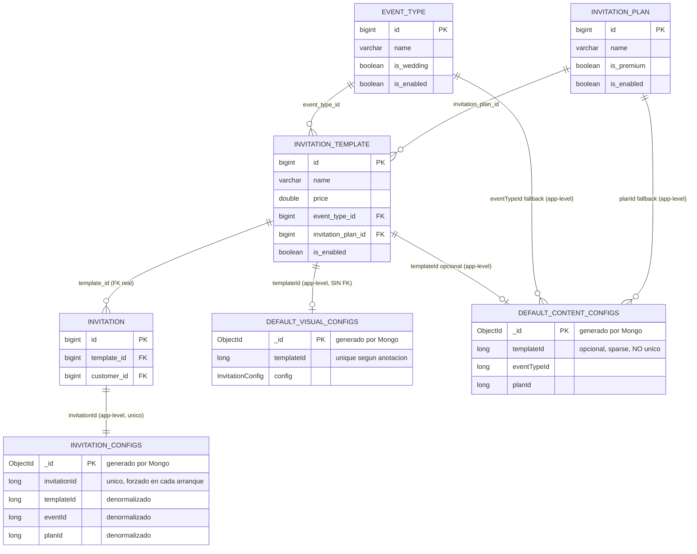

# A — Modelo de datos y fuentes de verdad

## 1. Resumen (≤10 líneas)

Una "plantilla" no es una entidad única: es la combinación de una fila en Postgres (`invitation_template`, el catálogo comercial) más, obligatoriamente, un documento en Mongo `default_visual_configs` con el mismo `templateId` (si falta, la generación de la invitación falla en tiempo de ejecución) y, opcionalmente, un documento en `default_content_configs` (por `templateId` o, si no existe, por el par `eventTypeId+planId`). La unión Postgres↔Mongo es **por convención de aplicación, sin FK ni validación cruzada real**: nada impide que un `templateId` exista en un lado y no en el otro. La resolución en tiempo real (`DefaultConfigGeneratorService.kt:43-79`) usa `templateId` estricto para lo visual y `templateId → fallback (eventTypeId,planId)` para el contenido, con un método `findFirstByEventTypeIdAndPlanId` explícitamente diseñado para tolerar duplicados — evidencia de que los duplicados en `default_content_configs` ya ocurrieron o se anticiparon. El único índice único que el código **garantiza activamente** en cada arranque es `invitation_configs.invitationId` (recreado a mano en `MongoDataInitializer.ensureUniqueIndexes()`); la unicidad de `default_visual_configs.templateId` depende de una anotación `@Indexed(unique=true)` que Spring Data Mongo **no aplica automáticamente** salvo que `spring.data.mongodb.auto-index-creation=true`, propiedad que no aparece en ningún `application.yml` del repo. El inventario de plantillas revela una fuerte deriva entre Flyway (ids 4-10, perfectamente alineados 1:1 con los JSON) y el estado real de producción: los ids 11, 12, 13, 14, 16, 17 existen solo en scripts, comentarios de código o JSON sueltos — nunca en una migración versionada — lo que implica que el esquema relacional real no es reproducible desde este repositorio.

## 2. Entidades y claves

| Entidad | Almacén | Campo clave | Tipo | Referencia a | Evidencia |
|---|---|---|---|---|---|
| `InvitationTemplateEntity` | Postgres, tabla `invitation_template` | `id` (PK, identity) | `Long` | — | `src/main/kotlin/mx/evolutiondev/invitaciones/modules/master/templates/repository/model/InvitationTemplateEntity.kt:17-18` |
| `InvitationTemplateEntity.eventType` | Postgres | `event_type_id` (columna FK) | `Long` → `EventTypeEntity.id` | `event_type.id` | `InvitationTemplateEntity.kt:35-37`; FK real: `V1__initial_schema.sql:1710-1711` (`fkfo6nwmi80o4k6461lq6s3rrif`) |
| `InvitationTemplateEntity.invitationPlan` | Postgres | `invitation_plan_id` (columna FK) | `Long` → `InvitationPlanEntity.id` | `invitation_plan.id` | `InvitationTemplateEntity.kt:31-33`; FK real: `V1__initial_schema.sql:1846-1847` (`fky8a95woq2dqluorenhuymtvg`) |
| `EventTypeEntity` | Postgres, tabla `event_type` | `id` (PK, identity) | `Long` | — | `src/main/kotlin/.../eventtypes/repository/model/EventTypeEntity.kt:15-16` |
| `InvitationPlanEntity` | Postgres, tabla `invitation_plan` | `id` (PK, identity) | `Long` | — | `src/main/kotlin/.../plans/repository/model/InvitationPlanEntity.kt:15-16` |
| `InvitationEntity` | Postgres, tabla `invitation` | `id` (PK) / `template` (`template_id` FK, `nullable=false`) | `Long` | `invitation_template.id` | `src/main/kotlin/.../admin/invitations/repository/model/InvitationEntity.kt:18-23` |
| `DefaultVisualConfig` | Mongo, colección `default_visual_configs` | `templateId` (campo de negocio, no `_id`) | `Long`, `@Indexed(unique = true)` | `invitation_template.id` (solo por convención, sin FK) | `.../model/defaults/DefaultVisualConfig.kt:16-24` |
| `DefaultVisualConfig.config` | Mongo (embebido) | — | `InvitationConfig` (tipado, no blob) | — | `DefaultVisualConfig.kt:30` |
| `DefaultContentConfig` | Mongo, colección `default_content_configs` | `templateId` (opcional, `@Indexed(sparse=true)`) **o** `eventTypeId`+`planId` (cada uno `@Indexed` por separado, sin índice compuesto) | `Long?` / `Long`+`Long` | `invitation_template.id` (opcional) / `event_type.id`+`invitation_plan.id` (por convención) | `.../model/defaults/DefaultContentConfig.kt:16-36` |
| `InvitationConfig` | Mongo, colección `invitation_configs` | `invitationId` (`@Indexed(unique = true)`), campos denormalizados `templateId`, `eventId`, `planId` (todos `Long?`) | `Long` (invitationId) | `invitation.id` (por convención) | `.../model/editor/EditorModels.kt:12-22` |

## 3. Diagrama del modelo de datos

## 4. Clave de resolución y unicidad

| Método | Archivo:línea | Usado por | Qué devuelve si hay 0 / >1 matches |
|---|---|---|---|
| `DefaultVisualConfigRepository.findByTemplateId(templateId)` | `.../repository/mongo/DefaultVisualConfigRepository.kt:20` | `DefaultConfigGeneratorService.kt:47-54` (única llamada de lectura en runtime; `.save()` se usa aparte en el seeder y en `MasterTemplatesService`) | 0: `Optional.empty()` → se relanza como `DefaultVisualTemplateNotFoundException` (`DefaultConfigGeneratorService.kt:50-54`). >1: Spring Data lanza `IncorrectResultSizeDataAccessException` en tiempo de ejecución porque el método declara retorno `Optional<T>` para una consulta que no garantiza cardinalidad 1 (comportamiento de Spring Data, no manejado explícitamente en el código) |
| `DefaultContentConfigRepository.findByTemplateId(templateId)` | `.../DefaultContentConfigRepository.kt:20` | `DefaultConfigGeneratorService.kt:70-71` (primer intento); `MasterTemplatesService.kt:164` (con el id del template "más reciente" de la misma combinación evento/plan, no el propio) | 0: `Optional.empty()` → cae al fallback por `(eventTypeId, planId)`. >1: mismo riesgo de `IncorrectResultSizeDataAccessException` (nada en el modelo impide 2 documentos con el mismo `templateId` porque el índice es `sparse`, no `unique`) |
| `DefaultContentConfigRepository.findByEventTypeIdAndPlanId(eventTypeId, planId)` | `.../DefaultContentConfigRepository.kt:29` | Solo en el **seeder**, `MongoDataInitializer.kt:118` (para decidir si ya existe contenido genérico antes de insertar uno nuevo) | 0: inserta el documento del JSON (`MongoDataInitializer.kt:121-122`). >1: lanzaría `IncorrectResultSizeDataAccessException` durante el arranque — capturado por el `catch (e: Exception)` de `loadAndSaveContentConfig` (línea 124-126), así que solo se registra un log de error y ese archivo de contenido no se siembra, sin tumbar el arranque |
| `DefaultContentConfigRepository.findFirstByEventTypeIdAndPlanId(eventTypeId, planId)` | `.../DefaultContentConfigRepository.kt:32-35`, comentario explícito: *"retorna el primero sin explotar si hay múltiples"* | `DefaultConfigGeneratorService.kt:72` (fallback de contenido en el **camino de lectura real** que usa cada invitación) | 0: `Optional.empty()` → `DefaultContentTemplateNotFoundException` (líneas 73-78). >1: devuelve **uno cualquiera** de forma no determinista (Spring Data no garantiza orden sin `OrderBy`); no hay lógica de desempate |
| `DefaultContentConfigRepository.findByEventTypeIdAndPlanIdAndTemplateId(...)` | `.../DefaultContentConfigRepository.kt:37-41` | **Ninguno** — declarado pero sin ninguna llamada en todo `src/main/kotlin` (verificado por grep) | N/A — método muerto |
| `InvitationConfigRepository.findByInvitationId(invitationId)` | `.../InvitationConfigRepository.kt:11` | `InvitationConfigService.kt:53,136,160`; `InvitationAdminService.kt:377` | 0: `Optional.empty()` (cada llamador decide: generar config inicial, o lanzar excepción). >1: no puede ocurrir en la práctica porque `MongoDataInitializer.ensureUniqueIndexes()` (`MongoDataInitializer.kt:65-71`) recrea, **en cada arranque de la aplicación**, un índice único real sobre `invitation_configs.invitationId` vía `mongoTemplate.indexOps`, evitando así el problema de que `auto-index-creation` esté desactivado |

**Unicidad — qué garantiza el código vs. qué depende del estado real de la BD:**
- `invitation_configs.invitationId` → **garantizado por código en cada arranque** (`MongoDataInitializer.kt:67-70`, `dropIndex` + `ensureIndex` manual vía `MongoTemplate`, que no depende de la propiedad `auto-index-creation`).
- `default_visual_configs.templateId` → declarado `@Indexed(unique = true)` (`DefaultVisualConfig.kt:23`) pero **nunca creado explícitamente** en código (no aparece en `MongoDataInitializer` ni en ningún otro archivo del repo, verificado por grep de `indexOps|ensureIndex|@CompoundIndex|createIndex`). Spring Boot/Spring Data MongoDB no crea índices `@Indexed` automáticamente a menos que `spring.data.mongodb.auto-index-creation=true`; esa propiedad **no aparece** en `src/main/resources/application.yml` (verificado por grep en todo el repo). **NO DETERMINABLE desde el repositorio** si el índice existe realmente en la base de datos de producción — depende de si alguien lo creó manualmente fuera de Git.
- `default_content_configs.templateId/eventTypeId/planId` → índices individuales, no compuestos, ninguno `unique`. El propio código anticipa duplicados (`findFirstByEventTypeIdAndPlanId`), así que **el sistema no pretende garantizar unicidad aquí**, es una decisión de diseño (implícita) y no un descuido de índice.

## 5. Tipado del documento y campos descartados

`DefaultVisualConfig.config` es un `InvitationConfig` **tipado** (no `Map`/blob): `DefaultVisualConfig.kt:30` declara `val config: InvitationConfig`. `DefaultContentConfig` también está tipado campo a campo, salvo `hashtags: Any?`, `family: Map<String,Any>?`, `rsvp: Map<String,Any>?`, `footer: Map<String,Any>?` que son deliberadamente flexibles (`DefaultContentConfig.kt:68,103,108,113`).

`@JsonIgnoreProperties(ignoreUnknown = true)` aparece en **solo 2 archivos de todo `<K>/`** (verificado por grep recursivo): `EditorModels.kt` y `DefaultContentConfig.kt`. Dentro de `EditorModels.kt`, la clase raíz `InvitationConfig` (línea 13) **no lleva la anotación**, y tampoco la llevan `ModelSettings` (44), `ModelPropertiesIcon` (113), `ModelEditIcon` (125), `ModelPropertiesItem` (135), `ModelEditItem` (147), `BackgroundColor` (161), `DateItem` (183), `EventSinglePlaceCard` (255) y `SmallText` (492). Esto significa que si el JSON de un `config` trae una clave desconocida en esos niveles, Jackson lanza una excepción de deserialización en vez de ignorarla silenciosamente.

Comparando por `jq` las claves reales de `default_visual_boda_premium.json` y `default_visual_xv_premium.json` contra los campos de Kotlin:

| Sección | Campo en JSON | ¿Existe en Kotlin? | Evidencia |
|---|---|---|---|
| raíz del documento | `templateId`, `config` | Sí (`DefaultVisualConfig.templateId`, `.config`) | `jq 'keys'` sobre ambos archivos → `["config","templateId"]`; `DefaultVisualConfig.kt:24,30` |
| `config` (nivel InvitationConfig) | `settings`, `sectionCover`, `sectionCouple`, `sectionEvent`, `sectionGallery`, `sectionGifttable`, `sectionSuggestions`, `sectionAmenities`, `sectionStarted`, `sectionFamily`, `sectionStory`, `sectionDresscode`, `sectionFooter` | Sí, 1:1 (incl. remapeos `@JsonProperty("sectionGifttable")`→`sectionGiftTable` y `@JsonProperty("sectionDresscode")`→`sectionDressCode`) | `jq '.config\|keys'` en ambos archivos; `EditorModels.kt:24-38` |
| `config` (campo requerido, **ausente**) | `invitationId` | **No está presente en el JSON** (`jq '.config\|has("invitationId")'` → `false` en **las 9** `default_visual_*.json`, no solo boda/xv premium) pero `InvitationConfig.invitationId` es `val invitationId: Long` **sin valor por defecto** (`EditorModels.kt:18`) | Ver Hallazgo #1 |
| `sectionFamily.intro` | tipo `array` en ambos JSON | Coincide con `List<ModelEditText>?` (`EditorModels.kt:397`); el comentario del propio archivo ("El JSON de bodas debe actualizarse para enviar intro como [ { ... } ]", línea 389) está **desactualizado**: en los JSON versionados actuales ya es un array | `jq '.config.sectionFamily.intro\|type'` → `"array"` en ambos |
| `sectionCouple` | boda: `groomName,brideName,groomPhoto,bridePhoto,groomText,brideText,heading,datetime,subheading,icon,backgroundColor`; xv: `namePersonEvent,photoPersonEvent,imageTopBg,imageBottomBg,message,heading,datetime,background,backgroundColor` | Sí, todos existen como campos opcionales de `SectionCoupleData` (`EditorModels.kt:196-220`) | `jq '.config.sectionCouple\|keys'` en ambos |
| `default_content_cumpleanos.json` / `default_content_evento.json` (raíz) | `_comment` | **No existe** en `DefaultContentConfig` — descartado silenciosamente | `jq 'keys'` → incluye `"_comment"`; se descarta gracias a `@JsonIgnoreProperties(ignoreUnknown = true)` en `DefaultContentConfig.kt:13` (comportamiento correcto, no es un bug) |

No se encontraron claves desconocidas adicionales en `images`, `itinerary[]`, `giftRegistry[]`, `music`, `dressCode`, `parents`/`family` de los content JSON inspeccionados — coinciden 1:1 con `DefaultInvitationImages`, `DefaultItineraryItem`, etc.

## 6. Inventario de plantillas

| templateId | Nombre | eventTypeId/nombre | planId/nombre | Fuente SQL (archivo:línea) | JSON visual | JSON contenido | Observaciones |
|---|---|---|---|---|---|---|---|
| 4 | (nombre vacío en el dump) "Boda Básico" | 1 / Boda | 1 / Básico | `V1__initial_schema.sql:1133-1134` | `default_visual_boda_basico.json` (templateId=4, seeded) | `default_content_boda_basico.json` (eventTypeId=1,planId=1, seeded) | Coincide 1:1, sembrado automáticamente |
| 5 | (nombre vacío en el dump) "Boda Premium" | 1 / Boda | 2 / Premium | `V1__initial_schema.sql:1135-1136` | `default_visual_boda_premium.json` (templateId=5, seeded) | `default_content_boda_premium.json` (eventTypeId=1,planId=2, seeded) | Coincide 1:1; ver Hallazgo #1 sobre `invitationId` ausente |
| 6 | XV Años Elegance Premium | 2 / Quince años | 2 / Premium | `V24__add_new_event_types_and_xv_template.sql:10-13` | `default_visual_xv_premium.json` (templateId=6, seeded) | `default_content_xv_premium.json` (eventTypeId=2,planId=2, seeded) | Coincide 1:1 |
| 7 | Bautizo Premium Elegance | 3 / Bautizo | 2 / Premium | `V25__add_remaining_templates.sql:4` | `default_visual_bautizo.json` (templateId=7) | `default_content_bautizo.json` (eventTypeId=3,planId=2) | Coincide 1:1 |
| 8 | Comunión Premium Elegance | 4 / Comunión | 2 / Premium | `V25__add_remaining_templates.sql:5` | `default_visual_comunion.json` (templateId=8) | `default_content_comunion.json` (eventTypeId=4,planId=2) | Coincide 1:1 |
| 9 | Confirmación Premium Elegance | 5 / Confirmación | 2 / Premium | `V25__add_remaining_templates.sql:6` | `default_visual_confirmacion.json` (templateId=9) | `default_content_confirmacion.json` (eventTypeId=5,planId=2) | Coincide 1:1 |
| 10 | Cumpleaños Premium Elegance | 6 / Cumpleaños | 2 / Premium | `V25__add_remaining_templates.sql:7` | `default_visual_cumpleanos.json` (templateId=10) | `default_content_cumpleanos.json` (eventTypeId=6,planId=2) | Coincide 1:1 |
| 11 | "Boda Premium 2" (nombre solo en script) | 1 / Boda | 2 / Premium | **Ninguna migración Flyway.** Solo `scripts/apply_template_11_12_local.sh:29-38` (`UPDATE invitation_template ... WHERE id=11`) | `default_visual_boda_premium_2.json` existe en disco con `templateId=11` **pero está comentado** en `MongoDataInitializer.kt:36` — no se siembra solo | `default_content_boda_premium_2.json` existe, sin `templateId` propio, también **comentado** en `MongoDataInitializer.kt:50` | HUECO: la fila Postgres 11 no está en ningún Flyway; el JSON con el `templateId` correcto existe pero el seeder no lo carga (requiere ejecutar el script manual o la API `/master/templates/complete`) |
| 12 | "XV Premium 2" (nombre solo en script) | 2 / Quince años | 2 / Premium | **Ninguna migración Flyway.** Solo `scripts/apply_template_11_12_local.sh:40-48` | No existe `default_visual_xv_premium_2.json`; existe `payload-template-xv-2.json` (usado solo por `scripts/upsert_template_11_12.js:28-32`, que inyecta `templateId=12` en tiempo de ejecución del script) | mismo archivo (`payload-template-xv-2.json`, campo `contentConfig`) | HUECO: ni fila SQL versionada ni JSON de seeder estándar; solo alcanzable vía script manual `mongosh` |
| 13 | Sin nombre conocido | ¿7? (sin nombre en ninguna migración) | ¿2? (inferido) | **Ninguna fila Postgres encontrada en ninguna fuente** (ni Flyway ni `invitaciones.sql`) | `default_visual_evento.json` (templateId=13) — **sí se siembra automáticamente** (`MongoDataInitializer.kt:43`) | `default_content_evento.json` (eventTypeId=7,planId=2, con textos placeholder genéricos "Nuestra Boda / Mis XV") — se siembra automáticamente | HUECO INVERSO: existe documento Mongo con `templateId=13` sembrado por defecto, pero no hay evidencia de una fila `invitation_template.id=13` en el repo; y el `eventTypeId=7` que usa su contenido tampoco tiene fila `event_type` en ninguna migración |
| 14 | "Graduación" (nombre hardcodeado) | 7 (hardcodeado) | 2 (hardcodeado) | **Ninguna fila Postgres.** Solo referenciado por código: `DefaultConfigGeneratorService.kt:420` — `val isGraduacion = templateId == 14L && eventTypeId == 7L && planId == 2L` (hallado por grep; fuera del rango de lectura asignado a este sub-agente, línea 1-90) | **Ningún JSON declara `templateId=14`** (verificado con `jq '.templateId'` sobre los 9 `default_visual_*.json`) | `payload-template-graduacion.json` existe (name="Graduación", eventId=7, planId=2) pero es un payload de API sin `templateId` fijo — no está wireado a ningún script del repo | HUECO CRÍTICO: la lógica de negocio depende de `templateId=14` existiendo con visual propio, pero no hay documento `default_visual_configs` con ese id en el repo. Si el 14 real no fue creado en Mongo fuera de este repo, cualquier invitación con `templateId=14` fallaría con `DefaultVisualTemplateNotFoundException` |
| 16, 17 | "duplicados operativos" (sin nombre conocido) | desconocido | desconocido | **Ninguna fila Postgres, ninguna migración.** Solo mencionados en `scripts/apply_template_11_12_local.sh:50-53` (`UPDATE invitation_template SET is_enabled=false ... WHERE id IN (16,17)`) y `HOTFIX_ADD_TEMPLATES_CAMBIOS.md:211` | Ninguno en el repo | Ninguno en el repo | Ver Hallazgo #4: explicados como subproducto de reintentos del endpoint `/master/templates/complete`, que no tiene protección de idempotencia |
| 1, 2, 3 | — | — | — | La secuencia `invitation_template_id_seq` arranca en 1 pero la primera fila del dump es id=4 (`V1__initial_schema.sql:1133`, `invitaciones.sql:1133`) | — | — | **NO DETERMINABLE** desde el repo si 1-3 existieron y se borraron, o si simplemente nunca se usaron esos ids |

`invitaciones.sql` (raíz del repo) es, en la práctica, un volcado casi idéntico a `V1__initial_schema.sql` (diff de solo 4 líneas triviales: una longitud de columna, dos URLs de imagen y un `ON DELETE CASCADE`) y **no incluye ninguno** de los cambios de `V24`-`V28`: solo contiene `event_type` 1-2, `invitation_plan` 1-2 e `invitation_template` 4-5. Está desactualizado respecto a las migraciones versionadas y no debe usarse como fuente de verdad del estado actual del catálogo.

## 7. Hallazgos

1. **`InvitationConfig.invitationId` es un `Long` obligatorio sin valor por defecto, pero está ausente en los 9 JSON de plantilla visual versionados — probable fallo silencioso de siembra.** `EditorModels.kt:18` declara `val invitationId: Long` sin default; los 9 `default_visual_*.json` en `src/main/resources/data/mongo/` carecen del campo `config.invitationId` (verificado con `jq '.config|has("invitationId")'` → `false` en los 9). `MongoDataInitializer.loadAndSaveVisualConfig` (`MongoDataInitializer.kt:74-93`) deserializa cada archivo directamente a `DefaultVisualConfig` (que anida `InvitationConfig`) con `objectMapper.readValue()`, usando el `ObjectMapper` de `jackson-module-kotlin` (`jacksonObjectMapper()`, línea 27). El comportamiento documentado de `jackson-module-kotlin` para un parámetro de constructor no-nulo y sin valor por defecto cuya clave está totalmente ausente del JSON es lanzar `MissingKotlinParameterException`. El `catch (e: Exception)` de las líneas 91-93 capturaría esa excepción y solo emitiría un `logger.error(...)`, sin detener el arranque. Evidencia corroborante indirecta: el otro camino de creación de `InvitationConfig` a partir de un mapa JSON, en `MasterTemplatesService.kt:116-121`, **inyecta explícitamente `put("invitationId", 0)`** antes de convertir el payload — indicando que en algún momento del desarrollo se detectó que ese campo es obligatorio para esa conversión, pero el fix nunca se replicó a los JSON de siembra del classpath. **Estado: INFERIDO con alta confianza** (mecanismo de Jackson bien documentado y coherente con el resto del código; no se pudo ejecutar la aplicación en este entorno — sin caché de Gradle/Maven y sin acceso completo a Maven Central vía el proxy configurado — para observar la excepción real en logs de arranque). Verificación recomendada: correr `MongoDataInitializer` contra un Mongo real y revisar el log, o un test unitario que deserialice `default_visual_boda_premium.json`.

2. **El endpoint `POST /master/templates/complete` no tiene protección de idempotencia y crea una fila `invitation_template` nueva en cada llamada, sin comprobar si ya existe una equivalente.** `MasterTemplatesService.createCompleteTemplate` (`MasterTemplatesService.kt:85-197`) valida `eventType`/`plan` (líneas 87-100) pero pasa directo a `invitationTemplateRepository.save(InvitationTemplateEntity(...))` (líneas 103-113) sin buscar antes por nombre/evento/plan. No existe ninguna restricción `UNIQUE` en la tabla `invitation_template` más allá de la PK (`V1__initial_schema.sql`, verificado por grep de `UNIQUE` en todas las migraciones — solo aparecen en `customer.email` y `refresh_tokens.token`). Esto es consistente con la existencia documentada de los ids **16 y 17** como "duplicados operativos" que `scripts/apply_template_11_12_local.sh:50-53` deshabilita explícitamente. **Estado: VERIFICADO** (código leído íntegro; la existencia real de 16/17 en producción es INFERIDA a partir del script y la doc, no verificable sin acceso a la BD real).

3. **`HOTFIX_ADD_TEMPLATES_CAMBIOS.md` describe una lógica de reutilización de contenido que no es la que existe en el código.** La doc (líneas 85-88 y 127) afirma que el sistema "reutiliza uno existente por `(eventId, planId)`". El código real (`MasterTemplatesService.kt:151-166`) tiene esa consulta directa **comentada** (líneas 153-154: `// defaultContentConfigRepository.findByEventTypeIdAndPlanId(...)`) y en su lugar: busca todas las plantillas Postgres habilitadas para `(eventTypeId, planId)` excluyendo la recién creada, toma la de **mayor id** ("la más reciente", comentario línea 162), y solo entonces busca un `DefaultContentConfig` **atado al `templateId` de esa plantilla anterior** (línea 164). Si esa plantilla "más reciente" nunca tuvo un `DefaultContentConfig` propio (lo normal, ya que la mayoría de plantillas usan el contenido genérico por `eventTypeId+planId` sin `templateId` — ver tabla de la sección 6), la búsqueda falla aunque exista contenido genérico reutilizable, y la petición completa lanza `IllegalArgumentException` (líneas 174-179) pese a que, según la documentación, debería tener éxito. **Estado: VERIFICADO** (contradicción directa entre el texto de la doc, líneas 85-88/127, y el código real en `MasterTemplatesService.kt:151-179`, incluyendo el código comentado que prueba cuál era la intención original).

4. **La resolución de la plantilla visual (`DefaultVisualConfigRepository.findByTemplateId`) no tiene fallback alguno; si falta el documento Mongo para un `templateId` que sí existe en Postgres, la generación de la invitación falla en runtime con `DefaultVisualTemplateNotFoundException`.** `DefaultConfigGeneratorService.kt:47-54`. Esto convierte cualquier desincronización entre `invitation_template` (Postgres) y `default_visual_configs` (Mongo) — como las descritas en la sección 6 para los ids 11, 12 y especialmente 14 — en un fallo funcional total para esa plantilla, sin degradar a ningún valor por defecto. **Estado: VERIFICADO** (lectura completa de `DefaultConfigGeneratorService.kt:1-90`, dentro del rango asignado).

5. **`templateId==14L && eventTypeId==7L && planId==2L` está hardcodeado en `DefaultConfigGeneratorService.kt:420`** (hallado por búsqueda dirigida, fuera de las líneas 1-90 asignadas a este sub-agente) para una ramificación llamada `isGraduacion`, pero ni el id de plantilla 14 ni el `event_type.id=7` existen en ninguna migración Flyway del repo, y ningún `default_visual_*.json` declara `templateId=14`. La FK `invitation_template.event_type_id REFERENCES event_type(id)` (`V1__initial_schema.sql:1710-1711`) implica que, para que exista siquiera la fila `invitation_template` con `event_type_id=7`, la fila `event_type.id=7` tuvo que crearse fuera de las migraciones versionadas de este repo. **Estado: VERIFICADO que el código depende de esos ids** (grep + lectura directa de la línea); **NO DETERMINABLE** si esas filas existen hoy en la base de datos real, porque eso depende del estado de producción, no del repositorio.

6. **Inconsistencia de tolerancia a duplicados entre el sembrador y el consumidor de `default_content_configs`.** El sembrador (`MongoDataInitializer.kt:118`) usa el método estricto `findByEventTypeIdAndPlanId` (que asume cardinalidad ≤1 y lanzaría una excepción de Spring Data si ya hay más de un documento, aunque quedaría silenciada por el `catch` de la línea 124-126, dejando ese archivo sin sembrarse), mientras que el consumidor en el camino de lectura real (`DefaultConfigGeneratorService.kt:72`) usa el método explícitamente permisivo `findFirstByEventTypeIdAndPlanId`, cuyo propio nombre de commit/comentario (`DefaultContentConfigRepository.kt:31`, *"retorna el primero sin explotar si hay múltiples"*) confirma que los duplicados fueron un problema real conocido por el equipo. **Estado: VERIFICADO.**

7. **`default_visual_boda_premium_2.json` y `default_content_boda_premium_2.json` existen en `src/main/resources/data/mongo/` con el `templateId=11` ya correcto, pero están deliberadamente comentados en las listas de `MongoDataInitializer.kt:36` y `:50`.** Es decir, el arte para sembrar automáticamente el template 11 ya está en el repo, listo, pero apagado; solo se activa vía el script manual `scripts/apply_template_11_12_local.sh` o la API. **Estado: VERIFICADO.**

8. **Método de repositorio muerto:** `DefaultContentConfigRepository.findByEventTypeIdAndPlanIdAndTemplateId` (`DefaultContentConfigRepository.kt:37-41`) no tiene ninguna llamada en todo `src/main/kotlin` (verificado por grep). **Estado: VERIFICADO** (hallazgo menor).

9. **El endpoint `POST /master/templates/complete` sí exige rol `MASTER`, contrario a lo que podría parecer al no ver un `@PreAuthorize` en el controlador.** La protección está centralizada por patrón de ruta en `SecurityConfig.kt:44` (`it.requestMatchers("/master/**").hasRole("MASTER")`), no por anotación en `MasterTemplatesController.kt`. Esto coincide con lo que documenta `HOTFIX_ADD_TEMPLATES_CAMBIOS.md` línea 35 y 47. **Estado: VERIFICADO — la documentación es correcta en este punto.**

## 8. Lo que está bien resuelto

- Las plantillas 4 a 10 (las únicas dadas de alta por Flyway) tienen una correspondencia 1:1 perfecta y verificada entre `invitation_template.id` (Postgres), `default_visual_*.json.templateId` y `default_content_*.json.eventTypeId/planId` — no hay ambigüedad ni huecos en ese subconjunto.
- El índice único de `invitation_configs.invitationId` está genuinamente garantizado: `MongoDataInitializer.ensureUniqueIndexes()` lo recrea a mano en cada arranque (`drop` + `ensureIndex`), sin depender de la configuración `auto-index-creation` de Spring, que es la única parte del modelo de datos donde el código realmente impone unicidad en runtime.
- `DefaultContentConfig` usa `@JsonIgnoreProperties(ignoreUnknown = true)` de forma consistente en todas sus clases anidadas, y esto efectivamente protege la siembra: el campo `_comment` presente en `default_content_cumpleanos.json` y `default_content_evento.json` se descarta sin romper nada, tal como se espera.
- El seeder (`MongoDataInitializer`) usa `findByTemplateId(...).ifPresentOrElse(...)` con `config.copy(id = existing.id)` antes de volver a guardar (`MongoDataInitializer.kt:83-90`, `106-114`) — esto es un upsert correcto por clave de negocio (`templateId`) que preserva el `_id` real de Mongo y evita duplicar documentos al reiniciar la aplicación repetidamente.
- La autorización del módulo `/master/**` (que incluye el alta de plantillas) está correctamente centralizada por patrón de ruta en `SecurityConfig.kt`, coincidiendo con lo documentado.
- El campo `templateId` de `InvitationConfig` (colección `invitation_configs`) se re-sincroniza perezosamente si falta (`InvitationConfigService.kt:141-147`, "Lazy migration"), lo cual es una estrategia razonable para tolerar documentos antiguos creados antes de que esos campos existieran en el modelo.

## 9. Preguntas que no pude responder y por qué

- **¿Existe realmente el índice único `default_visual_configs.templateId` en la base de datos de producción?** No determinable desde el repositorio: la anotación `@Indexed(unique=true)` está presente pero no hay ninguna creación explícita de índice en código (a diferencia de `invitation_configs.invitationId`), y la propiedad `spring.data.mongodb.auto-index-creation` no aparece configurada en ningún `application.yml`/`.properties` del repo, por lo que depende del valor por defecto de Spring Boot 3.4.1 y de si alguien creó el índice manualmente fuera de Git. No tengo acceso a la base de datos real ni al código fuente de la librería para confirmar el comportamiento exacto en tiempo de ejecución.
- **¿Se lanza realmente `MissingKotlinParameterException` al sembrar los `default_visual_*.json` por la ausencia de `invitationId`?** (Hallazgo #1). Intenté verificarlo empíricamente: no hay caché de Gradle/Maven en este entorno, `./gradlew --offline` falla porque no puede resolver el plugin de Kotlin, y no hay `kotlinc` instalado para una prueba aislada. No pude ejecutar la aplicación real ni un test dirigido; el hallazgo queda como INFERIDO de alta confianza basado en el comportamiento documentado de `jackson-module-kotlin` y en evidencia corroborante cruzada (`MasterTemplatesService.kt:117`).
- **¿Qué nombre, `eventTypeId` y `planId` reales tienen los templates 16 y 17?** No aparecen en ningún archivo del repositorio más allá de sus ids en el script de deshabilitación; solo el estado real de la base de datos de producción lo tendría, y no tengo acceso a ella.
- **¿Existieron alguna vez las filas `invitation_template` con id 1, 2 o 3?** La secuencia de Postgres arranca en 1 pero la primera fila del dump inicial es la 4; no hay ninguna migración ni comentario que explique el salto. No determinable desde el código ni las migraciones disponibles.
- **¿Llegó a ejecutarse `scripts/apply_template_11_12_local.sh` / `upsert_template_11_12.js` en algún ambiente real, y con qué resultado?** Son scripts operativos, no versionados como parte del build ni con evidencia de ejecución (logs, changelog) dentro del repo. No puedo saber si el estado que describen (11 y 12 activos, 16 y 17 deshabilitados) refleja la base de datos actual.
- **El resto de la lógica de `DefaultConfigGeneratorService.kt` (líneas 91 en adelante, 2743 líneas totales)** queda fuera del alcance de este sub-agente por instrucción explícita del brief; cualquier hallazgo adicional sobre el merge de configuración, la rama `isGraduacion` completa, u otros usos de `templateId`/`eventTypeId` corresponde al sub-agente que audita ese archivo completo.
