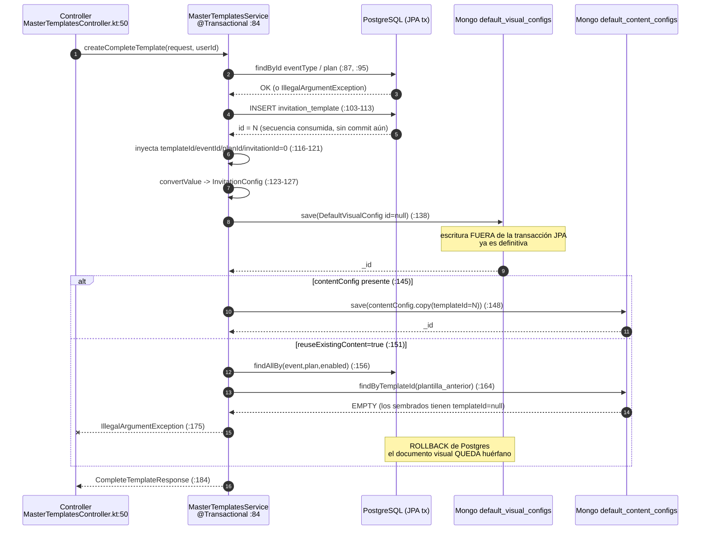

# B — Ciclo de vida del alta de plantillas

## 1. Resumen (≤10 líneas)

Hay **seis vías** por las que nace una plantilla y **ninguna produce el mismo estado**. La vía "oficial" (`POST /master/templates/complete`) tiene un defecto grave: su modo de reutilización de contenido (`reuseExistingContent=true`, el default) busca el contenido **por `templateId` de una plantilla anterior**, no por `(eventId, planId)` como promete la doc; como todos los contenidos sembrados tienen `templateId = null`, en un entorno recién migrado esa ruta **siempre falla** — y falla *después* de haber escrito ya el documento visual en Mongo, dejando un huérfano por cada intento (`MasterTemplatesService.kt:156-179`). El `@Transactional` solo cubre JPA: no hay `MongoTransactionManager` ni `ChainedTransactionManager` en todo el repo, y Mongo corre standalone (`docker-compose.yml:24`), así que ni siquiera sería posible. No hay compensación y el reintento no es idempotente. `MongoDataInitializer` hace *upsert por `templateId`* en visuales: sobrescribe en cada arranque cualquier edición manual y **pisaría** una plantilla creada por API que caiga en `templateId` 4-10 o 13 — y el siguiente id libre tras las migraciones es 11, así que la tercera plantilla creada por API cae exactamente en 13, que está sembrado (`default_visual_evento.json`). No existe índice único efectivo sobre `default_visual_configs.templateId`. No existe borrado: los documentos Mongo quedan para siempre.

## 2. Vías de alta

| Vía | Punto de entrada (archivo:línea) | Escribe en Postgres | Escribe en Mongo visual | Escribe en Mongo contenido | Orden | Valida | No valida | Estado resultante distinto a las demás |
|---|---|---|---|---|---|---|---|---|
| **A. Migración Flyway (V1)** | `src/main/resources/db/migration/V1__initial_schema.sql:1133-1136` | `invitation_template` ids 4 y 5 (`COPY`), `setval(...,5)` en :1385 | no | no | solo SQL | FK a `event_type` / `invitation_plan` (:1710, :1846) | nada de Mongo | `name` = **cadena vacía**; sin `created_by`; depende de que el seeder Mongo tenga los ficheros con `templateId` 4 y 5 |
| **B. Migración Flyway (V24, V25)** | `V24__add_new_event_types_and_xv_template.sql:10-17`; `V25__add_remaining_templates.sql:2-10` | ids 6 (V24) y 7-10 (V25) con id **explícito** + `setval` | no | no | solo SQL | `ON CONFLICT (id) DO NOTHING` | que exista config visual en Mongo para esos ids | `name` sí poblado; `created_by` null; el pareo con Mongo es por convención de ficheros |
| **C. `MongoDataInitializer` (arranque)** | `core/data/MongoDataInitializer.kt:29-63` | **no** | sí: upsert por `templateId` (:83-90) | sí: upsert por `templateId` si viene, si no *skip-if-exists* por `(eventTypeId, planId)` (:106-123) | visuales → contenidos | existencia del recurso classpath (:77, :99) | que el `templateId` exista en Postgres; que `eventTypeId`/`planId` existan; unicidad | Único que **sobrescribe**; los contenidos quedan con `templateId = null`; `config.templateId/eventId/planId` quedan **null** dentro del documento visual |
| **D. `POST /master/templates` (alta "no completa")** | `presentation/MasterTemplatesController.kt:26-34` → `service/MasterTemplatesService.kt:35-70` | fila nueva con `createdBy` | **no** | **no** | solo Postgres | eventType existe + habilitado (:36-41); plan existe + habilitado (:43-48) | nada de Mongo; el request **ni siquiera tiene campo `name`** (`InvitationTemplateRequest.kt:7-26`) | Plantilla **sin nombre** (`name=""`, default de `InvitationTemplateEntity.kt:20`) y **sin configuración visual** → toda invitación que la use revienta con 500 |
| **E. `POST /master/templates/complete`** | `MasterTemplatesController.kt:50-58` → `MasterTemplatesService.kt:84-197` | fila nueva con `name`, `createdBy` (:103-113) | sí, documento nuevo (`id=null` → insert) (:129-138) | sí **solo** si viene `contentConfig` (:145-150); si se "reutiliza", **no escribe nada** (:168-173) | Postgres → visual → contenido | eventType/plan existen y habilitados (:87-100); forma del visual vía `convertValue` (:123-127) | que `contentConfig.eventTypeId/planId` coincidan con `request.eventId/planId`; que `contentConfig.id` no pise otro documento; unicidad de `(eventId, planId)` | Único que inyecta `templateId/eventId/planId/invitationId` **dentro** de `config` (:116-136); en modo reuse deja la plantilla **sin contenido propio** |
| **F. Scripts `apply_template_11_12_local.sh` + `upsert_template_11_12.js`** | `scripts/apply_template_11_12_local.sh:29-64`; `scripts/upsert_template_11_12.js:22-68` | **solo `UPDATE`** de ids 11/12 y `is_enabled=false` de 16/17 (:30-53) — **nunca `INSERT`** | sí, `updateOne(..., upsert:true)` (:36-56) | sí, `updateOne({templateId}, {$set: contentConfig}, upsert:true)` (:58-68) | Postgres → Mongo | nada | que las filas 11/12 existan en Postgres (un `UPDATE` de 0 filas es silencioso) | Documentos Mongo **sin `_class`**; contenido **con `templateId`** poblado (a diferencia de C); si Postgres no tenía 11/12, quedan configs huérfanas |
| **G. Inserción manual** | No versionada; se infiere de `apply_template_11_12_local.sh:50-53` ("duplicados operativos 16 y 17") y de `HOTFIX_ADD_TEMPLATES_CAMBIOS.md:211` | — | — | — | — | — | — | NO DETERMINABLE desde el repo |

Nota sobre G: la existencia de plantillas 16 y 17 no está en ninguna migración (la última migración deja la secuencia en 10, `V25:10`), luego se crearon en runtime (API o SQL manual). Es evidencia de que la vía E/G ya se usó en producción y produjo duplicados.

## 3. Flujo detallado de `createCompleteTemplate`

Paso a paso, todo en `src/main/kotlin/mx/evolutiondev/invitaciones/modules/master/templates/service/MasterTemplatesService.kt`:

1. **:84** `@Transactional` (proxy CGLIB efectivo: `build.gradle.kts:5` aplica `kotlin("plugin.spring")`, que abre las clases `@Service`; la llamada entra desde el controlador, así que el proxy sí intercepta).
2. **:87-92** `eventTypeRepository.findById(request.eventId)` → `IllegalArgumentException` si no existe o si `!isEnabled`.
3. **:95-100** idem para el plan.
4. **:103-113** `invitationTemplateRepository.save(InvitationTemplateEntity(...))`. Con `GenerationType.IDENTITY` (`InvitationTemplateEntity.kt:17`) Hibernate ejecuta el `INSERT` **inmediatamente** para obtener el id; el id de la secuencia queda consumido pase lo que pase después.
5. **:116-121** Copia `request.visualConfig` (un `Map<String,Any>` crudo, `CompleteTemplateRequest.kt:55`) y le inyecta `invitationId=0`, `templateId`, `eventId`, `planId`.
6. **:123-127** `objectMapper.convertValue(..., InvitationConfig::class.java)` con el `ObjectMapper` de Spring (inyectado en :32). Spring Boot deshabilita `FAIL_ON_UNKNOWN_PROPERTIES`, así que **las claves desconocidas se descartan en silencio**; solo se rechaza si un campo obligatorio falta o tiene tipo incompatible. `InvitationConfig` (`EditorModels.kt:12-39`) **no** lleva `@JsonIgnoreProperties`, a diferencia de 27 de sus modelos anidados.
7. **:129-137** Construye `DefaultVisualConfig(templateId=..., config=invitationConfig.copy(...))` — vuelve a fijar los cuatro campos ya inyectados en el paso 5 (redundante pero inofensivo).
8. **:138** `defaultVisualConfigRepository.save(visualConfig)`. `id` es null (`DefaultVisualConfig.kt:17`) → **siempre inserta un documento nuevo**, nunca actualiza.
9. **:145-150** Rama A (`contentConfig != null`): `request.contentConfig.copy(templateId = savedTemplate.id)` y `save`. **Solo se sobreescribe `templateId`**: `eventTypeId` y `planId` del cuerpo quedan tal cual llegaron, sin contrastar contra `request.eventId/planId`. Si el cuerpo trae `id`, `save` **reemplaza el documento existente con ese `_id`**.
10. **:151-179** Rama B (`reuseExistingContent=true`, el default según `CompleteTemplateRequest.kt:67`): busca plantillas Postgres con el mismo `(eventId, planId)` y `isEnabled=true` (:156-160), excluye la recién creada (:161), toma la de id mayor (:162) y busca el contenido **por el `templateId` de esa plantilla anterior** (:164). Si no hay resultado → `IllegalArgumentException` (:175-178).
11. **:180-182** Rama C: ni `contentConfig` ni `reuseExistingContent` → `IllegalArgumentException`.
12. **:184-196** Respuesta. `contentConfigId` en modo reuse apunta al documento **de otra plantilla**, que no queda asociado a la nueva.

Contradicción código/comentario detectada aquí: el bloque comentado en **:153-154** muestra la implementación *correcta* (`findByEventTypeIdAndPlanId`) y el mensaje de error en **:176-177** sigue hablando de "configuración de contenido para (eventId, planId)", mientras el código vivo busca por `templateId` de otra plantilla.

## 4. Transaccionalidad y escenarios de fallo parcial

**Alcance del `@Transactional`:** solo JPA/Postgres. No existe ningún `MongoTransactionManager`, `ChainedTransactionManager` ni `@EnableTransactionManagement` en el repositorio (`grep -rn "TransactionManager" src/main` solo devuelve el import de `MongoTemplate` en `MongoDataInitializer.kt:13`). `application.yml:46-48` configura Mongo únicamente con `uri`. Además Mongo corre como **instancia standalone sin replica set** (`docker-compose.yml:24`, `image: mongo:6` sin `--replSet`), donde las transacciones multi-documento no están disponibles ni aunque se configurara el manager. Conclusión: **toda escritura a Mongo dentro de `createCompleteTemplate` es inmediata e irreversible**.

| Escenario | Qué queda en Postgres | Qué queda en Mongo | ¿Compensación? | ¿Reintento idempotente? | Evidencia |
|---|---|---|---|---|---|
| (a) Falla Mongo (visual) tras el INSERT relacional | Nada: rollback de la fila. La **secuencia sí queda consumida** (IDENTITY no es transaccional) | Nada | No | No: crea fila e id nuevos | `MasterTemplatesService.kt:84, 103-113, 138`; `InvitationTemplateEntity.kt:17` |
| (b) Falla el save de contenido después del save visual | Nada: rollback | **Documento visual huérfano** con `templateId` que ya no existe en Postgres | No | No: nuevo id, nuevo documento visual → un huérfano por intento | `MasterTemplatesService.kt:138` vs `:148` |
| (c) `reuseExistingContent=true` y no hay contenido asociado por `templateId` (**caso normal en entorno nuevo**) | Nada: rollback | **Documento visual huérfano** | No | No | `MasterTemplatesService.kt:156-178`; contenidos sembrados con `templateId=null` (verificado en los 9 `default_content_*.json`) |
| (d) `contentConfig` con `id` de un documento ya existente | Fila creada (si el resto va bien) | El documento de contenido **de otra plantilla queda reemplazado** por el nuevo cuerpo | No | No aplica | `MasterTemplatesService.kt:147-148`; `DefaultContentConfig.kt:16-17` (`id` es propiedad deserializable) |
| (e) Éxito y luego reintento del operador (doble POST) | **Dos filas** con el mismo `(event, plan)` | **Dos documentos visuales** y dos de contenido | No | No | No hay `findBy...` previo ni `_id` determinista; `save` con `id=null` siempre inserta (`:138`, `:148`) |
| (f) Excepción de validación *antes* del INSERT (:87-100) | Nada | Nada | N/A | Sí (no hay efecto lateral) | `MasterTemplatesService.kt:87-100` |

Detalle sobre (c) que agrava el problema: el `id` consumido de la secuencia **no se libera**, así que los `templateId` de los documentos huérfanos jamás vuelven a corresponder a una plantilla real… salvo que coincidan con un `templateId` sembrado (ver §5) o con un id insertado explícitamente por una migración futura.

**No hay ninguna compensación en el código**: no existe ni un `try/catch` alrededor de las escrituras Mongo, ni un `TransactionSynchronization`, ni un borrado del documento visual, ni un borrado de la fila Postgres. Verificado por ausencia: en todo `src/main` no aparece ninguna llamada `delete` sobre `defaultVisualConfigRepository` ni `defaultContentConfigRepository`.

## 5. Comportamiento del seed en arranque

**Qué hace exactamente** (`core/data/MongoDataInitializer.kt:29-63`, un `CommandLineRunner`, por tanto **después** de Flyway y del arranque del contexto):

- **Visuales (:74-94):** `findByTemplateId(config.templateId)` → si existe, `config.copy(id = existing.id)` + `save` → **sobrescritura total del documento, conservando el `_id`**. Si no existe, inserta. Es decir: **upsert destructivo por `templateId` en cada arranque**.
- **Contenidos (:96-127):** dos ramas. Si el JSON trae `templateId` (:106-116) → mismo upsert destructivo. Si no (**caso de los 9 ficheros del repo, todos con `templateId` ausente**), va a :118-123 → `findByEventTypeIdAndPlanId` → **si ya existe, no hace nada** ("Omitiendo"). O sea: los contenidos son *skip-if-exists*, los visuales son *overwrite*.

**Respuestas concretas:**

- *Plantilla creada por API cuando la app reinicia*: si su `templateId` **no** está en las listas de :34-44/:48-58 → intacta. Si **sí** está → su documento visual queda **reemplazado por el JSON del repo** y pierde de paso `config.templateId/eventId/planId` (los ficheros no los traen; verificado: `default_visual_boda_premium.json` tiene solo `templateId` y `config`, y dentro de `config` no hay `invitationId/templateId/eventId/planId`). Esto **no es hipotético**: `V25:10` deja `invitation_template_id_seq` en 10, luego el primer id que la API asigna es 11, el segundo 12 y el **tercero 13** — y `default_visual_evento.json` está sembrado con `templateId = 13`. La tercera plantilla creada por API en un entorno recién migrado se pisa sola al siguiente reinicio. **VERIFICADO** (contando ids; la única incertidumbre es el estado real de la secuencia en un entorno concreto).
- *Documento editado a mano en Mongo*: si su `templateId` está sembrado → la edición se pierde en el siguiente arranque, sin aviso más allá de un `logger.info` "actualizada" (:86).
- *Entradas comentadas*: `default_visual_boda_premium_2.json` (:36) y `default_content_boda_premium_2.json` (:50). Ambos ficheros **existen en disco** (131 KB y 5.6 KB). El visual comentado tiene `templateId = 11`, exactamente el id que los scripts de §2-F asignan a "Boda Premium 2". Consecuencia: **en un entorno nuevo la plantilla 11 no se siembra**, así que si alguien inserta la fila 11 en Postgres (o el script hace su `UPDATE`… que no inserta nada), la invitación asociada revienta.
- *Plantillas que ya no se siembran / que se siembran sin contraparte*: `default_visual_evento.json` (`templateId = 13`) y `default_content_evento.json` (`eventTypeId = 7`) **no tienen contraparte en Postgres**: las migraciones solo crean `event_type` 1-6 (`V1:929-930` + `V24:1-7`) e `invitation_template` 4-10. `payload-template-graduacion.json` también usa `eventId = 7`. Es decir, se siembra en Mongo una plantilla "evento/graduación" para la que no existe ni el tipo de evento ni la plantilla relacional.
- *Si no hay plantilla visual al generar*: **no hay fallback**. `DefaultConfigGeneratorService.kt:47-55` lanza `DefaultVisualTemplateNotFoundException`, que `GeneralExceptionHandler.kt:187-197` mapea a **HTTP 500**; el intermedio `InvitationConfigService.kt:154-164` lo captura, reintenta leer la config existente y, al no haberla, relanza `IllegalStateException`. Para contenido sí hay un fallback: `findByTemplateId` → `findFirstByEventTypeIdAndPlanId` (`DefaultConfigGeneratorService.kt:69-79`).
- *Si el JSON no parsea*: `catch (e: Exception)` en :91-93 y :124-126 → `logger.error` **solo con `e.message`, sin stack trace** → se salta ese fichero y continúa con el resto. La app arranca igual, con la plantilla ausente. El `MongoDataInitializer` usa `jacksonObjectMapper()` propio (:27), **no** el `ObjectMapper` de Spring, así que aquí `FAIL_ON_UNKNOWN_PROPERTIES` sí está activo: un JSON que la API aceptaría (descartando claves desconocidas) puede ser rechazado por el seeder. Asimetría verificada entre `MongoDataInitializer.kt:27` y `MasterTemplatesService.kt:32`.
- *Si Mongo no está disponible al arrancar*: `ensureUniqueIndexes()` tiene un `catch (e: Exception) {}` **vacío** (:71) y cada carga tiene su propio catch → **la aplicación arranca perfectamente con cero configuraciones sembradas**, y todas las generaciones de invitación devolverán 500 después. No hay ningún health check ni fallo rápido.

## 6. Duplicados, deshabilitado y borrado

**Duplicados `(eventTypeId, planId)`:** nada lo impide. No hay ninguna restricción `UNIQUE` sobre `invitation_template(event_type_id, invitation_plan_id)` en ninguna migración (grep sobre las 28 migraciones: cero coincidencias de `UNIQUE`/`CREATE INDEX` para esa tabla; `V23` solo indexa `invitation`). Y de hecho el diseño *espera* varias plantillas por combinación: `listAllFiltered` (`MasterTemplatesService.kt:318-339`) devuelve una lista.

**Quién gana en la resolución** (`DefaultConfigGeneratorService.kt:43-79`):
- **Visual: no hay competencia.** Se resuelve estrictamente por `templateId` (`:47-49`), relación 1:1. Si hay **dos** documentos con el mismo `templateId`, `findByTemplateId` devuelve `Optional` y Spring Data lanza `IncorrectResultSizeDataAccessException` → la invitación deja de poder generarse.
- **Contenido: gana un documento arbitrario.** Primero `findByTemplateId(templateId)`; si no hay, `findFirstByEventTypeIdAndPlanId(eventTypeId, planId)` (`:72`) — "el primero" en orden natural de Mongo, sin `sort`, es decir **no determinista a efectos de contrato**. Con varias plantillas premium de boda creadas por API (cada una guardando su contenido con `eventTypeId=1, planId=2`), cualquier plantilla de boda premium sin contenido propio recibe el contenido de *alguna* de ellas.

**Relación con `ensureUniqueIndexes()` (`MongoDataInitializer.kt:65-72`):** el método **solo** crea el índice único de `invitation_configs.invitationId`; **no toca `default_visual_configs` ni `default_content_configs`**. Y los `@Indexed(unique = true)` declarativos (`DefaultVisualConfig.kt:23-24`) solo se materializan si `spring.data.mongodb.auto-index-creation=true`, propiedad **ausente de `application.yml`** y cuyo valor por defecto en Spring Boot 3.x es `false` (INFERIDO por versión: `build.gradle.kts:6`, Boot 3.4.1). La existencia misma de `ensureUniqueIndexes()` — creando a mano un índice que ya está declarado con `@Indexed(unique=true)` en `EditorModels.kt:17` — es la prueba de que los autores comprobaron que las anotaciones no crean índices. Por tanto: **`default_visual_configs.templateId` no tiene unicidad garantizada**. Si realmente existe el índice en la BD de producción es NO DETERMINABLE desde el repo.

Consecuencia encadenada verificable: en cuanto la API crea un contenido con `(eventTypeId=1, planId=2)` (p. ej. desde `payload-template-2.json`, que trae esa pareja), `MongoDataInitializer.kt:118` — que usa `findByEventTypeIdAndPlanId`, la variante que **sí** revienta con múltiples resultados — lanzará `IncorrectResultSizeDataAccessException` en cada arranque, será tragada por el catch de :124-126 y **`default_content_boda_premium.json` dejará de sembrarse para siempre en silencio**. El comentario de `DefaultContentConfigRepository.kt:31` ("Agregar este — retorna el primero sin explotar si hay múltiples") demuestra que el equipo ya se topó con esa excepción y la parcheó **solo en el generador** (`DefaultConfigGeneratorService.kt:72`), dejando el initializer con la variante vieja.

**Deshabilitado:** sí existe. `deactivateTemplate` (`MasterTemplatesService.kt:277-299`) pone `is_enabled=false` y `deleted_by`; cuenta las invitaciones activas afectadas (:285) **solo para el mensaje**, no bloquea nada. `activateTemplate` (:301-316) revierte. Efecto sobre invitaciones existentes: **ninguno**. Las invitaciones ya creadas siguen funcionando porque su `invitation_configs` ya existe y, si hubiera que regenerarla, `DefaultConfigGeneratorService` **no consulta `isEnabled`** (`:43-55`). Lo que sí se bloquea es crear invitaciones nuevas con esa plantilla (`InvitationValidationService.kt:17-20`, invocado desde `InvitationService.kt:53` y `InvitationAdminService.kt:147`).

**Borrado:** **no existe borrado real ni en Postgres ni en Mongo.** La entidad declara `@SQLDelete(...)` (`InvitationTemplateEntity.kt:14`) que convertiría `delete()` en un soft-delete, pero **ningún código llama a `delete`** sobre `invitationTemplateRepository`. Y en Mongo no hay una sola llamada de borrado: los documentos `default_visual_configs`/`default_content_configs` de una plantilla desactivada **quedan indefinidamente**, igual que los huérfanos de §4. No hay ninguna herramienta de limpieza en el repo.

## 7. Doc vs código

| Afirmación de la doc (línea) | Qué hace el código (archivo:línea) | Veredicto |
|---|---|---|
| L6-10: el endpoint crea "en una sola operacion" Postgres + visual + contenido | Los tres pasos ocurren, pero en **tres sistemas transaccionales distintos**; el fallo en el paso 3 no revierte el paso 2 (`MasterTemplatesService.kt:138` vs `:175`) | **Parcialmente falso** — "una sola operación" no es atómica |
| L12: "se reduce el riesgo de inconsistencias entre Postgres y Mongo" | La ruta por defecto (`reuseExistingContent=true`) *genera* inconsistencias: documento visual huérfano en cada fallo (`:138` + `:175`) | **Falso en la ruta por defecto** |
| L35: "Requiere autenticacion (rol MASTER)" | `SecurityConfig.kt:44`: `/master/**` → `hasRole("MASTER")` | **Cumple** |
| L36: "Retorna 201 Created" | `MasterTemplatesController.kt:51`: `@ResponseStatus(HttpStatus.CREATED)` | **Cumple** |
| L55: "Si no viene `contentConfig` y `reuseExistingContent=false`, se rechaza la solicitud" | `MasterTemplatesService.kt:180-182` | **Cumple** |
| L82: "Inyecta `templateId`, `eventId`, `planId`, `invitationId=0`" | `MasterTemplatesService.kt:116-121` y de nuevo :131-135 | **Cumple** |
| L87 y L127: "reutiliza uno existente **por `(eventId, planId)`**" | Busca la última plantilla Postgres con ese `(event, plan)` y luego el contenido **por el `templateId` de esa plantilla** (`:156-166`). El código correcto está **comentado** en `:153-154` | **Falso** — y el mensaje de error de `:176-177` sigue mintiendo con el criterio antiguo |
| L127: "evitando duplicidad innecesaria" | En la práctica la reutilización casi nunca se activa en un entorno nuevo (contenidos sembrados con `templateId=null`), luego cada plantilla acaba duplicando contenido con la misma pareja `(eventTypeId, planId)` | **Falso en la práctica** |
| L128: "falla de forma explicita y controlada (**no deja datos incompletos**)" | Falla explícitamente (`:175`) pero **después** de haber persistido el documento visual (`:138`), que queda huérfano en Mongo | **Falso** — es exactamente el dato incompleto que dice no dejar |
| L126: "La API garantiza que un template nuevo tenga su configuracion visual asociada desde el inicio" | Cierto solo para `/complete`. `POST /master/templates` (`MasterTemplatesService.kt:35-70`) sigue vivo, sin Mongo y sin `name` | **Parcialmente falso** — la vía antigua no se retiró ni se deprecó |
| L152: "`@Transactional` cubre Postgres; Mongo no participa… puede requerir compensacion manual" | Exacto: no hay ningún transaction manager de Mongo en el repo; Mongo standalone (`docker-compose.yml:24`) | **Cumple** (única sección de riesgos acertada) |
| L145: "Nuevos tipos de evento y **templates** en migraciones SQL (p. ej. `V24`, `V25`, **`V26`**)" | `V26__add_xv_premium_phrases.sql` no contiene ni un `INSERT INTO invitation_template` (grep sin coincidencias); solo frases, imágenes de regalo y canciones | **Falso** para V26 |
| L146: "Carga de defaults visuales y de contenido en `MongoDataInitializer`" | Cierto, pero con dos entradas **comentadas** (`MongoDataInitializer.kt:36, 50`) para ficheros que sí existen en disco | **Parcialmente falso** — la doc no menciona la exclusión |
| L162 (QA caso 5): "validar que `visualConfig` queda persistido con `templateId/eventId/planId` correctos" | El código lo hace (`:116-136`) — pero **solo** por esta vía; los documentos sembrados por `MongoDataInitializer` los dejan `null` dentro de `config` | **Cumple** el caso descrito; la doc no señala la divergencia |
| L200-207 (§10): los scripts hacen el "**alta**/correccion de templates 11 y 12" y el "Ajuste en PostgreSQL de `invitation_template` para: id 11 → …, id 12 → …" | `apply_template_11_12_local.sh:30-48` contiene **únicamente `UPDATE … WHERE id=11/12`**, sin `INSERT` ni `ON CONFLICT`. Si las filas no existen, el `UPDATE` afecta 0 filas y el script **continúa igual** (`set -euo pipefail` no detecta 0 filas) y escribe los documentos Mongo → configs huérfanas | **Falso** — no hay alta; el propio encabezado del script (`:4`, "Aplica el alta/correccion") contradice a su código |
| L211: "Deshabilita duplicados operativos 16 y 17 (si existen)" | `apply_template_11_12_local.sh:50-53` | **Cumple** |
| L18-22 (§2, "Alcance real del hotfix"): lista de archivos del diff | No verificable: el repo tiene un único commit ("initial commit"), no hay ramas `main`/`hotfix-add-template` que comparar | **NO DETERMINABLE** |

## 8. Hallazgos

1. **La reutilización de contenido busca por la clave equivocada y por eso siempre falla en un entorno nuevo.** `MasterTemplatesService.kt:156-166` resuelve el contenido con `defaultContentConfigRepository.findByTemplateId(previousTemplate.id)`, pero los nueve `default_content_*.json` del repo se siembran **sin `templateId`** (van por la rama `findByEventTypeIdAndPlanId` de `MongoDataInitializer.kt:118`). Resultado: con `reuseExistingContent=true` — el valor por defecto (`CompleteTemplateRequest.kt:67`) — la llamada lanza `IllegalArgumentException` en `:175` aunque exista un contenido perfectamente válido para ese `(eventId, planId)`. La versión correcta está comentada justo encima, en `:153-154`. — **VERIFICADO**
2. **Ese fallo deja basura en Mongo: un documento visual huérfano por cada intento.** El `@Transactional` de `:84` revierte la fila Postgres, pero el `defaultVisualConfigRepository.save` de `:138` ya se ejecutó fuera de cualquier transacción Mongo. No hay compensación en ninguna parte del repo. La doc afirma lo contrario en `HOTFIX_ADD_TEMPLATES_CAMBIOS.md:128`. — **VERIFICADO**
3. **No existe transaccionalidad Mongo ni podría existir con esta infraestructura.** Cero apariciones de `MongoTransactionManager`/`ChainedTransactionManager`/`@EnableTransactionManagement` en `src/main`; `application.yml:46-48` solo define la URI; y `docker-compose.yml:24` levanta `mongo:6` **standalone**, sin replica set, donde las transacciones multi-documento no están soportadas. — **VERIFICADO**
4. **El reintento no es idempotente: duplica en los dos motores.** `invitationTemplateRepository.save` (`:103`) crea siempre una fila nueva (IDENTITY) y `defaultVisualConfigRepository.save` (`:138`) siempre inserta porque `DefaultVisualConfig.id` es null (`DefaultVisualConfig.kt:17`). No hay `findBy…` previo, ni `_id` determinista, ni clave de idempotencia en el request. Dos POST iguales = dos plantillas + dos documentos visuales. — **VERIFICADO**
5. **`MongoDataInitializer` pisa en cada arranque cualquier configuración visual cuyo `templateId` esté en su lista hardcodeada — y la tercera plantilla creada por API cae exactamente en una de ellas.** El upsert de `MongoDataInitializer.kt:83-90` reemplaza el documento conservando el `_id`. `V25__add_remaining_templates.sql:10` deja la secuencia en 10, luego los ids que la API asigna son 11, 12, **13** — y `default_visual_evento.json` está sembrado con `templateId = 13` (`MongoDataInitializer.kt:43`). Esa plantilla pierde su diseño en el siguiente reinicio, en silencio (`logger.info` "actualizada", `:86`). — **VERIFICADO** (la coincidencia exacta depende del estado real de la secuencia en cada entorno: **NO DETERMINABLE** para producción)
6. **Se siembran configuraciones para entidades que no existen en Postgres.** `default_visual_evento.json` usa `templateId = 13` y `default_content_evento.json` usa `eventTypeId = 7`, pero las migraciones solo crean `event_type` 1-6 (`V1:929-930`, `V24:1-7`) e `invitation_template` 4-10 (`V1:1133-1135`, `V24:12`, `V25:4-7`). `payload-template-graduacion.json` también apunta a `eventId = 7`. Mongo no tiene integridad referencial, así que estos documentos quedan como ruido permanente. — **VERIFICADO**
7. **Dos plantillas quedan sin sembrar por entradas comentadas.** `MongoDataInitializer.kt:36` y `:50` comentan `default_visual_boda_premium_2.json` y `default_content_boda_premium_2.json`, ficheros que **sí existen** en `src/main/resources/data/mongo/`. El visual comentado tiene `templateId = 11`, precisamente el id que `scripts/apply_template_11_12_local.sh:30-38` llama "Boda Premium 2". En un entorno nuevo la plantilla 11 no tendrá configuración visual → cualquier invitación asociada devuelve 500 (`DefaultConfigGeneratorService.kt:50-54` → `GeneralExceptionHandler.kt:187-197`). — **VERIFICADO**
8. **`scripts/apply_template_11_12_local.sh` promete un alta pero solo hace `UPDATE`.** Las sentencias de `:30-48` son `UPDATE … WHERE id=11/12`; no hay `INSERT`. Si las filas no existen, `psql` reporta `UPDATE 0`, el script no lo detecta (`set -euo pipefail` no cubre 0 filas) y **aun así** ejecuta el upsert Mongo de `:61-64`, creando configuraciones para plantillas inexistentes. Su propio comentario de cabecera (`:4`, "Aplica el alta/correccion") contradice al código. — **VERIFICADO**
9. **No hay unicidad efectiva sobre `default_visual_configs.templateId`.** `DefaultVisualConfig.kt:23-24` declara `@Indexed(unique = true)`, pero eso solo se aplica con `spring.data.mongodb.auto-index-creation=true`, propiedad ausente de `application.yml` (por defecto `false` en Boot 3.4.1, `build.gradle.kts:6`). `ensureUniqueIndexes()` (`MongoDataInitializer.kt:65-72`) crea a mano el índice de `invitation_configs` y **no** el de las colecciones de plantillas — su propia existencia demuestra que las anotaciones no bastan. Con dos documentos del mismo `templateId`, `findByTemplateId` (`DefaultConfigGeneratorService.kt:49`) lanza `IncorrectResultSizeDataAccessException` y la invitación deja de generarse. — **VERIFICADO** el código; el estado real de índices en producción es **NO DETERMINABLE**
10. **El initializer se rompe en silencio en cuanto la API crea contenidos duplicados por `(eventTypeId, planId)`.** `MongoDataInitializer.kt:118` usa `findByEventTypeIdAndPlanId` (retorno `Optional`, explota con varios resultados) mientras que el generador ya fue migrado a `findFirstByEventTypeIdAndPlanId` (`DefaultConfigGeneratorService.kt:72`) precisamente por ese motivo — el comentario `DefaultContentConfigRepository.kt:31` lo dice explícitamente ("retorna el primero sin explotar si hay múltiples"). La excepción resultante la traga el `catch` de `:124-126` y la siembra de ese contenido se pierde para siempre, sin señal más allá de un `logger.error` sin stack trace. — **VERIFICADO**
11. **`POST /master/templates` sigue vivo y crea plantillas rotas.** `MasterTemplatesService.kt:35-70` no escribe nada en Mongo y ni siquiera acepta `name` (`InvitationTemplateRequest.kt:7-26`), así que la plantilla nace con `name = ""` (`InvitationTemplateEntity.kt:20`) y sin configuración visual. Cualquier invitación creada sobre ella falla con 500 al generar la configuración. El endpoint no está deprecado ni documentado como peligroso. — **VERIFICADO**
12. **`contentConfig` del request se guarda sin contrastar sus claves de negocio.** `MasterTemplatesService.kt:147` solo sobrescribe `templateId`; `eventTypeId` y `planId` del cuerpo se persisten tal cual, sin compararlos con `request.eventId`/`request.planId`. Un payload copiado de otra plantilla (p. ej. `payload-template-2.json`, con `eventTypeId=1, planId=2`) enviado para crear una plantilla de cumpleaños queda indexado bajo la pareja equivocada y contamina el fallback `findFirstByEventTypeIdAndPlanId` de otras plantillas. — **VERIFICADO**
13. **Un `id` en `contentConfig` permite sobrescribir el contenido de otra plantilla.** `DefaultContentConfig.id` es una propiedad deserializable (`DefaultContentConfig.kt:16-17`) y `save` con `_id` no nulo reemplaza el documento existente (`MasterTemplatesService.kt:148`). No hay ninguna validación de que el `id` venga vacío. — **VERIFICADO** el vector; su explotación real requiere conocer un `_id`, luego el impacto práctico es **INFERIDO**
14. **La respuesta miente sobre el contenido en modo reuse.** `CompleteTemplateResponse.contentConfigId` (`:193`) devuelve el `_id` del documento **de otra plantilla**, que nunca se asocia a la nueva. En la generación, `findByTemplateId(nuevoId)` fallará y se caerá al fallback no determinista `findFirstByEventTypeIdAndPlanId` (`DefaultConfigGeneratorService.kt:70-72`), que puede devolver un documento distinto del reportado. — **VERIFICADO**
15. **Asimetría de parseo entre la API y el seeder.** El servicio usa el `ObjectMapper` de Spring (`MasterTemplatesService.kt:32`), con `FAIL_ON_UNKNOWN_PROPERTIES` deshabilitado por Boot: las claves desconocidas del `visualConfig` **se descartan en silencio** (`InvitationConfig` no lleva `@JsonIgnoreProperties`, `EditorModels.kt:12-13`, a diferencia de 27 de sus modelos anidados). El seeder usa un `jacksonObjectMapper()` propio (`MongoDataInitializer.kt:27`) con esa comprobación activa. El mismo JSON puede pasar por la API y ser rechazado al arrancar. — **VERIFICADO** el código; el comportamiento exacto por defecto de Boot es **INFERIDO** (documentado, no ejecutado aquí)
16. **Divergencia campo a campo entre vías, para el mismo concepto de plantilla.** Documento visual: la API rellena `config.templateId/eventId/planId` e `invitationId=0` (`:116-136`) y el script mongosh también (`upsert_template_11_12.js:22-31`), pero los ficheros sembrados dejan los cuatro **ausentes** (verificado en `default_visual_boda_premium.json`). Es inocuo para la generación porque `DefaultConfigGeneratorService.kt:83-87` los reescribe desde la invitación — pero cualquier consumidor que lea el default directamente ve datos distintos según el origen. Documento de contenido: `templateId` poblado por la API (`:147`) y por el script (`upsert_template_11_12.js:26, 32`), **null** por el seeder. Y los documentos del script no llevan `_class` (Spring Data lo escribe, `updateOne` no), lo cual es tolerable para lecturas tipadas pero rompe cualquier lectura polimórfica. — **VERIFICADO** los tres orígenes; el impacto de la ausencia de `_class` es **INFERIDO**
17. **Si Mongo no responde al arrancar, la aplicación arranca igual y sin plantillas.** `ensureUniqueIndexes()` tiene un `catch` **vacío** (`MongoDataInitializer.kt:71`) y cada carga su propio catch (`:91-93`, `:124-126`). No hay fail-fast ni health check. El síntoma aparece más tarde, como 500 en la generación de invitaciones. — **VERIFICADO**
18. **Nunca se borra nada en Mongo.** No existe una sola llamada de borrado sobre `defaultVisualConfigRepository`/`defaultContentConfigRepository` en todo `src/main`. `deactivateTemplate` (`MasterTemplatesService.kt:277-299`) solo marca `is_enabled=false` en Postgres. Los documentos de plantillas retiradas y los huérfanos del hallazgo 2 se acumulan indefinidamente, y siguen siendo candidatos del fallback `findFirstByEventTypeIdAndPlanId`. — **VERIFICADO**
19. **Desactivar una plantilla no protege ni rompe las invitaciones existentes, pero por accidente.** `deactivateTemplate` cuenta las invitaciones activas afectadas (`:285`) y lo dice en el mensaje, sin bloquear. Las invitaciones siguen funcionando porque `DefaultConfigGeneratorService.kt:43-55` **no consulta `isEnabled`** — es decir, el comportamiento correcto se obtiene de una omisión, no de una decisión explícita. — **VERIFICADO**
20. **`payload-template-2.json` en la raíz del repo está vacío (0 bytes) y no lo usa nadie.** El fichero real que consumen los scripts es `src/main/resources/data/mongo/payload-template-2.json` (157 KB), según `apply_template_11_12_local.sh:18`. El de la raíz parece el residuo de una redirección de shell; junto a `src/main/resources/data/mongo/bash.exe.stackdump` (un volcado de Cygwin, 530 bytes, empaquetado dentro del classpath de la aplicación) evidencian una operación manual desde Windows que se coló al commit. El stackdump viaja dentro del JAR. — **VERIFICADO**
21. **(secundario, mismo subsistema) La FK de `invitation_template_extra_modules` apunta a la tabla equivocada.** `V1__initial_schema.sql:1718-1719`: `FOREIGN KEY (template_id) REFERENCES public.invitation(id)` — debería referenciar `invitation_template(id)`. Además ninguna entidad Kotlin mapea esa tabla (grep sin resultados sobre `extra_modules` en `src/main/kotlin`), así que los módulos extra por plantilla se resuelven por otro camino (`ExtraModuleHelper`) y esta tabla queda como esquema muerto pero con una FK que sí restringe borrados de invitaciones. — **VERIFICADO**

## 9. Lo que está bien resuelto

- **La validación de precondiciones relacionales es correcta y consistente.** `createCompleteTemplate` comprueba existencia **y** `isEnabled` de `eventType` y `plan` antes de escribir nada (`MasterTemplatesService.kt:87-100`), con el mismo criterio que `createTemplate` (:36-48) y `updateTemplate` (:250-262). No conviene relajarlo.
- **El orden de las operaciones es el menos malo posible dado que no hay transacción distribuida:** primero lo transaccional (Postgres), luego lo no transaccional (Mongo). Si se invirtiera, un fallo de Postgres dejaría *siempre* huérfanos; así solo los deja en el camino de contenido. El arreglo correcto es mover el `save` visual **después** de resolver el contenido, no reordenar más.
- **La resolución visual es estricta y explícita.** `DefaultConfigGeneratorService.kt:47-55` falla ruidosamente con una excepción tipada en vez de inventarse un fallback de plantilla, y `GeneralExceptionHandler.kt:187-197` la mapea con mensaje. Un fallback silencioso aquí sería mucho peor: serviría una invitación con el diseño de otra plantilla.
- **La conversión del `visualConfig` está envuelta y traducida a un error de negocio** (`MasterTemplatesService.kt:123-127`), en vez de propagar un stack trace de Jackson al cliente.
- **La sección 7 de la doc (`HOTFIX_ADD_TEMPLATES_CAMBIOS.md:152`) declara honestamente la limitación transaccional**, incluida la necesidad de compensación manual. Es la única parte de la documentación que el código respalda por completo.
- **`deactivateTemplate` es un soft-delete real, con auditoría (`deleted_by`) y reversible vía `activateTemplate`** (`MasterTemplatesService.kt:277-316`), y avisa de cuántas invitaciones activas quedan afectadas. El modelo de retirada de plantillas está bien planteado; lo que falta es su contraparte en Mongo.
- **`listAllFiltered` filtra en cascada por `eventType.isEnabled` y `invitationPlan.isEnabled`** (`MasterTemplatesService.kt:333-336`), no solo por el `isEnabled` de la plantilla. Es un detalle correcto y fácil de perder en una refactorización.

## 10. Preguntas que no pude responder y por qué

1. **Si los índices únicos existen realmente en la BD Mongo de producción.** El código no los crea para `default_visual_configs`/`default_content_configs` (§6), pero pudieron crearse a mano en su día. Requiere `db.default_visual_configs.getIndexes()` contra el entorno real. **Depende del estado de la BD.**
2. **Cuántas plantillas y configuraciones huérfanas hay hoy.** El script `apply_template_11_12_local.sh:50-53` menciona "duplicados operativos 16 y 17" que ninguna migración crea, prueba de que el estado real divergió del versionado. El alcance exacto (huérfanos por fallos de `reuseExistingContent`, duplicados por `(eventTypeId, planId)`) solo se determina consultando la BD.
3. **Cuál es el valor actual de `invitation_template_id_seq` en cada entorno.** De ello depende si la colisión del hallazgo 5 (`templateId = 13`) ya ocurrió, está por ocurrir o se esquivó. Las migraciones lo dejan en 10 (`V25:10`), pero cada `POST` posterior lo avanza — incluidos los que terminan en rollback.
4. **El contenido exacto del diff `main..hotfix-add-template` que declara `HOTFIX_ADD_TEMPLATES_CAMBIOS.md:14-23`.** El repositorio tiene un único commit ("initial commit") y ninguna de las dos ramas, así que no es verificable qué se añadió en ese hotfix frente a lo preexistente.
5. **Si `jacksonObjectMapper()` acepta o rechaza los `default_visual_*.json` actuales**, que carecen de `config.invitationId` siendo `InvitationConfig.invitationId: Long` un parámetro obligatorio sin valor por defecto (`EditorModels.kt:18`). Por el comportamiento de `jackson-module-kotlin` con tipos primitivos, lo esperable es que se rellene con `0L` sin excepción — coincidiendo con lo que la API inyecta explícitamente — pero **no lo pude ejecutar** (no hay `src/test` ni entorno de build disponible), así que lo dejo como **INFERIDO**. Si la inferencia fuera errónea, ninguna plantilla se sembraría en ningún entorno, lo que contradiría el hecho de que el producto funciona.
6. **Si el `templateId` que el script mongosh escribe en `default_content_configs` queda como `Double` en lugar de `NumberLong`.** El filtro usa `NumberLong("11")` (`upsert_template_11_12.js:59`) pero el `$set` vuelca el JSON crudo con `templateId: 11` (`:60` + `:26`), sin envolver. MongoDB compara numéricamente entre tipos, así que probablemente funcione, pero verificar la representación real y su mapeo a `Long?` exige inspeccionar la colección. **Depende del estado de la BD.**
