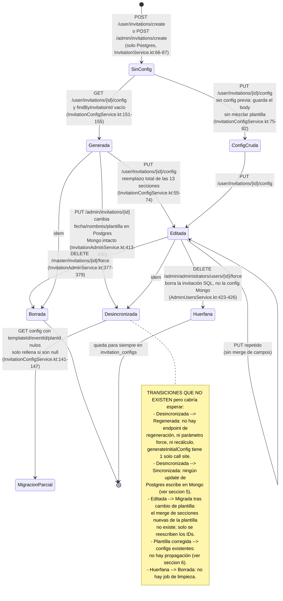

# C3 — Regeneración y ciclo de vida de la config

> Convención de rutas: todas las rutas son relativas a la raíz del repo. `<K>` =
> `src/main/kotlin/mx/evolutiondev/invitaciones`.

## 1. Resumen (≤10 líneas)

`generateInitialConfig` tiene **un único call site en todo el repositorio**
(`InvitationConfigService.kt:154`), alcanzable solo por `GET /user/invitations/{invitationId}/config`
y solo cuando no existe documento previo. La generación es por tanto **perezosa, única y
efectivamente irrepetible**: no existe endpoint de regeneración, ni `force`, ni recálculo. Eso
protege las ediciones del usuario (nunca se pierden por regeneración) pero congela la config:
**ningún `update` de Postgres se propaga a Mongo**. El caso grave es
`PUT /admin/invitations/{id}` (`InvitationAdminService.kt:385-433`), que **sí permite cambiar
`template_id`** y además borra/recrea todos los subcomponentes de Postgres
(`InvitationPersistenceHelper.kt:31-49`) sin tocar `invitation_configs`: la invitación queda con
plantilla nueva en SQL y secciones visuales de la plantilla vieja en Mongo. No hay versionado de
ningún tipo (`version`, `templateVersion`, `updatedAt`: ninguno existe). El borrado duro de
invitación sí limpia Mongo, pero el borrado duro de **usuario** no: deja configs huérfanas
(`AdminUsersService.kt:423-426`). La concurrencia está resuelta con un `ReentrantLock` por
invitación que tiene una carrera real al liberarse, mitigada (no eliminada) por el índice único.

## 2. Call sites de generateInitialConfig

Búsqueda exhaustiva: `grep -rn "generateInitialConfig" src/main/kotlin` devuelve exactamente dos
líneas — la definición (`DefaultConfigGeneratorService.kt:36`) y **una sola invocación**
(`InvitationConfigService.kt:154`). Igualmente, `invitationConfigRepository` solo aparece en dos
clases: `InvitationConfigService` y `InvitationAdminService`.

| # | Endpoint (verbo ruta) | Cadena de llamadas | Condición para que se genere | ¿Sobrescribe config existente? | Evidencia |
|---|---|---|---|---|---|
| 1 | `GET /user/invitations/{invitationId}/config` | `<K>/modules/user/invitations/presentation/InvitationConfigController.kt:44-51` → `<K>/modules/user/invitations/service/InvitationConfigService.kt:112` → `InvitationConfigService.kt:154` → `<K>/modules/user/invitations/service/DefaultConfigGeneratorService.kt:36` | Todas a la vez: la invitación existe (`:113-114`); el usuario pasa `validateInvitationAccess` (`:116-118`); `invitation.isEnabled` (`:120-122`); `customer.isEnabled` (`:124-127`); `!customer.isBanned` (`:128-130`); y **`findByInvitationId` devuelve vacío** (`:136`, rama `else` de `:138`, entrada en `:151`) | **No.** La rama de generación es inalcanzable si el documento existe: `:138` corta antes | `InvitationConfigController.kt:11` (base path), `:44-51`; `InvitationConfigService.kt:112-165`; `SecurityConfig.kt:43` (`/user/**` → USER, ADMIN, MASTER) |

**Rutas verificadas que NO generan config** (relevante porque su ausencia es el hallazgo):

| Camino | Qué hace en su lugar | Evidencia |
|---|---|---|
| `POST /user/invitations/create` (creación de invitación) | Solo Postgres + email. Cero referencias a Mongo | `<K>/modules/user/invitations/service/InvitationService.kt:44-104`; `InvitationsController.kt:34-42` |
| `POST /admin/invitations/create` (alta por admin) | Idéntico: `saveNewSubComponents` + notificación | `<K>/modules/admin/invitations/service/InvitationAdminService.kt:121-194` |
| `PUT /admin/invitations/{id}` (actualización, incluido cambio de plantilla) | Reescribe Postgres y `syncInvitationSubComponents`; no toca `invitationConfigRepository` | `InvitationAdminService.kt:385-433` |
| `PUT /admin/invitations/{id}/mark-as-paid` | Solo `isPaid` | `InvitationAdminService.kt:107-118` |
| `PUT /admin/invitations/{id}/toggle-status` | Solo `isEnabled`/`deletedBy` | `InvitationAdminService.kt:453-475` |
| Activación de módulos extra | `ExtraModulesHandler` **no tiene ninguna dependencia de Mongo** (constructor `:10-19`, solo repos JPA) | `<K>/modules/user/invitations/service/ExtraModulesHandler.kt:1-19` |
| `GET /user/template/{invitationId}` | *Stub*: devuelve `UserInvitationTemplateConfigResponse(emptyMap())` con un `TODO` | `<K>/modules/user/template/service/UserTemplateService.kt:34-51` |
| `PUT /user/template/{invitationId}` | *Stub*: devuelve el request sin persistir nada (`TODO`) | `UserTemplateService.kt:53-70` |
| `POST /master/templates/complete` | Escribe `default_visual_configs` / `default_content_configs`, **no** `invitation_configs` | `<K>/modules/master/templates/service/MasterTemplatesService.kt:84-197` |
| `PUT /user/invitations/{invitationId}/config` | Si no hay config previa, **guarda el body del cliente tal cual** sin generar nada desde la plantilla | `InvitationConfigService.kt:75-82` |

No hay `@Scheduled`, `@EventListener` ni `ApplicationRunner` en el repositorio salvo
`MongoDataInitializer` (`grep -rn "@Scheduled\|CommandLineRunner\|@EventListener" src/main/kotlin`),
así que no existe ninguna vía asíncrona adicional de generación.

## 3. Diagrama de estados de la config

## 4. Idempotencia y escritura

**Perezosa, no ansiosa.** Ni `InvitationService.createInvitation`
(`InvitationService.kt:44-104`) ni `InvitationAdminService.createInvitationForUser`
(`InvitationAdminService.kt:121-194`) escriben en Mongo. La config nace en el primer
`GET .../config` (`InvitationConfigService.kt:151-155`). El KDoc que lo declara
(`InvitationConfigService.kt:94-95`, *"Implements lazy generation pattern"*) **coincide con el
código** — caso poco frecuente en este subsistema.

**Clave del documento.** El `_id` de `invitation_configs` es el `id: String?` autogenerado por
Mongo (`<K>/modules/user/invitations/model/editor/EditorModels.kt:14-15`), **no** el
`invitationId`. La clave de negocio es `invitationId`, declarada
`@Indexed(unique = true)` (`EditorModels.kt:17-18`).

**Materialización real del índice único.** `spring.data.mongodb.auto-index-creation` no aparece en
`src/main/resources/application.yml` (líneas 46-48 solo definen `uri`), ni en ningún otro sitio
(`grep -rn "auto-index-creation\|autoIndexCreation" src/main/resources src/main/kotlin` → vacío).
En Spring Boot 3.4.1 / Spring Data MongoDB 4.x (`build.gradle.kts:6`) el valor por defecto es
`false`, así que `@Indexed` es decorativo. El índice que realmente existe lo crea a mano
`MongoDataInitializer.ensureUniqueIndexes()`
(`<K>/core/data/MongoDataInitializer.kt:65-72`), invocado desde `run()` (`:32`).

**Método de escritura.** Siempre `MongoRepository.save(...)`
(`InvitationConfigService.kt:84`, `:147`, `:155`), nunca `insert`. Semántica de `save`: si `id`
es `null` inserta; si no, reemplaza el documento con ese `_id`.

**Idempotencia.** Llamar dos veces a `getConfig` para la misma invitación **no** crea dos
documentos: la segunda llamada entra por `existingConfig.isPresent` (`:138`) y devuelve el
existente. Si por carrera dos hilos llegan a la vez a `:155`, el segundo `save` viola el índice
único de `invitationId` y lanza; el `catch (e: Exception)` de `:158` registra el error y
**recupera el documento ganador** con `findByInvitationId` (`:160-163`). El resultado neto es
correcto siempre que el índice único exista de verdad (ver hallazgo 8).

**Verificado que `mergeConfiguration` no arrastra un `_id` heredado.** `mergeConfiguration`
devuelve `visualTemplate.copy(...)` (`DefaultConfigGeneratorService.kt:98-179`) sin resetear `id`
a `null`, es decir hereda el `id` del `InvitationConfig` anidado dentro de
`DefaultVisualConfig.config` (`<K>/modules/user/invitations/model/defaults/DefaultVisualConfig.kt:30`).
Comprobé los 9 JSON semilla de `src/main/resources/data/mongo/default_visual_*.json`: ninguno
contiene `id` ni `_id` dentro de `config`, así que en la práctica el `id` heredado es `null` y el
`save` inserta. Es una dependencia frágil, no un fallo actual (hallazgo 6).

## 5. Propagación de cambios Postgres → Mongo

**Resultado global: no hay ninguna propagación Postgres → Mongo. Ni total, ni parcial.** La única
sincronización que existe va en dirección contraria (Mongo → Postgres) y cubre exclusivamente los
títulos y el primer mensaje de la mesa de regalos física.

| Operación de update en Postgres | ¿Toca la config Mongo? | Sección afectada | Evidencia |
|---|---|---|---|
| `PUT /admin/invitations/{id}` → `updateInvitation`: `template`, `date`, `time`, `childrenAllowed`, `youngAllowed`, `hashtag`, `coverPhotoUrl`, `hasMusic`, `hasGallery`, `extraModulesIncluded`, `totalAmount`, `allEventsSameLocation` | **No** | Ninguna. Quedan obsoletas `sectionCover`, `sectionEvent`, `sectionCouple`, `settings`, y las secciones condicionadas a módulos extra | `<K>/modules/admin/invitations/service/InvitationAdminService.kt:413-426`; `save` en `:428`; el servicio inyecta `invitationConfigRepository` (`:46`) pero solo lo usa en `:377-379` |
| Misma llamada → `syncInvitationSubComponents`: borra y recrea personas, frases, itinerario, galería, música, mesa de regalos, recomendaciones, historia, actividades, padres, padrinos y dress code | **No** | Todas las secciones de contenido de la config quedan apuntando a datos que ya no existen en Postgres | `InvitationAdminService.kt:430` → `<K>/modules/shared/invitations/service/InvitationPersistenceHelper.kt:31-49` (12 `deleteAllInBatchByInvitationId` seguidos de `saveNewSubComponents` en `:48`) |
| `PUT /admin/invitations/{id}/mark-as-paid` | **No** | — | `InvitationAdminService.kt:107-118` |
| `PUT /admin/invitations/{id}/toggle-status` | **No** | — (pero `getConfig` bloquea la lectura con `InvitationDisabledException`, `InvitationConfigService.kt:120-122`) | `InvitationAdminService.kt:453-475` |
| `PUT /user/template/file/{invitationId}/upload` → `isFinished = true` | **No** | — | `<K>/modules/user/template/service/UserTemplateService.kt:101-103` |
| `AdminUsersService`: deshabilitar usuario y sus invitaciones (`isEnabled = false`) | **No** (la clase ni siquiera importa nada de Mongo: `grep -n "Mongo\|Config"` sobre el archivo → vacío) | — | `<K>/modules/admin/users/service/AdminUsersService.kt:301`, `:306-309` |
| `POST /user/invitations/{id}/assets/upload` (subida de imagen a S3) | **No** | La URL devuelta debe insertarla el cliente vía `PUT .../config`; el backend no la escribe | `<K>/modules/user/invitations/presentation/InvitationAssetsController.kt:41-80` |
| **Dirección inversa**: `PUT /user/invitations/{id}/config` → `syncGiftRegistryTitles` | Mongo → **Postgres** | Solo `invitation_gift_registry.title` y `.message`, y solo si `type == "physical"` o `"fisico"` | `InvitationConfigService.kt:87`, `:176-211` (filtro de tipo en `:190`) |

Observación adicional sobre esa única sincronización: empareja
`sectionGiftTable.items[i]` con `existingGiftRegistry[i]` **por posición**
(`InvitationConfigService.kt:186-188`), y `findAllByInvitationId`
(`<K>/modules/admin/invitations/repository/InvitationRepository.kt:93`) no declara ningún
`OrderBy`. El emparejamiento depende del orden que devuelva Postgres sin `ORDER BY`.

Consecuencia práctica del conjunto: un usuario **no puede** cambiar sus propios datos de invitación
después de crearla. Los endpoints `/user/**` mutantes son solo invitados, assets, perfil y la
config (`grep -rn "PutMapping\|PatchMapping\|PostMapping" <K>/modules/user/`). El único camino para
corregir fecha, nombres o lugar es `PUT /admin/invitations/{id}`, restringido a ADMIN y MASTER
(`<K>/core/auth/security/SecurityConfig.kt:42`), y ese camino no propaga a Mongo. Es decir: en el
flujo normal, los datos de Postgres los edita el admin y los datos que ve el invitado salen de
Mongo, y ambos divergen desde el primer cambio.

## 6. Cambio de plantilla y versionado

**Sí se puede cambiar la plantilla, y solo desde admin.**
`InvitationAdminService.updateInvitation` resuelve el template pedido
(`InvitationAdminService.kt:398-401`), lo valida con
`validateEnabledComponents`, y lo asigna: `invitation.template = template`
(`InvitationAdminService.kt:413`). `InvitationEntity.template` es `var`
(`<K>/modules/admin/invitations/repository/model/InvitationEntity.kt:21-23`), o sea el campo es
mutable a nivel de mapeo JPA. El endpoint es `PUT /admin/invitations/{id}`
(`<K>/modules/admin/invitations/presentation/InvitationController.kt:110-125`), reservado a
ADMIN/MASTER (`SecurityConfig.kt:42`). **No existe ningún endpoint de usuario** para cambiar
plantilla, y `InvitationValidationService` (`<K>/modules/shared/invitations/service/InvitationValidationService.kt:17-31`)
solo comprueba que la plantilla destino esté habilitada: **no impide cambiar de tipo de evento ni
de plan**, así que una invitación de boda puede pasar a apuntar a una plantilla de bautizo.

Qué pasa con la config ya generada tras ese cambio:

1. El documento de `invitation_configs` no se toca en ningún punto de `updateInvitation`.
2. En el siguiente `GET .../config`, la "lazy migration" de
   `InvitationConfigService.kt:141-147` **solo actúa si `templateId`, `eventId` o `planId` son
   `null`**. Tras una generación normal nunca lo son (`DefaultConfigGeneratorService.kt:83-87` los
   rellena siempre), así que la config sigue devolviendo el `templateId` **antiguo**.
3. En cambio, en el siguiente `PUT .../config`, `saveOrUpdateConfig` **sí** reescribe
   incondicionalmente `templateId`, `eventId` y `planId` con los de la plantilla actual
   (`InvitationConfigService.kt:71-73`) mientras conserva las secciones visuales de la plantilla
   vieja. Resultado: un documento que dice pertenecer a la plantilla nueva y contiene el diseño de
   la vieja. Las dos rutas de lectura/escritura se contradicen entre sí.
4. El contenido editado por el usuario se conserva íntegro, pero puede quedar inconsistente con la
   nueva plantilla (secciones que la plantilla nueva no define, o secciones que define y la config
   no tiene, quedan `null` para siempre porque nada las rellena).

**Versionado: no existe, en ninguna forma.**
`grep -rn "version|updatedAt|createdAt|@Version|LastModified"` sobre `EditorModels.kt`,
`DefaultVisualConfig.kt` y `DefaultContentConfig.kt` devuelve **cero coincidencias**. Ni
`@Version` (bloqueo optimista), ni `@CreatedDate`/`@LastModifiedDate`, ni histórico, ni campo
`templateVersion`. Los campos completos de `InvitationConfig` son 17 y están en
`EditorModels.kt:13-39`.

**Qué pasa si se corrige una plantilla en `default_visual_configs`:**

- Las invitaciones que ya tienen documento en `invitation_configs` quedan **congeladas**. La
  config es una copia completa por valor hecha en el instante de la generación
  (`DefaultConfigGeneratorService.kt:98` copia el `visualTemplate` entero) y `getConfig` nunca
  vuelve a consultar `default_visual_configs`.
- Las invitaciones que aún no han abierto el editor **sí** se benefician: su primera generación
  leerá la plantilla ya corregida (`DefaultConfigGeneratorService.kt:47-55`).
- El "estado mixto" real no viene de corregir la plantilla, sino del punto 3 de arriba: `templateId`
  reescrito sobre secciones antiguas.
- Además, **no hay ningún endpoint que actualice el `default_visual_configs` de una plantilla
  existente**: `MasterTemplatesService.updateTemplate`
  (`<K>/modules/master/templates/service/MasterTemplatesService.kt:246-275`) solo toca Postgres, y
  `createCompleteTemplate` (`:84-197`) solo inserta plantillas nuevas. El único mecanismo de
  corrección en producción es reiniciar la aplicación para que `MongoDataInitializer` reescriba los
  8 JSON hardcodeados (`MongoDataInitializer.kt:34-46`, upsert en `:83-90`). Corregir una plantilla
  creada por API requiere tocar Mongo a mano.

## 7. Borrado y huérfanos

Existen **dos** caminos de borrado físico de invitación y solo uno limpia Mongo.

| Camino | Endpoint | ¿Borra `invitation_configs`? | Evidencia |
|---|---|---|---|
| Borrado duro de invitación | `DELETE /master/invitations/{id}/force` (rol MASTER, `SecurityConfig.kt:44`) | **Sí** | `<K>/modules/admin/users/presentation/MasterController.kt:31` (base `/master`), `:146-153` → `InvitationAdminService.hardDeleteInvitation` `:366-383`, borrado explícito en `:377-379` |
| Borrado duro de usuario | `DELETE /admin/administrators/users/{id}/force` (rol MASTER, `SecurityConfig.kt:41`) | **No** | `<K>/modules/admin/users/presentation/AdminMasterUsersController.kt:21` (base), `:76-85` → `AdminUsersService.hardDeleteUser` `:404-434`; itera las invitaciones propias y llama `hardDeleteById` en `:426` sin tocar Mongo. La clase no importa nada de Mongo |

Sobre la cascada de V9: `src/main/resources/db/migration/V9__add_cascade_delete_to_invitation_relations.sql`
solo redefine claves foráneas de PostgreSQL (14 tablas, líneas 6-86). MongoDB no participa; la
limpieza tiene que ser explícita en código y solo lo es en un sitio. El propio código lo reconoce a
medias: el comentario de `InvitationAdminService.kt:376` califica el borrado de la config de
*"(Opcional pero recomendado) ... para no dejar basura"*, describiendo como opcional lo que es la
única barrera contra huérfanos.

Nota adicional: `InvitationEntity` lleva `@SQLDelete` que convierte `delete` en un soft delete
(`InvitationEntity.kt:15`), y `hardDeleteById` es una query nativa que lo esquiva
(`InvitationRepository.kt:41-43`). El *soft delete* (`toggleInvitationStatus`,
`InvitationAdminService.kt:453-475`) deja la config intacta, lo cual es correcto: es reversible.

**Huérfanos que quedan:** todo documento de `invitation_configs` cuya invitación se eliminó junto a
su usuario. No hay ningún job de limpieza (`grep -rn "@Scheduled" src/main/kotlin` → vacío). El
volumen real depende del estado de la BD y no lo puedo determinar desde el código.

## 8. Concurrencia

Sí hay lock, y es el punto más cuidado del archivo — con una carrera residual.

`InvitationConfigService` mantiene `ConcurrentHashMap<Long, ReentrantLock>`
(`InvitationConfigService.kt:32`). `getConfig` toma el lock por `invitationId`
(`:132-134`), hace comprobar-y-generar dentro
(`:136-165`) y lo suelta en `finally` (`:166-172`).

Tres limitaciones verificadas:

1. **Carrera al retirar el lock del mapa.** En el `finally` se hace `unlock()` (`:167`) y después
   se comprueba `hasQueuedThreads()` (`:169`) para retirar la entrada (`:170`). Entre el `unlock` y
   el `remove`, un hilo B puede haber obtenido *ese mismo* lock por `computeIfAbsent` y estar ya
   dentro de la sección crítica; el `remove(invitationId, lock)` de A tiene éxito igualmente
   (mismo objeto), y un hilo C posterior crea un `ReentrantLock` **nuevo** y entra en paralelo con
   B. `hasQueuedThreads()` no ve a B porque B ya no está encolado, está ejecutando.
2. **El lock es local a la JVM.** Es un campo de instancia del bean; con más de una réplica del
   backend no hay exclusión ninguna.
3. **La red de seguridad real es el índice único de `invitationId`**, y ese índice se crea en un
   `try/catch` que se traga la excepción sin registrar nada (`MongoDataInitializer.kt:66-71`, el
   `catch (e: Exception) {}` de `:71` está vacío). Si la colección ya tiene duplicados o el arranque
   falla, `ensureIndex` no crea el índice, nadie se entera, y las dos limitaciones anteriores dejan
   de estar mitigadas.

Cuando el índice sí existe, el resultado degrada correctamente: el segundo `save` lanza,
`catch` en `:158` lo registra y `:160-163` devuelve el documento que ganó. Eso es un patrón
defensivo bien planteado.

Punto aparte: `@Transactional` en `getConfig` (`:111`) y en `saveOrUpdateConfig` (`:44`) **no cubre
Mongo**. No hay ningún `MongoTransactionManager` ni `@EnableTransactionManagement` en el
repositorio (`grep -rn "MongoTransactionManager\|PlatformTransactionManager\|TransactionManager" src/main/kotlin`
→ vacío), así que el único gestor es el de JPA autoconfigurado. Si `syncGiftRegistryTitles` falla
(`:87`), la escritura en Mongo de `:84` **ya está hecha y no se revierte**.

## 9. Hallazgos

1. **Un solo cambio de plantilla en Postgres deja la invitación en estado mixto permanente.**
   `PUT /admin/invitations/{id}` reasigna `invitation.template`
   (`<K>/modules/admin/invitations/service/InvitationAdminService.kt:413`) sin tocar
   `invitation_configs`. El siguiente `PUT .../config` reescribe `templateId`/`eventId`/`planId`
   al valor nuevo (`<K>/modules/user/invitations/service/InvitationConfigService.kt:71-73`)
   conservando el diseño de la plantilla anterior; el `GET` en cambio deja el `templateId` viejo
   porque la migración perezosa solo rellena nulos
   (`InvitationConfigService.kt:141`). Las dos rutas se contradicen.
   Estado: **VERIFICADO** (el código); el aspecto visual resultante es **INFERIDO**.

2. **`PUT /admin/invitations/{id}` destruye la correspondencia entre la config y los datos.**
   `syncInvitationSubComponents` borra en bloque las 12 tablas de subcomponentes y las recrea con
   IDs nuevos (`<K>/modules/shared/invitations/service/InvitationPersistenceHelper.kt:35-48`),
   mientras la config Mongo conserva los nombres, fechas y mesa de regalos anteriores. No hay
   ninguna llamada a Mongo en toda la ruta (`InvitationAdminService.kt:385-433`).
   Estado: **VERIFICADO**.

3. **`InvitationConfig.id` viaja en el body del PUT y no está protegido.** El campo `@Id id` no
   lleva `@JsonIgnore` (`<K>/modules/user/invitations/model/editor/EditorModels.kt:14-15`; el
   import de `JsonIgnore` está en `:4` pero se aplica en otra parte). En la rama sin config previa,
   `saveOrUpdateConfig` hace `configRequest.copy(invitationId = ..., ...)`
   (`InvitationConfigService.kt:76-81`) sin anular `id`, y `save` (`:84`) con un `_id` no nulo
   reemplaza ese documento. Un usuario que envíe el `_id` de la config de **otra** invitación
   sobreescribe la config ajena (y la deja sin documento asociado a su `invitationId`).
   La rama con config previa sí es segura porque parte de `currentConfig.copy(...)` (`:57`).
   Estado: **VERIFICADO** a nivel de código; el efecto en Mongo (`save` con `_id` = reemplazo) es
   **INFERIDO** de la semántica de `MongoRepository.save`, no ejecutado.

4. **El borrado duro de usuario deja configs huérfanas en Mongo.**
   `AdminUsersService.hardDeleteUser` elimina físicamente cada invitación propia
   (`<K>/modules/admin/users/service/AdminUsersService.kt:423-426`) y no borra
   `invitation_configs`; la clase no tiene ninguna dependencia de Mongo. El camino hermano
   `InvitationAdminService.hardDeleteInvitation:377-379` sí lo hace, lo que confirma que es un
   olvido y no una decisión. No hay job de limpieza.
   Estado: **VERIFICADO** (la ausencia del borrado); el volumen de huérfanos existentes es
   **NO DETERMINABLE** sin la BD.

5. **El índice único que sostiene toda la idempotencia se crea en un `catch` vacío.**
   `MongoDataInitializer.ensureUniqueIndexes()` envuelve el `ensureIndex` en
   `catch (e: Exception) {}` sin log (`<K>/core/data/MongoDataInitializer.kt:66-71`), y el
   `@Indexed(unique = true)` de `EditorModels.kt:17` es inerte porque
   `spring.data.mongodb.auto-index-creation` no está activado en
   `src/main/resources/application.yml:46-48` (por defecto `false` en Spring Boot 3.4.1,
   `build.gradle.kts:6`). Si el índice no llega a crearse, nada lo indica y la protección contra
   generación duplicada desaparece.
   Estado: **VERIFICADO** (código y ausencia de la propiedad); el comportamiento por defecto del
   framework es **INFERIDO** de su documentación, no ejecutado aquí.

6. **`mergeConfiguration` hereda el `_id` de la plantilla visual.**
   Devuelve `visualTemplate.copy(...)` sin poner `id = null`
   (`<K>/modules/user/invitations/service/DefaultConfigGeneratorService.kt:98-179`). Hoy es inocuo:
   comprobé los 9 ficheros `src/main/resources/data/mongo/default_visual_*.json` y ninguno tiene
   `id`/`_id` dentro de `config`. Pero `createCompleteTemplate` construye el `InvitationConfig`
   desde un `Map` del cliente sin filtrar la clave `id`
   (`<K>/modules/master/templates/service/MasterTemplatesService.kt:116-136`): una plantilla creada
   por API con un `"id"` en el payload haría que **todas** las invitaciones generadas desde ella
   compartieran el mismo `_id` y se pisaran entre sí.
   Estado: **VERIFICADO** (que el `id` no se anula y que el payload no lo filtra); la explotación
   es **INFERIDA**.

7. **La única sincronización que existe empareja por posición sin `ORDER BY`.**
   `syncGiftRegistryTitles` casa `sectionGiftTable.items[index]` con `existingGiftRegistry[index]`
   (`InvitationConfigService.kt:186-188`) sobre el resultado de
   `findAllByInvitationId` (`<K>/modules/admin/invitations/repository/InvitationRepository.kt:93`),
   que no declara orden. Si el orden difiere, el título de un regalo se escribe sobre otro.
   Estado: **VERIFICADO** (código y ausencia de `OrderBy`); la probabilidad de desorden real es
   **NO DETERMINABLE** sin la BD.

8. **`@Transactional` sobre un método `private` invocado desde la propia clase: doble no-op.**
   `syncGiftRegistryTitles` está anotado `@Transactional` y declarado `private`
   (`InvitationConfigService.kt:175-176`), y se llama por auto-invocación desde `:87`. Spring AOP
   no puede interceptar ninguno de los dos casos, así que la anotación no hace nada. Los `save`
   individuales de `:196` y `:205` se confirman uno a uno.
   Estado: **VERIFICADO**.

9. **Los `@Transactional` de `InvitationConfigService` no cubren las escrituras de Mongo.**
   No existe `MongoTransactionManager` en el repositorio, luego el gestor activo es el de JPA. La
   escritura en `invitation_configs` de `:84` no se revierte si falla lo que viene después
   (`:87`). Lo mismo aplica al par generar-guardar de `:154-155`.
   Estado: **VERIFICADO** (ausencia del bean); el comportamiento transaccional resultante es
   **INFERIDO**.

10. **Carrera al retirar el lock por invitación.** Entre `unlock()` (`:167`) y
    `locks.remove(invitationId, lock)` (`:170`) otro hilo puede haber adquirido ya ese mismo lock,
    de modo que `hasQueuedThreads()` (`:169`) devuelve `false` y un tercer hilo obtiene un
    `ReentrantLock` distinto y entra en paralelo. Además el lock es por JVM, no distribuido.
    Estado: **VERIFICADO** (la secuencia del código); la materialización de la carrera es
    **INFERIDA**.

11. **`PUT .../config` sin config previa se salta la plantilla por completo.** Si el frontend hace
    `PUT` antes que `GET`, se persiste el body tal cual con los IDs corregidos
    (`InvitationConfigService.kt:75-82`), sin pasar nunca por `generateInitialConfig`. La
    invitación tendrá una config que jamás vio `default_visual_configs` ni `default_content_configs`.
    Estado: **VERIFICADO**.

12. **`saveOrUpdateConfig` es reemplazo total, no merge.** Copia las 13 secciones y `settings`
    desde el request (`InvitationConfigService.kt:57-74`); un `PUT` que omita una sección la deja a
    `null` y esa sección desaparece definitivamente, porque nada la puede regenerar
    (ver hallazgo 13).
    Estado: **VERIFICADO**.

13. **No existe camino de regeneración.** `generateInitialConfig` tiene un único call site
    (`InvitationConfigService.kt:154`) protegido por `if (existingConfig.isPresent)` (`:138`). No
    hay parámetro `force`, ni endpoint de reset, ni acción de admin. Una config corrupta o vaciada
    solo se recupera borrando el documento a mano en Mongo.
    Estado: **VERIFICADO**.

14. **Dos endpoints de plantilla de usuario son *stubs* que fingen funcionar.**
    `GET /user/template/{invitationId}` devuelve `emptyMap()` bajo un `TODO`
    (`<K>/modules/user/template/service/UserTemplateService.kt:45-50`) y
    `PUT /user/template/{invitationId}` devuelve el request recibido sin persistir nada
    (`:65-69`). Ambos responden 200. Un cliente que use esta pareja creerá haber guardado su
    configuración y no habrá guardado nada.
    Estado: **VERIFICADO**.

15. **El comentario contradice la criticidad del código.** `InvitationAdminService.kt:376` describe
    el borrado de la config Mongo como *"(Opcional pero recomendado) Eliminar la configuración de
    Mongo para no dejar basura"*, cuando es el único mecanismo que evita huérfanos y su ausencia en
    el camino hermano (hallazgo 4) es precisamente un bug.
    Estado: **VERIFICADO**.

16. **Import muerto que sugiere una ruta de error que no existe.**
    `InvitationConfigNotFoundException` se importa en `InvitationConfigService.kt:11` y nunca se
    lanza en el archivo; tiene incluso su `@ExceptionHandler` con 404
    (`<K>/core/error/GeneralExceptionHandler.kt:175-185`) que nunca se dispara desde aquí. El fallo
    real de `getConfig` sale como `IllegalStateException` (`InvitationConfigService.kt:162`).
    Estado: **VERIFICADO**.

17. **Cambiar de plantilla no valida compatibilidad de tipo de evento ni de plan.**
    `validateEnabledComponents` solo comprueba `isEnabled` de plantilla, evento y plan
    (`<K>/modules/shared/invitations/service/InvitationValidationService.kt:17-31`), y
    `validateExtraModulesRules` está **vacía**, con un comentario que dice que la validación "ahora
    es opcional" (`:59-62`). Nada impide mover una invitación de boda premium a una plantilla de
    bautizo básico.
    Estado: **VERIFICADO**.

## 10. Lo que está bien resuelto

- **La guarda anti-duplicado de la generación perezosa.** `if (existingConfig.isPresent)`
  (`InvitationConfigService.kt:138`) más el `catch` que releé el documento ganador
  (`:158-163`) es el patrón correcto: el lock optimiza el caso común y el índice único es la
  garantía real. Con el índice presente, este bloque es correcto incluso con varias réplicas.
  **No tocar la estructura de este `try/catch`.**
- **El uso de `ReentrantLock` por invitación en lugar de `synchronized` global**
  (`InvitationConfigService.kt:32`, `:132`) es la elección adecuada: no serializa el editor entero
  por un solo cliente lento.
- **El intento de retirar entradas del mapa de locks** (`:169-170`) demuestra que se pensó en la
  fuga de memoria; la idea es correcta aunque la condición sea insuficiente (hallazgo 10).
- **`hardDeleteInvitation` sí limpia Mongo** (`InvitationAdminService.kt:377-379`). Es el modelo a
  replicar en `hardDeleteUser`, no algo a cambiar.
- **La validación de acceso previa a cualquier operación de config** es completa y consistente
  entre `getConfig` y `saveOrUpdateConfig`: existencia (`:113`/`:46`), jerarquía (`:116`/`:49`) y,
  en lectura, estado de invitación y de cliente (`:120-130`). Esa capa está bien.
- **La migración perezosa de `templateId`/`eventId`/`planId`** (`:141-147`) es un mecanismo
  razonable para documentos anteriores a la introducción de esos campos; el problema es solo que se
  reutilizó donde hacía falta una resincronización real (hallazgo 1).
- **El KDoc de `getConfig` describe fielmente el comportamiento** (`:92-110`): declara la
  generación perezosa y las tres excepciones de estado, y las tres están implementadas
  (`:120-130`). Es documentación fiable.
- **La `@SQLDelete` + `hardDeleteById` nativa** (`InvitationEntity.kt:15`,
  `InvitationRepository.kt:41-43`) separa limpiamente borrado lógico y físico, y el borrado lógico
  conserva la config para poder reactivar.

## 11. Preguntas que no pude responder y por qué

- **Cuántas configs huérfanas y cuántos duplicados de `invitationId` existen realmente.** Depende
  del estado de la instancia de MongoDB. Solo puedo afirmar que el código permite ambos
  (hallazgos 4 y 5) y que el `catch` vacío de `MongoDataInitializer.kt:71` impide saber si el
  índice único llegó a crearse: no hay log ni en el éxito ni en el fallo.
- **Si el índice único de `invitation_configs.invitationId` está activo en producción.**
  Requiere `db.invitation_configs.getIndexes()`. El código lo intenta en cada arranque
  (`MongoDataInitializer.kt:32`, `:65-72`) pero el resultado se descarta.
- **Si algún cliente llega a enviar `id` en el body del `PUT .../config`.** El backend lo acepta
  (hallazgo 3) pero no hay frontend en este repositorio para comprobar si se envía; el riesgo es de
  superficie de ataque, no necesariamente de fallo activo.
- **Si el frontend llama `GET` antes que `PUT`.** De ello depende que el hallazgo 11 sea teórico o
  frecuente. No hay código de cliente ni contrato de API en el repositorio.
- **El comportamiento exacto de las secciones al cambiar de plantilla** (qué ve el invitado con
  `templateId` nuevo y secciones viejas) depende del renderizador del frontend, fuera de este
  repositorio.
- **Cuáles de los 2743 renglones restantes de `DefaultConfigGeneratorService` podrían tener efectos
  secundarios de escritura.** Verifiqué por `grep` que el fichero **no** referencia
  `invitationConfigRepository` en ninguna línea, así que no escribe en `invitation_configs`; el
  detalle del merge por sección corresponde a C1 y C2 según el reparto.
