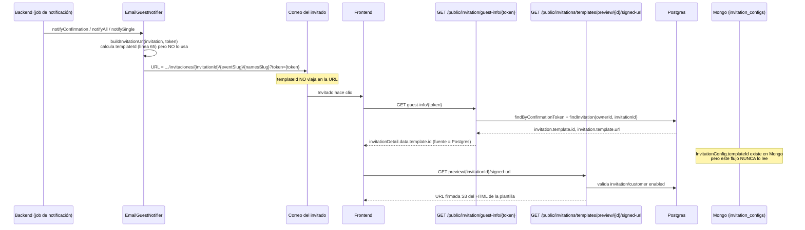

# D — Consumo, edición y exposición

## 1. Resumen (≤10 líneas)

El editor guarda y lee el `InvitationConfig` **completo** (no hay delta/PATCH) vía `PUT/GET /user/invitations/{invitationId}/config`, sin ninguna anotación de Bean Validation (`@Valid` ausente, cero `@field:*` en `EditorModels.kt`). `invitationId` y `templateId/eventId/planId` **no pueden** ser sobrescritos por el body en ninguna rama del código (siempre se toman del path/Postgres), pero el campo `id` (`_id` de Mongo) **sí viaja intacto desde el body cuando el documento de configuración aún no existe** (`InvitationConfigService.kt:76-82`), lo que permite en teoría un upsert por `_id` ajeno si el atacante conoce/adivina el ObjectId de otra invitación. `EmailGuestNotifier.buildInvitationUrl` calcula `templateId` (línea 65) pero **nunca lo incluye en la URL** enviada por correo (línea 68) — contradice la premisa del brief; además ignora el parámetro `frontendUrl` inyectado y usa un dominio hardcodeado, con la línea "correcta" comentada justo debajo. El `templateId` que sí llega al front en el flujo público de RSVP viene de Postgres (`invitation.template.id`) vía `InvitationService.findInvitation`, expuesto en `PublicGuestInfoController` e `InviteAttendingController` — nunca del `InvitationConfig` de Mongo. `UserTemplateController`/`UserTemplateService` (endpoint `/user/template/{invitationId}`) es código muerto: lee y "actualiza" pero no toca Mongo (TODOs explícitos). `PublicInvitationTemplateController` (bajo `/public/**`, sin token) filtra correctamente por `isEnabled` en tres niveles. Hay una excepción declarada e importada (`InvitationConfigNotFoundException`, con handler 404 registrado) que **nunca se lanza** en ningún flujo real — código muerto. El camino de error para plantilla-default-no-encontrada tiene un handler 500 dedicado que en la práctica nunca se ejecuta porque `InvitationConfigService.getConfig` atrapa la excepción y relanza un `IllegalStateException` sin handler registrado (cae al 500 genérico de Spring). No existe `src/test` ni ningún otro rastro de pruebas; `build.gradle.kts` declara 5 dependencias `testImplementation`/`testRuntimeOnly` que no tienen ningún archivo de test que las use.

## 2. Tabla de endpoints

| Verbo | Ruta completa | Controlador:línea | Request | Response | Auth (rol / público / propiedad) | Evidencia de auth | Qué toca (Postgres/Mongo/S3) |
|---|---|---|---|---|---|---|---|
| GET | `/user/invitations/{invitationId}/config` | `InvitationConfigController.kt:44-52` | — | `InvitationConfig` | rol USER/ADMIN/MASTER + propiedad vía `HierarchyValidationService.validateInvitationAccess` | `SecurityConfig.kt:43` (`/user/**` → hasAnyRole); `InvitationConfigService.kt:116-118` | Postgres (lee `InvitationEntity`, `customer`), Mongo (`invitation_configs`, lee o genera) |
| PUT | `/user/invitations/{invitationId}/config` | `InvitationConfigController.kt:25-34` | `InvitationConfig` (body completo, sin `@Valid`) | `InvitationConfig` | igual que arriba | `InvitationConfigService.kt:49-51` | Postgres (lee `InvitationEntity`; escribe `InvitationGiftRegistryEntity.title/message` vía `syncGiftRegistryTitles`), Mongo (upsert `invitation_configs`) |
| POST | `/user/invitations/{invitationId}/assets/upload` | `InvitationAssetsController.kt:41-80` | `multipart/form-data` (`sectionPath`, `file`) | `AssetUploadResponse{url,key}` | rol USER/ADMIN/MASTER + propiedad vía `InvitationAccessValidationService` | `InvitationAssetsController.kt:51` | S3 (`S3Buckets.ASSETS`, sube imagen optimizada); no toca `InvitationConfig` directamente (la URL resultante la inserta el frontend en el JSON al hacer el siguiente `PUT .../config`) |
| DELETE | `/user/invitations/{invitationId}/assets/delete` | `InvitationAssetsController.kt:90-119` | `AssetDeleteRequest{assetUrl}` | `GeneralMessageResponse` | rol + propiedad de la invitación **y** propiedad del archivo (compara `keyUserId` del key S3 contra el usuario, o jerarquía) | `InvitationAssetsController.kt:99,105-108` | S3 (borra objeto) |
| GET | `/user/template/{invitationId}` | `UserTemplateController.kt:19-28` | — | `UserInvitationTemplateConfigResponse` | rol + propiedad | `UserTemplateService.kt:41-43` | Postgres (solo valida existencia/acceso); **no lee Mongo** — devuelve siempre `emptyMap()` (TODO sin implementar, línea 45-50) |
| PUT | `/user/template/{invitationId}` | `UserTemplateController.kt:41-52` | `UserInvitationTemplateConfigRequest{sections}` | `UserInvitationTemplateConfigResponse` (eco del request) | rol + propiedad | `UserTemplateService.kt:61-63` | Ninguno real — TODO sin implementar (línea 65-69); no persiste nada |
| PUT | `/user/template/file/{invitationId}/upload` | `UserTemplateController.kt:30-39` | `multipart/form-data` (`file`, debe ser `text/html`) | `{"url": ...}` | rol + propiedad | `UserTemplateService.kt:80-82` | S3 (sube HTML a key fija `user/{ownerId}/invitation/{invitationId}/invitation-{invitationId}-template.html`); Postgres (`invitation.isFinished=true`, `updatedBy`) |
| GET | `/user/template/preview/{invitationId}/signed-url` | `UserTemplateController.kt:54-62` | — | `{"url": ...}` (URL firmada S3, 7 días) | rol + propiedad | `UserTemplateService.kt:112-114` | S3 (presigned GET), Postgres (lectura) |
| GET | `/public/invitations/templates` | `PublicInvitationTemplateController.kt:16-23` | query `eventId?`, `planId?` | `List<InvitationTemplateResponse>` | **público, sin token** | `SecurityConfig.kt:38` (`/public/**` permitAll) | Postgres (`InvitationTemplateEntity` vía `MasterTemplatesService.listAllFiltered`) |
| GET | `/public/invitations/templates/preview/{invitationId}/signed-url` | `PublicInvitationTemplateController.kt:33-40` | — | `{"url": ...}` | **público, sin token** | `SecurityConfig.kt:38` | S3 (presigned GET vía `UserTemplateService.generatePublicSignedUrl`), Postgres (valida invitación/dueño habilitados) |
| POST/GET/PUT/DELETE/PATCH | `/master/templates`, `/master/templates/complete`, `/master/templates/{id}` (×3), `/master/templates/{id}/activate` | `MasterTemplatesController.kt:26-108` | ver modelos `InvitationTemplateRequest`/`CompleteTemplateRequest`/`UpdateTemplateRequest` (todos `@Valid`) | `InvitationTemplateResponse`/`CompleteTemplateResponse`/`InvitationTemplateEntity`/`PaginatedResponse<...>`/`GeneralMessageResponse` | **solo rol MASTER** | `SecurityConfig.kt:44` (`/master/**` → hasRole("MASTER")) | Postgres + Mongo (ciclo de alta auditado por otro sub-agente) |
| GET | `/public/invitation/guest-info/{token}` | `PublicGuestInfoController.kt:58-106` | path `token` | `GuestInfoResponse` (incluye `invitationDetail: InvitationDetailResponse?`) | **público, sin token JWT** — la autorización es el `confirmationToken` en sí | `SecurityConfig.kt:38`; internamente llama `invitationService.findInvitation(userId = invitation.customer.id, ...)` (línea 77), es decir se autoriza a sí mismo pasando el `userId` del dueño | Postgres (guest, invitation, template.id/url) |
| PUT | `/public/invitation/{confirmationToken}/attend` | `InviteAttendingController.kt:20-42` | `ConfirmAttendanceRequest` | `AttendanceConfirmationResponse` (incluye `invitationDetail`) | público, autorizado por el token de confirmación | igual patrón que arriba (línea 33-36) | Postgres (guest, invitation) |
| PUT | `/public/invitation/cancel/{cancellationToken}` | `InviteAttendingController.kt:44-50` | — | `GeneralMessageResponse` | público, autorizado por token de cancelación | `GuestAttendanceService.kt:63-73` | Postgres |
| GET×6 | `/public/invitations/dress-code/predefined`, `/event-type`, `/plan`, `/gift-registry/predefined-data`, `/music/recommendations`, `/phrases/configuration`, `/extra-modules` | `PublicInvitationInfoController.kt:33-117` | varios query params | catálogos (`DressCodeResponseDto`, `ServiceType`, `Plan`, etc.) | público | `SecurityConfig.kt:38` | Solo Postgres (catálogos maestros); no tocan `InvitationConfig` |

Notas sobre `InvitationsController.kt` (282 líneas, `/user/invitations/**`): no expone ni modifica `InvitationConfig` ni `templateId` directamente; `POST /user/invitations/create` sí exige `templateId` con `@field:NotNull` + `@field:Positive` (`CreateInvitationRequest.kt:11-13`), validado con `@Valid` (`InvitationsController.kt:38`). El resto de sus endpoints son de invitados/exportación, sin relación con la config del editor.

## 3. Edición de la config: delta vs completo, validación

Se guarda el **JSON completo** en cada `PUT` — no hay merge/patch parcial en el sentido semántico del dominio, aunque el propio `.copy()` de Kotlin actúa como merge estructural con el documento existente en Mongo (`InvitationConfigService.kt:55-82`). No hay `@Valid` en el controlador (`InvitationConfigController.kt:28`) ni una sola anotación de Bean Validation (`@field:NotNull`, `@field:Size`, etc.) en ninguna de las ~30 data classes de `EditorModels.kt`; solo hay `@JsonIgnoreProperties(ignoreUnknown = true)` (permite campos extra) y campos Kotlin no-nulos sin default (obligan a Jackson a rechazar el JSON si faltan, pero como `HttpMessageNotReadableException` genérica, no como error de validación de negocio). No hay límite de tamaño explícito a nivel de aplicación (ni `@Size` ni configuración de `spring.servlet.multipart`/body size en `application.yml`); el único techo es el default del contenedor embebido (Tomcat), no configurado explícitamente en el repo.

| Riesgo | ¿Posible? | Evidencia |
|---|---|---|
| Enviar `invitationId` de otra invitación en el body y que se use para sobrescribir esa otra invitación | **No.** El `invitationId` del `configToSave` siempre se fija server-side: rama "update" conserva `currentConfig.invitationId` (no listado en el `.copy()`, `InvitationConfigService.kt:57-74`); rama "create" lo fuerza explícitamente a `invitationId` (path) en `InvitationConfigService.kt:77`. | `InvitationConfigService.kt:53-82` |
| Cambiar `templateId`/`eventId`/`planId` desde el body | **No.** En ambas ramas se sobrescriben siempre con `invitation.template.id / eventType.id / invitationPlan.id` leídos de Postgres (`InvitationConfigService.kt:71-73` y `:78-80`), el valor del body se descarta. | `InvitationConfigService.kt:71-73,78-80` |
| Controlar el `_id` de Mongo (`InvitationConfig.id`) y forzar un upsert sobre el documento de **otra** invitación | **Sí, condicionado.** Solo quien no tiene aún config guardada (rama `existingConfig.isPresent == false`) pasa por `configRequest.copy(invitationId=…, templateId=…, …)` (`InvitationConfigService.kt:76-81`), que **no** reescribe `id` — el `id` que llega en el JSON del atacante se conserva y se pasa a `invitationConfigRepository.save(configToSave)` (`InvitationConfigRepository.kt:9`, `MongoRepository<InvitationConfig, String>`). Con un `_id` de tipo `String` no nulo, el comportamiento estándar de Spring Data MongoDB es tratar la entidad como "no nueva" y hacer `save()` (reemplazo total por `_id`, no `insert()`), por lo que si el string coincide con el `_id` real de otro documento de `invitation_configs`, ese documento se sobrescribe entero (incluido su `invitationId`, que pasa a apuntar al atacante). Requiere que el atacante conozca/adivine el ObjectId de 24 hex del documento víctima (parcialmente predecible: 4 bytes timestamp + 5 aleatorios + 3 contador) — no hay ningún control adicional (rate limit, formato, ownership) sobre el campo `id` del body. | `InvitationConfigService.kt:15 (id: String?), 76-82`; `EditorModels.kt:14-15` (`@Id val id: String? = null`, sin `@JsonIgnore`); `InvitationConfigRepository.kt:9` |
| Enviar un `InvitationConfig` sin campos obligatorios (payload parcial) | Falla con 400 genérico de Jackson (`HttpMessageNotReadableException`), no con un mensaje de validación de negocio por campo — no hay lista estructurada de "qué falta" como sí la hay para `@Valid` en otros endpoints (`InternalExceptionHandler.kt`). | `EditorModels.kt` (sin defaults en la mayoría de campos anidados, p.ej. `SectionCoverProps.title: ModelEditText` línea 174); `GeneralExceptionHandler.kt:75-89` |
| Enviar un payload arbitrariamente grande (sin `@Size`, sin límite de body configurado) | Posible hasta el límite implícito del servidor embebido; no hay techo explícito de la aplicación. | Ausencia confirmada por `grep` en `application.yml` (sin `server.tomcat.max-*` ni `spring.servlet.multipart.max-*` para JSON) |

## 4. templateId, URL del correo y RSVP

`templateId` **sí** vive dentro de `InvitationConfig` (Mongo) como campo propio (`EditorModels.kt:20`), pero es metadata de bookkeeping fijada por el backend (Postgres → Mongo), no algo que el usuario edite ni algo que el flujo de RSVP consuma.

`EmailGuestNotifier.buildInvitationUrl` (líneas 58-70) calcula `val templateId = invitation.template.id` (línea 65) pero **esa variable nunca se usa**: la URL devuelta (línea 68) es
`https://invitaciones-digitales-agape.cloud/invitaciones/{invitation.id}/{eventTypeSlug}/{peopleNamesSlug}?token={token}` — sin `templateId` en ningún lado. Además:
- Ignora el parámetro `frontendUrl` inyectado por `@Value("\${app.frontend.url}")` (línea 22) — la línea que sí lo usaría está comentada justo debajo (línea 69: `//return "$frontendUrl/invitaciones/...`).
- El dominio está hardcodeado en el código fuente.

Esto **contradice la premisa del brief** ("buildInvitationUrl incluye templateId"): en el código actual no lo incluye. Es un hallazgo de código muerto/URL hardcodeada, no una feature de seguridad ausente.

¿Qué endpoint público consume el token de la URL y qué relación tiene con `templateId`? `GET /public/invitation/guest-info/{token}` (`PublicGuestInfoController.kt:58-106`) resuelve el guest por `confirmationToken`, y llama `invitationService.findInvitation(userId = invitation.customer.id, invitationId = invitation.id)` (línea 77) — esto **no lee `InvitationConfig` de Mongo en absoluto**; construye la respuesta desde entidades de Postgres, y el `templateId` que el frontend recibe llega como `invitationDetail.data.template.id` (`InvitationTemplateResponseItem.id`, `InvitationDetailResponse.kt` / `InvitationService.kt` línea ~148, `invitation.template.toInvitationTemplateResponseItem()`), es decir, **la fuente del `templateId` para el flujo público es siempre Postgres, nunca el `InvitationConfig` de Mongo**. Lo mismo aplica a `PUT /public/invitation/{confirmationToken}/attend` (`InviteAttendingController.kt:33-40`), que repite el mismo patrón.

Sobre "qué se rompe si el templateId de la URL y el de la config no coinciden": la pregunta no aplica tal como está planteada porque la URL nunca lleva `templateId` (verificado arriba). Pero sí existe una inconsistencia real y distinta, encontrada al rastrear el ciclo de vida de `InvitationConfig.templateId`: `InvitationAdminService.updateInvitation` (`InvitationAdminService.kt:413`, fuera de mi alcance de archivos pero relevante como causa) permite reasignar `invitation.template` de una invitación ya existente. `InvitationConfigService.getConfig` solo sincroniza `config.templateId` de Mongo con el valor de Postgres **si estaba `null`** ("lazy migration", `InvitationConfigService.kt:141-146`): si ya tenía un valor (el antiguo template), un simple `GET` de la config **no lo actualiza**, quedando desincronizado hasta el próximo `PUT` a `/user/invitations/{id}/config`, que sí lo fuerza siempre (`InvitationConfigService.kt:71-73`). Esto sí es un caso real donde `InvitationConfig.templateId` (Mongo) puede quedar obsoleto respecto a Postgres.

No hay evidencia en el backend de que ningún consumidor use `InvitationConfig.templateId` para decidir lógica de negocio (solo se persiste y se devuelve tal cual al editor vía `GET/PUT .../config`). Cómo lo interpreta el frontend con ese JSON es **NO DETERMINABLE desde este backend**.



## 5. Exposición pública de plantillas

`PublicInvitationTemplateController` (`/public/invitations/templates`, bajo `/public/**` → `permitAll()` en `SecurityConfig.kt:38`, sin token):

- `GET /public/invitations/templates` (líneas 16-23): delega en `MasterTemplatesService.listAllFiltered(eventId, planId)`. Filtra en tres niveles: la query a repositorio ya usa variantes `...AndIsEnabledTrue` (`MasterTemplatesService.kt:319-331`), y además filtra en memoria por `template.eventType.isEnabled && template.invitationPlan.isEnabled` (líneas 334-336) — **no expone plantillas deshabilitadas** ni las de tipo de evento/plan deshabilitados. La clave de respuesta es `InvitationTemplateResponse{id, event, plan, image, url, eventId, planId}` — metadata de catálogo, no el `InvitationConfig` de ninguna invitación.
- `GET /public/invitations/templates/preview/{invitationId}/signed-url` (líneas 33-40): no filtra por `enabled` de la plantilla (no aplica, es por invitación), pero delega en `UserTemplateService.generatePublicSignedUrl` que sí valida `invitation.isEnabled`, `customer.isEnabled`, `!customer.isBanned` (`UserTemplateService.kt:158-167`) antes de generar la URL firmada de S3 (`user/{ownerId}/invitation/{invitationId}/invitation-{invitationId}-template.html`). No expone `InvitationConfig` de Mongo ni datos de otras invitaciones — solo una URL S3 firmada (7 días) del HTML propio de esa invitación, sin restricción de "propiedad" más allá del `invitationId` en el path (cualquiera que conozca/adivine un `invitationId` numérico puede pedir su URL firmada, siempre que la invitación esté habilitada — comportamiento deliberado ya que es la ruta usada por invitados sin cuenta).

## 6. Manejo de errores hacia el cliente

| Situación | Excepción | HTTP | Mensaje | Evidencia |
|---|---|---|---|---|
| Invitación no existe (`findById().orElseThrow`) | `IllegalArgumentException` | **400** (no 404) | `"La invitación con ID $invitationId no existe"` / variantes | `InvitationConfigService.kt:47,114`; `GeneralExceptionHandler.kt:42-52` |
| Sin permiso vía `InvitationConfigService`/`UserTemplateService` (llamada directa a `hierarchyValidationService`) | `UnauthorizedAccessException` | **403** | `"No tienes permiso para..."` | `InvitationConfigService.kt:50,117`; `GeneralExceptionHandler.kt:151-161` |
| Sin permiso vía `InvitationAccessValidationService` (usado por `InvitationAssetsController`) | `IllegalArgumentException` | **400** | `"No tienes permiso para acceder a esta invitación"` | `InvitationAccessValidationService.kt:28`; `GeneralExceptionHandler.kt:42-52` — **inconsistente** con la fila anterior: la misma situación lógica (sin permiso) da 403 en un flujo y 400 en otro, según qué servicio se invoque |
| Invitación deshabilitada | `InvitationDisabledException` | **403** | mensaje propio + `"type":"INVITATION_DISABLED"` | `InvitationConfigService.kt:121`; `GeneralExceptionHandler.kt:211-222` |
| Dueño de la invitación deshabilitado / baneado | `UserDisabledException` / `UserBannedException` | **403** | + `"type":"USER_DISABLED"`/`"USER_BANNED"` | `InvitationConfigService.kt:126,129`; `GeneralExceptionHandler.kt:224-248` |
| `InvitationConfig` no encontrada | `InvitationConfigNotFoundException` (handler 404 registrado) | **nunca se dispara** | — | La excepción está definida, importada en `InvitationConfigService.kt:11` y tiene handler en `GeneralExceptionHandler.kt:175-185`, pero **no hay ningún `throw InvitationConfigNotFoundException` en todo el repo** (confirmado por grep) — código muerto; el servicio usa generación perezosa (`getConfig`, líneas 151-165) en vez de fallar |
| Falta `DefaultVisualConfig`/`DefaultContentConfig` para el template (primera generación de config) | `DefaultVisualTemplateNotFoundException` / `DefaultContentTemplateNotFoundException` (handlers 500 registrados y con mensaje propio) | **En teoría 500 con mensaje propio, en la práctica 500 genérico de Spring sin el formato `ErrorMessage`** | — | Se lanzan en `DefaultConfigGeneratorService.kt:51,74`, pero `InvitationConfigService.getConfig` las atrapa en un `catch (e: Exception)` genérico (líneas 158-164), reintenta `findByInvitationId` y si sigue vacío relanza `IllegalStateException(..., e)` — tipo **sin `@ExceptionHandler` registrado** en `GeneralExceptionHandler.kt` ni en `InternalExceptionHandler.kt` (confirmado, no hay handler para `IllegalStateException` ni catch-all de `Exception`) → cae al manejador de error por defecto de Spring Boot (`server.error.whitelabel.enabled: false`, `include-message: always` en `application.yml`), es decir un JSON genérico distinto al formato `ErrorMessage` del resto de la API, potencialmente exponiendo el mensaje interno de la excepción |
| Body JSON inválido / campo Kotlin no-nulo ausente en `PUT .../config` | `HttpMessageNotReadableException` | **400** | incluye `message` y `rootCause` (puede filtrar detalles internos de Jackson) | `GeneralExceptionHandler.kt:75-89` |
| `@Valid` fallido (p.ej. `CreateInvitationRequest`, `CompleteTemplateRequest`) — **no aplica a `InvitationConfig` por no tener `@Valid`** | `MethodArgumentNotValidException` | **400** | mapa `campo → mensaje` | `InternalExceptionHandler.kt:22-42` |
| Token de confirmación/cancelación o guest no encontrado | `GuestNotFoundException` / `IllegalArgumentException` | **404** / **400** según el punto de entrada | — | `PublicGuestInfoController.kt:61` (`GuestNotFoundException` → 404); `GuestAttendanceService.kt:29,65` (`IllegalArgumentException` → 400) |

## 7. Cobertura de pruebas

Confirmado con `find . -type d -iname "*test*"` (excluyendo `node_modules`): **no existe ningún directorio de test** en el repo (ni `src/test`, ni `src/integrationTest`). Tampoco hay archivos `.http` ni artefactos de Postman (`find . -iname "*.http" -o -iname "*postman*"` sin resultados). `build.gradle.kts` (líneas 82-87) sí declara dependencias de test:
```
testImplementation("org.springframework.boot:spring-boot-starter-test")
testImplementation("org.jetbrains.kotlin:kotlin-test-junit5")
testImplementation("org.springframework.security:spring-security-test")
testImplementation("org.mockito.kotlin:mockito-kotlin:5.1.0")
testRuntimeOnly("org.junit.platform:junit-platform-launcher")
testRuntimeOnly("com.h2database:h2")
testImplementation("de.flapdoodle.embed:de.flapdoodle.embed.mongo:4.11.0")
```
Ninguna de estas 7 dependencias tiene código que las use — no hay clase de test alguna que las importe (no hay directorio `src/test` donde vivir). Es decir, el proyecto está preparado (H2 para JPA, Flapdoodle para Mongo embebido, Mockito-Kotlin, Spring Security Test) pero **cero pruebas escritas** para todo el subsistema de plantillas/config (ni unitarias del `InvitationConfigService`/`saveOrUpdateConfig` para los riesgos de la sección 3, ni de integración de los endpoints públicos).

## 8. Hallazgos

1. **El `_id` de Mongo (`InvitationConfig.id`) es controlable por el body en el camino de "primera creación" de config, permitiendo en teoría un upsert sobre el documento de otra invitación.** Evidencia: `EditorModels.kt:14-15` (`@Id val id: String? = null`, serializado, sin `@JsonIgnore`); `InvitationConfigService.kt:76-82` (`configRequest.copy(invitationId=…, templateId=…, eventId=…, planId=…)` no reescribe `id`); `InvitationConfigRepository.kt:9` (`MongoRepository<InvitationConfig, String>`, semántica estándar de Spring Data Mongo: `_id` no nulo ⇒ `save()` hace reemplazo total, no `insert()`). Estado: **VERIFICADO** el camino de código; **INFERIDO** el impacto real (requiere que el atacante conozca/adivine un ObjectId de 24 hex de otra invitación — no se puede confirmar explotabilidad sin acceso a datos reales de Mongo).

2. **`EmailGuestNotifier.buildInvitationUrl` calcula `templateId` pero nunca lo usa en la URL, y la URL real está hardcodeada ignorando el parámetro `frontendUrl` inyectado (con la línea "correcta" comentada justo debajo).** Contradice la premisa "buildInvitationUrl incluye templateId" del brief. Evidencia: `EmailGuestNotifier.kt:58-70` (línea 65: `val templateId = invitation.template.id`, no usado; línea 68 URL sin templateId; línea 69 comentada `//return "$frontendUrl/...`). Estado: **VERIFICADO**.

3. **`InvitationConfigNotFoundException` es código muerto**: declarada, importada en `InvitationConfigService.kt`, con `@ExceptionHandler` dedicado (404) en `GeneralExceptionHandler.kt:175-185`, pero nunca se lanza en ningún flujo (confirmado por grep en todo el repo) — `getConfig()` usa generación perezosa en su lugar. Estado: **VERIFICADO**.

4. **El handler 500 dedicado para `DefaultVisualTemplateNotFoundException`/`DefaultContentTemplateNotFoundException` nunca se ejecuta en la práctica** en el flujo `GET .../config`: `InvitationConfigService.getConfig` (líneas 153-164) atrapa esas excepciones con `catch (e: Exception)`, reintenta la lectura y relanza `IllegalStateException`, tipo sin handler registrado en el `@RestControllerAdvice` de la app → cae al error 500 genérico de Spring Boot (formato distinto al `ErrorMessage` del resto de la API; con `include-message: always` en `application.yml` puede filtrar el mensaje interno). Estado: **VERIFICADO** (código); el contenido exacto del cuerpo 500 por defecto de Spring Boot no se verificó en runtime — **INFERIDO** a partir de la configuración (`whitelabel.enabled: false`, sin handler de `Exception`/`IllegalStateException`).

5. **Inconsistencia de código HTTP para "sin permiso"**: la misma situación lógica da 403 (`UnauthorizedAccessException`, usada directamente por `InvitationConfigService`/`UserTemplateService`) o 400 (`IllegalArgumentException`, lanzada por `InvitationAccessValidationService`, usado por `InvitationAssetsController`), dependiendo de qué capa de autorización se invoque. Evidencia: `InvitationConfigService.kt:50`; `InvitationAccessValidationService.kt:28`; `GeneralExceptionHandler.kt:42-52,151-161`. Estado: **VERIFICADO**.

6. **`invitation.template.id` (Postgres) puede quedar desincronizado con `InvitationConfig.templateId` (Mongo) tras un cambio de plantilla en una invitación existente**, porque la "migración perezosa" solo actualiza el campo si era `null` (`InvitationConfigService.kt:141-146`), no si ya tenía el valor antiguo; un `GET` de la config no lo repara, solo un `PUT` posterior lo fuerza. Causa raíz: `InvitationAdminService.updateInvitation` permite reasignar `invitation.template` de una invitación ya creada (`InvitationAdminService.kt:385-413`, fuera de mi lote de archivos pero necesario para explicar el efecto). Estado: **VERIFICADO** el mecanismo en el código que sí me corresponde; **INFERIDO** si en la práctica un ADMIN/MASTER llega a usar esa ruta de reasignación de plantilla con configs ya generadas.

7. **`UserTemplateController`/`UserTemplateService` (endpoint `/user/template/{invitationId}` GET/PUT) es código muerto/placeholder**: `recoverInvitationTemplateConfig` siempre devuelve `UserInvitationTemplateConfigResponse(emptyMap())` (TODO explícito, `UserTemplateService.kt:44-51`) y `updateInvitationTemplateConfig` no persiste nada, solo hace eco del request (TODO explícito, líneas 65-69). El endpoint pasa las validaciones de existencia/autorización pero no cumple ninguna función real de config. Estado: **VERIFICADO**.

8. **No hay validación de tamaño/tipo de contenido en `PUT /user/invitations/{invitationId}/config`**: sin `@Valid`, sin ninguna anotación Bean Validation en `EditorModels.kt`, sin límite de tamaño de body configurado explícitamente en `application.yml`. Solo la ausencia de un campo Kotlin no-nulo produce un error (genérico, 400 vía `HttpMessageNotReadableException`), no una validación de negocio. Estado: **VERIFICADO**.

9. **`application.yml` contiene credenciales en texto plano committeadas al repo** (JWT secret, AWS access/secret key usadas por el mismo `S3Service` que sirve `InvitationAssetsController`/`UserTemplateService`, credenciales SMTP, token de WhatsApp, credenciales de MongoDB) — encontrado incidentalmente al verificar límites de tamaño de body para la sección 3, directamente relevante porque son las credenciales que autorizan la subida/borrado de assets S3 de este mismo subsistema. Puede solaparse con el trabajo de otro sub-agente centrado en seguridad/infra; lo reporto igualmente por estar en el camino de "qué toca S3" de mis endpoints. Evidencia: `src/main/resources/application.yml` (bloques `invitaciones.jwt.secret`, `aws.credentials`, `spring.mail.password`, `whatsapp.access-token`, `spring.data.mongodb.uri`). Estado: **VERIFICADO**.

## 9. Lo que está bien resuelto

- La protección contra sobrescribir `invitationId`/`templateId`/`eventId`/`planId` vía body en `PUT .../config` está bien resuelta: en las dos ramas de `saveOrUpdateConfig` estos cuatro campos siempre se fuerzan server-side (path variable + entidades de Postgres), nunca se toman del JSON del atacante (`InvitationConfigService.kt:53-82`). No tocar esta lógica sin entender el efecto en la sección 3.
- La autorización jerárquica (`HierarchyValidationService.validateInvitationAccess`, `core/auth/service/HierarchyValidationService.kt:42-71`) es consistente y centralizada: MASTER accede a todo, ADMIN a lo suyo y a lo de usuarios que creó (comprobado por `createdBy` en dos niveles), USER solo a lo propio. Todos los puntos de entrada de este lote (`InvitationConfigService`, `InvitationAccessValidationService`, `UserTemplateService`, `InvitationService`) delegan en el mismo servicio — no hay una segunda implementación paralela de esta regla.
- `PublicInvitationTemplateController.listAll` filtra correctamente por `isEnabled` en tres niveles (plantilla, tipo de evento, plan) antes de exponer catálogo público — no hay fuga de plantillas deshabilitadas.
- Los endpoints públicos de RSVP (`PublicGuestInfoController`, `InviteAttendingController`) verifican explícitamente `invitation.isEnabled`, `customer.isEnabled` y `!customer.isBanned` antes de responder, evitando que un token de un invitado de una invitación desactivada o de un dueño baneado siga funcionando.
- El endpoint de borrado de assets (`InvitationAssetsController.deleteAsset`) no solo valida la propiedad de la invitación sino también, por separado, que el `userId` embebido en el key S3 coincida con el usuario autenticado (o su jerarquía) antes de borrar — doble comprobación de propiedad, líneas 99 y 105-108.

## 10. Preguntas que no pude responder y por qué

- **Explotabilidad real de la sobrescritura del `_id` de Mongo (hallazgo 1)**: no tengo acceso a una instancia real de MongoDB con datos, por lo que no puedo confirmar si los `_id` de `invitation_configs` son efectivamente adivinables/enumerables en este despliegue concreto, ni ejecutar el `PUT` con un `id` ajeno para observar el comportamiento real de `save()` en runtime. Marcado como INFERIDO en la sección 8.
- **Si algún ADMIN/MASTER ha usado en producción `InvitationAdminService.updateInvitation` para reasignar `template` de una invitación con config ya generada (hallazgo 6)**: depende del estado real de la base de datos/histórico de uso, no verificable desde el código estático.
- **Cuerpo exacto de la respuesta 500 por defecto de Spring Boot para el `IllegalStateException` no manejado (hallazgo 4)**: no arranqué la aplicación ni hice una petición real; la conclusión de "cae al manejador por defecto" se basa en la ausencia de handlers y en la configuración de `application.yml`, no en una observación en runtime.
- **Cómo interpreta el frontend el campo `InvitationConfig.templateId` una vez recibido en `GET/PUT .../config`**: fuera del alcance del backend; marcado explícitamente como NO DETERMINABLE en la sección 4, tal como pide el brief.
